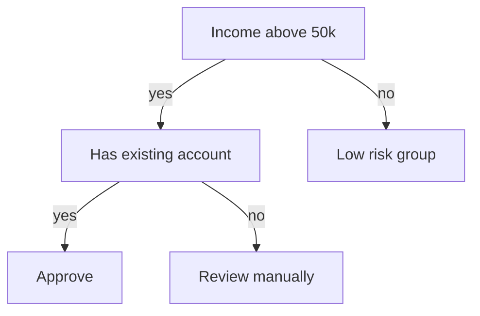
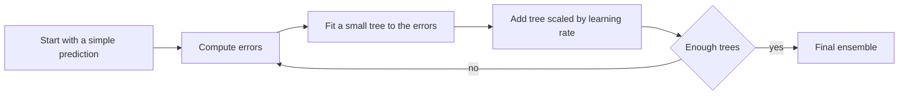
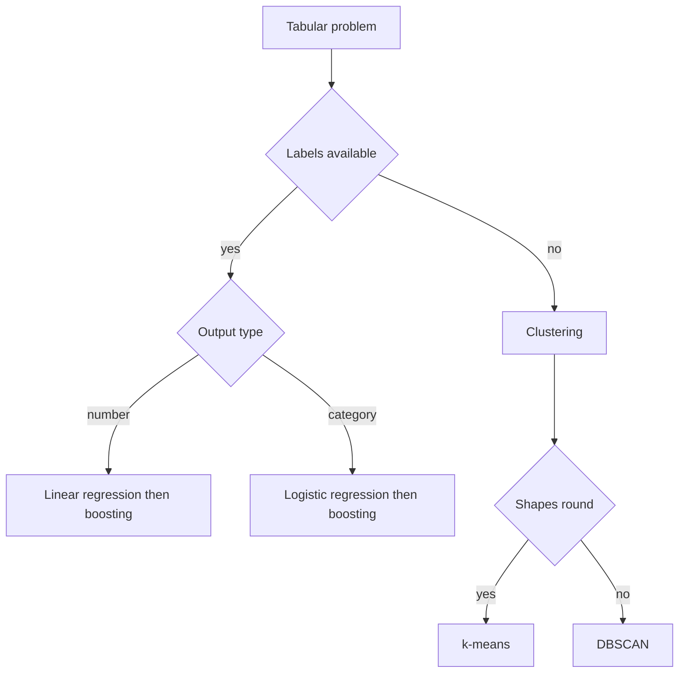

# Machine Learning Algorithms

Classical algorithms remain the first tool for tabular data. This page covers linear models, decision trees, ensembles of trees, support vector machines, and clustering. Interviewers ask how each one works, when it fails, and how to choose between them.

!!! note "In simple words"
    Each algorithm draws a different kind of boundary or finds a different kind of pattern in data. Simple models are fast and easy to explain. Ensembles of many trees are often more accurate, but harder to read.

## Why it matters

Most business data is tabular: rows of customers, orders, transactions, or sensor readings. For this kind of data, a well-tuned classical model often beats a deep network that costs far more to train and serve. Knowing each algorithm's assumptions lets you pick a sensible baseline, explain the result, and spot when the model is the wrong tool.

## How it works

### Linear regression

Linear regression predicts a continuous value as a weighted sum of the features:

```
y = w0 + w1 x1 + w2 x2 + ... + wn xn
```

Training chooses the weights that minimise the mean squared error. The model is fast, interpretable (each weight shows a feature's effect with the other features held fixed), and it makes a good baseline.

Its assumptions matter when you read the coefficients. The relationship should be roughly linear, the features should not be strongly correlated with each other, the residuals should have constant variance, and for statistical inference the residuals should be roughly normal.

### Gradient descent in one example

Most models are trained by gradient descent. It computes the gradient of the loss and moves the weights a small step against it. The learning rate sets the step size. Too large and training diverges. Too small and it crawls.

The Python example below is not compiled here. It is plain Python with no dependencies, and it fits a line to four points:

```python
def fit_line(xs, ys, lr=0.05, steps=1000):
    """Fit y = w*x + b by gradient descent on mean squared error."""
    w, b = 0.0, 0.0
    n = len(xs)
    for _ in range(steps):
        dw = sum(2 * (w * x + b - y) * x for x, y in zip(xs, ys)) / n
        db = sum(2 * (w * x + b - y) for x, y in zip(xs, ys)) / n
        w -= lr * dw
        b -= lr * db
    return w, b

w, b = fit_line([1, 2, 3, 4], [3, 5, 7, 9])
print(round(w, 2), round(b, 2))  # close to 2 and 1
```

### Logistic regression

Logistic regression is a classifier. It computes a linear score `z` and passes it through the sigmoid function:

```
P(y = 1) = 1 / (1 + e^(-z))
```

The model is trained by minimising log loss, also called cross-entropy. The output is a probability. A threshold, 0.5 by default, turns the probability into a class. Moving the threshold trades precision for recall. Like linear regression, it is fast and interpretable, and it is a strong baseline for binary problems.

### Decision trees

A decision tree splits the data recursively. At each node it picks the feature and threshold that best separate the classes, measured by impurity:

```
Gini = 1 - sum of p_i squared
```

A pure node has Gini 0. A 50/50 binary node has Gini 0.5. Entropy, which is the basis of information gain, is the other common criterion.



Trees handle non-linear relationships and mixed feature types, and they need no scaling. A single deep tree memorises the training data, and it changes a lot when the data changes. Control this with `max_depth`, `min_samples_leaf`, or pruning.

### Random forests (bagging)

A random forest trains many trees. Each tree sees a bootstrap sample of the rows, which is a sample drawn with replacement, and a random subset of features at each split. Predictions are averaged for regression and voted for classification.

Averaging decorrelated trees reduces variance without adding much bias. The trees train in parallel. The out-of-bag samples give a built-in validation estimate. Forests are a strong default for tabular data, although their predictions are harder to explain than a single tree.

### Gradient boosting

Boosting trains trees one after another. Each new tree fits the errors left by the ensemble so far, more precisely the negative gradient of the loss. The learning rate scales each tree's contribution.

Gradient-boosted tree libraries such as XGBoost, LightGBM, and CatBoost are often the strongest choice on tabular data. They are slower to tune than a forest and less transparent. Regularise them with tree depth, learning rate, minimum leaf size, and row or column subsampling.



### Support vector machines

An SVM finds the hyperplane that separates the classes with the widest margin. The points closest to the boundary are the *support vectors*. A soft-margin parameter `C` trades margin width against misclassified training points. Kernels such as RBF let the boundary bend by implicitly mapping the data into a higher-dimensional space, and `gamma` controls how local that bend is.

SVMs need scaled features. They work well on high-dimensional, sparse inputs such as text, and they can be slow on very large datasets. They do not produce probabilities natively, and they are hard to interpret.

```python
from sklearn.pipeline import make_pipeline
from sklearn.preprocessing import StandardScaler
from sklearn.svm import SVC

svm = make_pipeline(StandardScaler(), SVC(kernel="rbf", C=1.0, gamma="scale"))
svm.fit(X_train, y_train)
print(round(svm.score(X_test, y_test), 3))
```

### Clustering

**k-means** assigns each point to the nearest of K centroids, recomputes each centroid as the mean of its members, and repeats until the assignments stop changing. It needs K in advance and works best with roughly round clusters of similar size. It is sensitive to initialisation, and k-means++ helps. Compare values of K with the elbow method or silhouette scores.

```python
from sklearn.cluster import KMeans

kmeans = KMeans(n_clusters=3, n_init=10, random_state=0)
labels = kmeans.fit_predict(X_train)  # scale the features first
```

**DBSCAN** groups points that have at least `min_samples` neighbours within a radius `eps`. It grows clusters from these core points and labels everything else as noise. It finds clusters of arbitrary shape and needs no K. It struggles when clusters have very different densities, because one `eps` cannot suit them all.

### Gradient descent variants

| Variant | Each update uses | Trade-off |
|---------|------------------|-----------|
| Batch | All samples | Stable, slow, memory-heavy on large data |
| Stochastic (SGD) | One sample | Fast, but noisy |
| Mini-batch | A small batch | The usual compromise on CPUs and GPUs |
| Adam | Mini-batch plus adaptive per-parameter steps | Robust defaults, with a few more hyperparameters |

### Choosing an algorithm

For a tabular problem, a practical order is:

1. Fit a baseline: logistic or linear regression, with scaling where needed.
2. Try a random forest with reasonable settings and check the cross-validated scores.
3. If accuracy is not enough, try gradient boosting and tune its learning rate, depth, and number of trees.
4. Weigh the result against interpretability, latency, and training cost.
5. For unlabelled data, start with k-means and check the cluster quality. Try DBSCAN if the shapes look irregular.

| Algorithm | Task | Training speed | Interpretability | Typical use |
|-----------|------|----------------|------------------|-------------|
| Linear regression | Regression | Fast | High | Baseline, linear trends |
| Logistic regression | Classification | Fast | High | Binary probabilities |
| Decision tree | Both | Fast | High | Rules, mixed features |
| Random forest | Both | Medium | Medium | Strong tabular baseline |
| Gradient boosting | Both | Slower | Low to medium | Top accuracy on tabular data |
| SVM | Both | Slow on large data | Low | High-dimensional, small to medium data |
| k-means | Clustering | Fast | Medium | Segments, compression |
| DBSCAN | Clustering | Medium | Medium | Irregular shapes and outliers |



## Where it is used

- Credit scoring and fraud models, where interpretability matters and gradient boosting is common.
- Churn and propensity models built on customer tables.
- Text classification with linear SVMs or logistic regression over sparse features.
- Customer segmentation with k-means.
- Outlier detection on sensor or transaction streams with DBSCAN.

## Benefits

- Linear and logistic models are fast to train, easy to explain, and hard to break.
- Trees need no scaling and handle mixed feature types directly.
- Forests reduce variance and give a useful estimate from out-of-bag samples.
- Gradient boosting often gives the best accuracy on tabular data.
- Clustering finds structure in data that has no labels.

## Cons and limits

- Linear models miss non-linear patterns unless features are engineered for them.
- A single deep tree overfits and is unstable.
- Boosting needs careful tuning and can overfit when the learning rate or depth is too high.
- SVMs slow down sharply on very large datasets.
- k-means assumes round, similar-sized clusters. DBSCAN struggles with mixed densities.
- Feature importances measure predictive use, not cause. Correlated features share credit.

## Best practices

- Scale features for SVMs, k-means, and k-nearest neighbours. Tree models do not need scaling.
- Read a single deep tree as unreliable. Limit its depth or use an ensemble.
- Do not treat feature importances as causal evidence.
- Choose the number of clusters with a validation criterion, not by intuition alone.
- Pick DBSCAN's `eps` with a k-distance plot, and check it against data with different densities.
- Compare models with cross-validation over several splits, not one lucky split.

!!! tip "Interview tip"
    **Q: Random forest or gradient boosting?**
    Forests build independent trees in parallel and reduce variance by averaging. Boosting builds trees in sequence, each correcting the errors of the last, which lowers bias and often gives higher accuracy. Boosting is more sensitive to tuning and more prone to overfitting if the learning rate and depth are not controlled.

## Quick recap

- Linear and logistic regression are fast, interpretable baselines.
- Decision trees split on impurity. Single trees overfit, so limit depth or use ensembles.
- Forests average decorrelated trees. Boosting fits each new tree to the remaining errors.
- SVMs maximise the margin, need scaled inputs, and use kernels for non-linear boundaries.
- k-means needs K and suits round clusters. DBSCAN finds arbitrary shapes and labels noise.

## Official documentation

- [scikit-learn documentation](https://scikit-learn.org/stable/)
- [scikit-learn: cross-validation](https://scikit-learn.org/stable/modules/cross_validation.html)

**See also:** [ML Fundamentals](ml-fundamentals.md), [Deep Learning](deep-learning.md), [LLMs and Transformers](llms-and-transformers.md)
