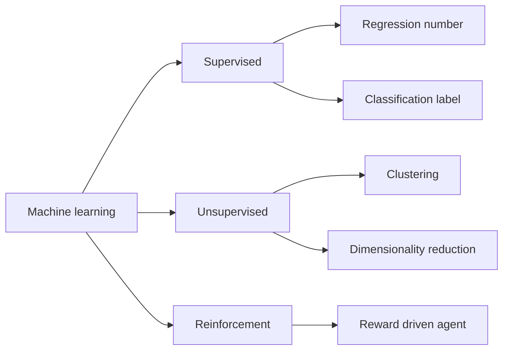
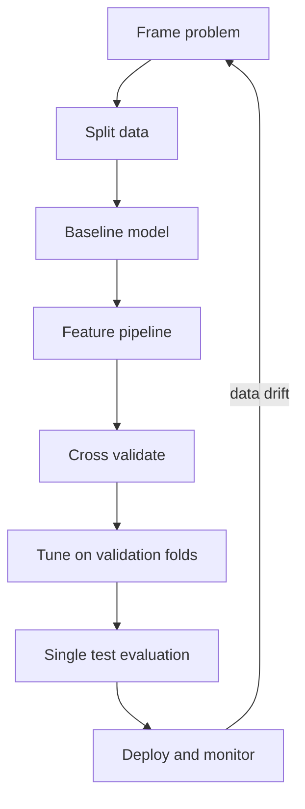

# Machine Learning Fundamentals

Machine learning fits a model to data so that it can predict outcomes or find structure without hand-written rules. Interviewers start here because later topics rely on the same ideas: learning paradigms, data splits, bias and variance, tuning, and metrics.

!!! note "In simple words"
    Instead of writing the rule yourself, you show a model many past examples and let it find the pattern. Then you test it on examples it has never seen, to check that it learned something real.

## Why it matters

A model that scores well on the data it learned from can still fail on new data. Many production failures come from a bad evaluation, not a bad algorithm: a leaked feature, a test set used for tuning, or a metric that hides the rare cases that matter. Knowing the workflow protects you from those mistakes and makes results trustworthy.

## How it works

### Learning paradigms

- **Supervised learning** uses labelled examples, pairs of inputs and known outputs. The two main task types are *regression*, which predicts a continuous number, and *classification*, which predicts a category.
- **Unsupervised learning** works on unlabelled inputs and looks for structure. Typical tasks are clustering, dimensionality reduction, and anomaly detection.
- **Reinforcement learning** trains an agent that acts in an environment and adjusts its behaviour from reward signals. The key terms are *state*, *action*, *reward*, *policy* (how to act in each state), and *value* (expected future reward).



### Regression versus classification

| Task | Output | Examples | Common metrics |
|------|--------|----------|----------------|
| Regression | Continuous number | House price, demand forecast | MAE, MSE, RMSE, R-squared |
| Classification | Discrete label | Spam or not, fraud or not, digit recognition | Accuracy, precision, recall, F1, ROC AUC |

A quick way to choose: ask what the output looks like. A number on a continuous scale means regression. A choice from a fixed set means classification.

### Train, validation, and test splits

Hold data back so you can measure generalisation honestly.

- **Training set**: fits the model's parameters.
- **Validation set**: compares models and chooses hyperparameters.
- **Test set**: reports the final score once. Do not use it to make decisions.

Typical splits are 70/15/15 or 80/10/10. Without a separate validation set, repeated tuning against the test set inflates the score you report.

### Data leakage

Leakage happens when information from outside the training data reaches the model. Common causes:

- Fitting a scaler or imputer on the full dataset before splitting.
- Selecting features by looking at the target across the whole dataset.
- Splitting time-ordered data at random, so the model sees the future.

A scikit-learn `Pipeline` keeps preprocessing inside the cross-validation loop, which prevents the first cause. The example below is Python with scikit-learn. It is not compiled here, and it needs scikit-learn installed:

```python
from sklearn.datasets import load_breast_cancer
from sklearn.linear_model import LogisticRegression
from sklearn.model_selection import cross_val_score, train_test_split
from sklearn.pipeline import make_pipeline
from sklearn.preprocessing import StandardScaler

X, y = load_breast_cancer(return_X_y=True)
X_train, X_test, y_train, y_test = train_test_split(
    X, y, test_size=0.2, stratify=y, random_state=42
)

model = make_pipeline(StandardScaler(), LogisticRegression(max_iter=1000))
scores = cross_val_score(model, X_train, y_train, cv=5)  # scaler is refit per fold
print(f"CV accuracy: {scores.mean():.3f}")

model.fit(X_train, y_train)
print(f"Test accuracy: {model.score(X_test, y_test):.3f}")  # touched once
```

### Cross-validation

K-fold cross-validation splits the training data into K parts. Each part serves once as the validation fold, while the model trains on the other parts. The average of the K scores is a steadier estimate than a single split, and every row is used for both training and validation. Use stratified folds for classification, so each fold keeps the class balance. Use time-ordered splits for time series.

### Overfitting and underfitting

- **Overfitting** means the model learns noise in the training set. The signature is low training error with much higher validation error.
- **Underfitting** means the model is too simple, or too little trained, to capture the pattern. Training and validation errors both stay high.

Remedies for overfitting include more data, simpler models, regularisation (L1 or L2 penalties), feature selection, early stopping, and dropout in neural networks. Remedies for underfitting include richer features, a more flexible model, or longer training.

### Bias and variance

For squared-error loss, the expected test error splits into three parts:

```
Expected error = bias squared + variance + irreducible noise
```

- **Bias** is error from wrong assumptions. High bias usually means underfitting.
- **Variance** is sensitivity to the particular training sample. High variance usually means overfitting.

Simple models tend toward high bias and low variance. Very flexible models tend toward low bias and high variance. The goal is the complexity where validation error is lowest.

### Hyperparameters and tuning

Hyperparameters are set before training and are not learned from data. Examples are the learning rate, tree depth, the regularisation strength `C`, batch size, and the number of epochs.

- **Grid search** tries every combination in a list. It is exhaustive, but the number of combinations multiplies with each parameter.
- **Random search** samples combinations from distributions. It often finds good settings with fewer trials, especially when only a few parameters matter.
- **Early stopping** halts training once validation loss stops improving for a set number of epochs (the patience), and it keeps the best checkpoint.

```python
from sklearn.model_selection import GridSearchCV

param_grid = {"logisticregression__C": [0.1, 1.0, 10.0]}
search = GridSearchCV(model, param_grid, cv=5, scoring="f1")
search.fit(X_train, y_train)
print(search.best_params_, round(search.best_score_, 3))
```

### Feature engineering

- **Scaling** means standardisation (subtract the mean, divide by the standard deviation) or min-max scaling to the range [0, 1]. Distance-based methods such as k-means, k-nearest neighbours, and SVMs need it. Tree-based models do not.
- **Encoding categories**: use one-hot encoding for nominal categories. Use ordinal codes only when the order means something.
- **Feature selection** drops features that add noise. Methods include correlation filters, mutual information, recursive feature elimination, and L1 regularisation, which drives some weights to zero.
- **Feature creation** combines raw fields into signals the model cannot easily form, such as a ratio or the time since the last event.

### Evaluation metrics

For classification, start from the confusion matrix:

| | Predicted positive | Predicted negative |
|---|---|---|
| Actual positive | True positive (TP) | False negative (FN) |
| Actual negative | False positive (FP) | True negative (TN) |

- **Precision** = TP / (TP + FP). Of the items flagged positive, how many were right?
- **Recall** = TP / (TP + FN). Of the real positives, how many were found?
- **F1** is the harmonic mean of precision and recall.
- **Accuracy** misleads on imbalanced data. A model that always predicts the majority class can score well.
- **ROC AUC** measures ranking quality across all thresholds, so it does not depend on one cut-off.

For regression, MAE is the mean absolute error, MSE is the mean squared error, RMSE is its square root (in the same units as the target), and R-squared is the share of variance the model explains.

```python
from sklearn.metrics import classification_report, roc_auc_score

y_pred = model.predict(X_test)
y_prob = model.predict_proba(X_test)[:, 1]
print(classification_report(y_test, y_pred))
print(f"ROC AUC: {roc_auc_score(y_test, y_prob):.3f}")
```

### Step by step

1. Frame the problem: what is the output, and what would a good result look like?
2. Split the data before any exploration that could leak information.
3. Build a simple baseline, such as a majority-class predictor or a linear model.
4. Engineer features inside a pipeline.
5. Cross-validate candidate models on the training data.
6. Tune hyperparameters with search on validation folds.
7. Evaluate the chosen model once on the test set.
8. Monitor the model after deployment, because the data changes over time.



## Where it is used

- Fraud detection and credit scoring, where the cost of each error type differs.
- Demand forecasting and pricing, which are regression problems.
- Customer churn prediction and recommendations.
- Anomaly detection in logs and sensor data.
- Quality checks in manufacturing, where rare defects need recall-focused metrics.

## Benefits

- Models learn patterns that are too complex to write as rules.
- Clear splits and metrics make results comparable and honest.
- Pipelines keep preprocessing consistent between training and serving.
- Baselines show quickly whether a complex model is worth the effort.

## Cons and limits

- A model is only as good as its data. Biased or noisy labels produce biased or noisy predictions.
- Metrics can hide problems. Accuracy on imbalanced data says little about the rare class.
- Models decay after deployment as the world changes, which requires monitoring and retraining.
- Explaining why a model made a prediction is harder for complex models.
- Small test sets give wide error bars, so small score differences may be noise.

## Best practices

- Split the data before any exploration, and keep the test set untouched until the end.
- Put preprocessing inside a pipeline so it is refit on each training fold.
- Always compare against a simple baseline.
- Choose metrics that match the cost of each error type, especially on imbalanced data.
- Use stratified or time-ordered splits where they fit the problem.
- Track model versions, data versions, and metrics over time.

!!! tip "Interview tip"
    **Q: Why keep a test set when you already have validation folds?**
    Validation folds guide your choices, so the model is indirectly fitted to them. The test set is the only untouched estimate of how the chosen model behaves on new data. Use it once, at the end.

## Quick recap

- Supervised learning predicts from labelled data; unsupervised learning finds structure; reinforcement learning optimises rewards.
- Regression predicts numbers; classification predicts labels.
- Keep train, validation, and test data separate, and prevent leakage with pipelines.
- Overfitting shows as a gap between training and validation scores; underfitting shows high error on both.
- Choose metrics that match the cost of each error type.

## Official documentation

- [scikit-learn documentation](https://scikit-learn.org/stable/)
- [scikit-learn: cross-validation](https://scikit-learn.org/stable/modules/cross_validation.html)
- [NumPy documentation](https://numpy.org/doc/stable/)

**See also:** [ML Algorithms](ml-algorithms.md), [Deep Learning](deep-learning.md), [LLMs and Transformers](llms-and-transformers.md), [Interview questions on AI and ML](../../interview-questions/technical/ai-and-machine-learning.md)
