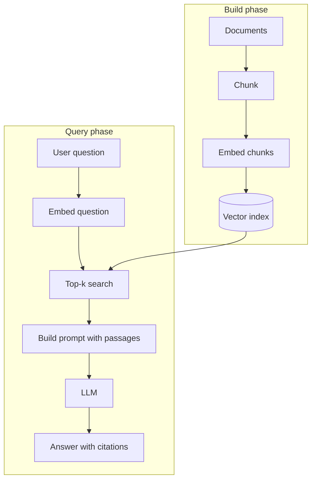

# RAG and Generative AI

Retrieval-augmented generation (RAG) fetches relevant passages from your own data and passes them to an LLM with the question. The model answers from that context instead of from memory alone. Interviewers ask why RAG exists, how the pipeline works, how embeddings and vector search behave, and how you would evaluate the result.

## Core concepts

### Why RAG

An LLM's knowledge is fixed at training time and blended from many sources. Asked about a private document, a recent event, or a product policy, it may produce a fluent but invented answer (a hallucination). RAG addresses this by:

- **Grounding**: the answer is based on passages you supply.
- **Freshness**: updating the index updates what the system knows, with no retraining.
- **Citations**: the answer can point to the passages it used.
- **Access control**: retrieval can filter documents by user permissions.

### The pipeline

RAG has two phases. The build phase runs offline or on a schedule. The query phase runs per request.



The question must be embedded with the same model that embedded the chunks. Vectors from different models live in different spaces and cannot be compared.

### Chunking

Documents are split into chunks before embedding. Chunk size is a trade-off:

- Small chunks are specific, but may lose the context needed to interpret them.
- Large chunks carry context, but dilute the signal and use more of the prompt budget.

Common approaches are fixed-size windows with some overlap, and structure-aware splits on headings, paragraphs, or code blocks. Chunks of a few hundred tokens are a common starting point, tuned with evaluation. Store metadata (source, section, date, permissions) with each chunk so you can filter and cite.

### Embeddings

An embedding model maps text to a dense vector, often a few hundred to a few thousand dimensions depending on the model. Texts with similar meaning land near each other. Two properties matter in practice:

- Vectors from one model are only comparable with each other.
- Higher dimensions can capture more nuance but cost more storage and search time.

Check each model's documentation for its dimension and maximum input length. Domain-specific or multilingual needs may call for a different model than a general-purpose one.

### Similarity measures

- **Cosine similarity** compares direction and ignores length: `(a · b) / (‖a‖ ‖b‖)`, ranging from -1 to 1.
- **Dot product** is cosine similarity when vectors are normalised, and it also rewards length if you do not normalise.
- **Euclidean distance** measures straight-line distance. Smaller means closer.

A minimal top-k retrieval with cosine similarity:

```python
import numpy as np

def top_k(query_vec: np.ndarray, doc_matrix: np.ndarray, k: int = 3):
    q = query_vec / np.linalg.norm(query_vec)
    d = doc_matrix / np.linalg.norm(doc_matrix, axis=1, keepdims=True)
    scores = d @ q
    best = np.argsort(scores)[::-1][:k]
    return best, scores[best]
```

### Exact versus approximate search

- **Exact search** compares the query with every vector. It is accurate and fine for small collections.
- **Approximate nearest neighbour (ANN)** search trades a little recall for much lower latency at scale. HNSW builds a layered proximity graph. IVF clusters vectors and searches only the nearest clusters. Product quantisation compresses vectors to save memory.

ANN results can miss some true neighbours, so measure recall against exact search on a sample before you rely on it.

### Vector databases

A vector database stores vectors with metadata and serves filtered similarity queries. Options include dedicated systems such as Pinecone, Weaviate, Milvus, Qdrant, and Chroma, and extensions to existing databases such as pgvector for PostgreSQL. Choose on operational needs: managed or self-hosted, scale, filtering, and the team's existing stack.

### Hybrid search and re-ranking

Vector search matches meaning but can miss exact tokens such as product codes or error IDs. Keyword ranking such as BM25 matches exact terms but misses paraphrases. Hybrid search combines both scores. A re-ranker, typically a cross-encoder, then re-orders the top candidates by scoring each question-passage pair together. It costs latency but often improves precision at the top of the list.

### Prompt construction

The prompt should separate instructions, retrieved passages, and the question, and it should tell the model what to do when the passages do not contain the answer.

```text
You answer questions using only the passages below.
Cite passage IDs in square brackets. If the passages do not contain the
answer, reply exactly: "I could not find this in the documents."

Passages:
[P1] Employees accrue 1.5 days of leave per month worked.
[P2] Unused leave carries over for up to 12 months.

Question: How much leave do I earn each month?
```

Retrieved text is data, not instructions. A document can contain text that tries to override the system prompt (indirect prompt injection). Treat retrieved content as untrusted and limit what tools the model can invoke based on it.

### RAG versus fine-tuning

| Concern | RAG | Fine-tuning |
|---------|-----|-------------|
| Changing facts | Re-index documents | Retrain the model |
| Source citations | Natural | Not built in |
| Style, format, or task behaviour | Limited | Strong |
| Per-request cost | Retrieval plus longer prompts | Usually lower per call once trained |
| Set-up effort | Pipeline, chunking, index | Labelled data, training runs |

Start with RAG when knowledge changes or must be cited. Fine-tune when you need consistent behaviour or format that prompting cannot achieve. The two can be combined.

## How it works / Step by step

1. Collect and clean documents, and record metadata and access rules.
2. Chunk and embed, then store vectors and metadata in the index.
3. At query time, embed the question and apply metadata filters.
4. Retrieve top-k candidates, optionally hybrid-search and re-rank.
5. Build the prompt with instructions, passages, and the question.
6. Generate, then check the output: citations present, answer grounded in passages.
7. Log queries, retrieved IDs, and answers for later evaluation.

## Evaluation

Measure retrieval and generation separately:

- **Retrieval**: recall@k (did the relevant chunk appear in the top k?), precision@k, and mean reciprocal rank.
- **Grounding (faithfulness)**: is every claim in the answer supported by the passages?
- **Answer relevance**: does the answer address the question?
- **Human review**: a sample of real questions, scored by people who know the domain.

Build a small labelled set of questions with known source passages early. It lets you compare chunk sizes, embedding models, and re-rankers with numbers rather than impressions. Lexical metrics such as BLEU and ROUGE are weak proxies for answer quality.

## Other generative AI patterns

- **Document Q&A**: retrieval over manuals, contracts, or reports.
- **Support assistants**: retrieval over FAQs, tickets, and product docs, with escalation paths.
- **Summarisation**: map-reduce over chunks for long documents, or retrieval of the relevant sections first.
- **Code assistance**: retrieval over a repository, with tests as the check on generated code.
- **Content drafting**: a model with a style guide and approved facts, reviewed by an editor.

## LLM integration frameworks

Frameworks wrap the repetitive parts of an LLM application: calling the model, splitting and embedding documents, talking to vector stores, and chaining steps together. You can build all of this by hand with an HTTP client and a vector library. A framework saves that plumbing, at the cost of an extra abstraction to learn and debug.

### LangChain

LangChain is a general framework for building LLM applications. Its core idea is composition: small components (prompts, models, retrievers, output parsers, tools) are joined into chains or agent loops. It covers many providers and vector stores behind shared interfaces, so swapping one model or store changes less code.

Use it when the application is more than retrieval. Typical cases are multi-step workflows, tool-calling agents, and apps that must switch between model providers.

### LlamaIndex

LlamaIndex (formerly GPT Index) focuses on data. Its core idea is an index over your documents: it loads sources, parses and chunks them, builds indexes, and provides query engines that retrieve and answer. Its retrieval features, such as several index types and query routing, are its main strength.

Use it when the application is mainly question answering over a large body of documents and retrieval quality is the central problem.

### Comparison

| Concern | LangChain | LlamaIndex |
|---------|-----------|------------|
| Main focus | General orchestration of LLM steps and tools | Indexing and querying private data |
| Typical unit | Chain, agent, or graph of components | Index and query engine |
| Strongest fit | Workflows, agents, multi-provider apps | Document Q&A and retrieval-heavy apps |
| Retrieval | Available through retriever components | Central, with many index and query options |

The two overlap. Many teams use LlamaIndex for ingestion and retrieval inside a LangChain workflow, or pick one and build the rest directly. Whichever you choose, keep the RAG concerns from this page in view: chunking, metadata, evaluation, and access control are still your responsibility.

!!! note "Verify before you rely on it"
    Both projects change quickly, and their class names and import paths have moved between releases. Check the current documentation for the version you install, rather than copying older examples.

!!! tip "Interview tip"
    **When would you use LangChain instead of calling the model API directly?** When the workflow has several steps, tools, or provider swaps, a framework gives shared components and less glue code. For a single prompt with one model call, a direct API call is simpler, easier to debug, and has fewer dependencies. Say that you would adopt a framework only when its abstractions remove real complexity.

## Common pitfalls

- Chunks that split a table or a definition in half.
- Embedding queries with a different model from the documents.
- A stale index after source documents change, with no re-indexing job.
- Top-k so large that irrelevant passages drown the relevant ones.
- No "not found" path, which forces the model to guess.
- Returning answers with no citations, so users cannot check them.
- Ignoring document permissions, so one user's answer leaks another user's data.

!!! tip "Interview tip"
    **Why is RAG cheaper than fine-tuning for most knowledge problems?** Adding knowledge through retrieval changes only the index, which is quick and reversible. Fine-tuning must retrain or re-run a training job for every change and can still hallucinate. RAG also gives citations. Fine-tuning is better for behaviour and format, not for facts that change.

## Quick recap

- RAG grounds answers in retrieved passages, which reduces hallucination and keeps knowledge current.
- The build phase chunks and embeds documents; the query phase embeds the question and retrieves top-k.
- Use the same embedding model for indexing and querying; cosine similarity is the usual measure.
- ANN search trades a little recall for speed; hybrid search and re-ranking improve precision.
- Evaluate retrieval and grounding separately, and treat retrieved text as untrusted input.

**See also:** [LLMs and Transformers](llms-and-transformers.md), [AI in Java](ai-in-java.md), [AI integration section](../22-ai-integration/index.md)
