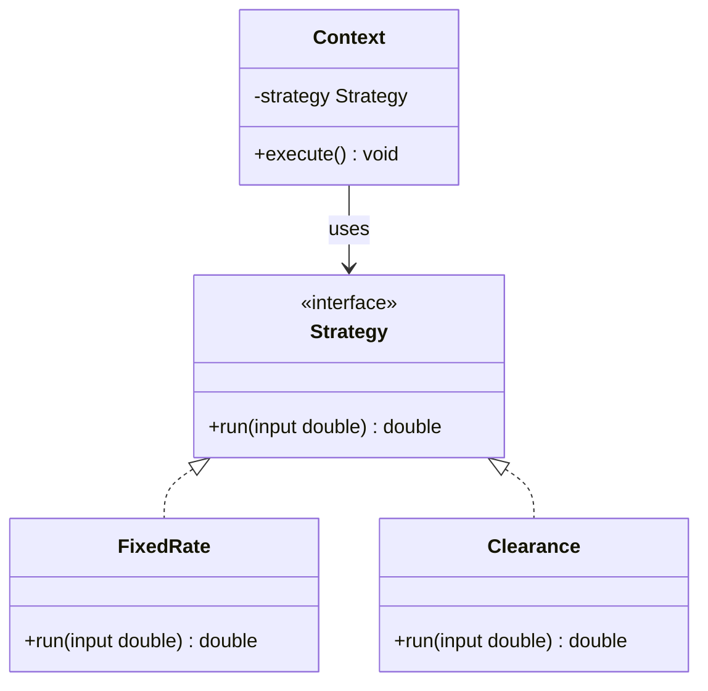
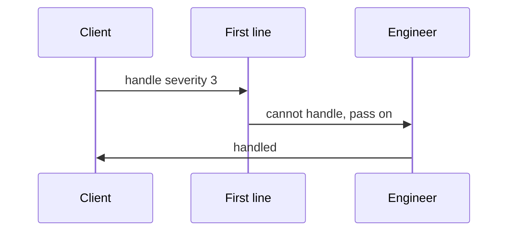
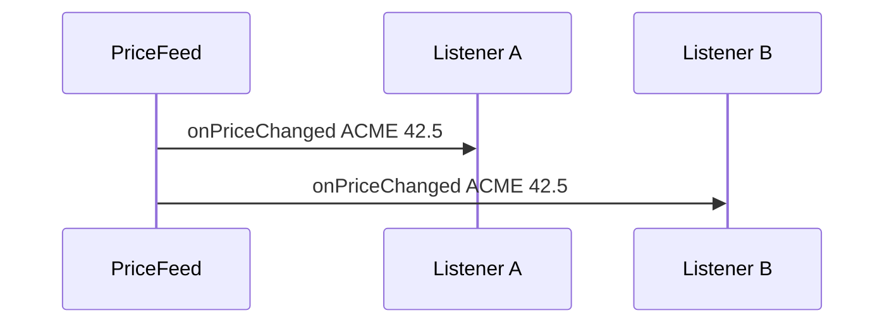
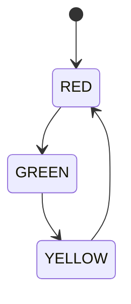
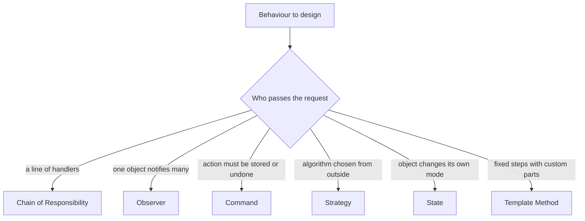

# Behavioural Design Patterns

Behavioural patterns deal with how objects communicate and share responsibility. They are the patterns most likely to appear in everyday code: event listeners, undo buttons, pluggable algorithms, and request pipelines all use them.

!!! note "In simple words"
    Behavioural patterns decide who does what and who tells whom. A request can be passed along a line of helpers, a change can be announced to many listeners, and an action can be saved and replayed later.

## Why it matters

Much of the difficulty in a system is not the data but the flow of control: which code runs when, who gets notified, and what happens when something changes. Behavioural patterns name these flows, so a team can talk about them and change them safely. Without them, control logic tends to pile up in one large method with many `if` branches.

## How it works

### Shape of the common behaviour patterns

Many behavioural patterns have a caller that holds a reference to an interface, and several implementations that carry out the work. The class diagram below shows Strategy, which is the simplest case. Observer and Command have the same kind of shape with different roles.



### Chain of Responsibility

A request passes along a chain of handlers. Each handler either deals with the request or passes it to the next one. The sender does not need to know which handler will process it. Servlet filters and Spring Security's filter chain follow this shape. The sample below compiles with Java 21:

```java
abstract class SupportHandler {

    private SupportHandler next;

    SupportHandler setNext(SupportHandler next) {
        this.next = next;
        return next;
    }

    void handle(int severity) {
        if (canHandle(severity)) {
            System.out.println(name() + " handled severity " + severity);
        } else if (next != null) {
            next.handle(severity);
        } else {
            System.out.println("No handler for severity " + severity);
        }
    }

    abstract boolean canHandle(int severity);

    abstract String name();
}

class FirstLine extends SupportHandler {
    @Override boolean canHandle(int severity) { return severity <= 2; }
    @Override String name() { return "First line"; }
}

class Engineer extends SupportHandler {
    @Override boolean canHandle(int severity) { return severity <= 4; }
    @Override String name() { return "Engineer"; }
}

class ChainDemo {
    public static void main(String[] args) {
        SupportHandler first = new FirstLine();
        first.setNext(new Engineer());
        first.handle(3); // Engineer handled severity 3
    }
}
```

The chain can also end with a handler that always accepts. Without one, a request that nobody accepts disappears silently, as the last branch above shows.



### Command

A command turns a request into an object. That object can be stored, queued, logged, or undone later. `Runnable` and `Callable` are simple forms of this idea. Adding an `undo()` method supports undo. The sample below compiles with Java 21:

```java
import java.util.ArrayDeque;
import java.util.Deque;

interface Command {
    void execute();
    void undo();
}

class Light {
    void on() { System.out.println("Light on"); }
    void off() { System.out.println("Light off"); }
}

class TurnOnLight implements Command {

    private final Light light;

    TurnOnLight(Light light) {
        this.light = light;
    }

    @Override
    public void execute() {
        light.on();
    }

    @Override
    public void undo() {
        light.off();
    }
}

class CommandHistory {

    private final Deque<Command> done = new ArrayDeque<>();

    void run(Command command) {
        command.execute();
        done.push(command);
    }

    void undoLast() {
        if (!done.isEmpty()) {
            done.pop().undo();
        }
    }

    public static void main(String[] args) {
        CommandHistory history = new CommandHistory();
        history.run(new TurnOnLight(new Light()));
        history.undoLast(); // Light on, then Light off
    }
}
```

An invoker, such as a button, a menu, or a job queue, stores commands in a list. Undo is then "pop the last command and call `undo()`".

### Interpreter

An interpreter defines a grammar as a set of classes, where each class knows how to evaluate one kind of expression. It suits small languages, such as rule expressions or arithmetic formulas. For a large grammar, a parser generator is a better tool. The sample below compiles with Java 21:

```java
interface Expr {
    int eval();
}

record Num(int value) implements Expr {
    @Override
    public int eval() {
        return value;
    }
}

record Add(Expr left, Expr right) implements Expr {
    @Override
    public int eval() {
        return left.eval() + right.eval();
    }
}

class InterpreterDemo {
    public static void main(String[] args) {
        Expr expr = new Add(new Num(2), new Add(new Num(3), new Num(4)));
        System.out.println(expr.eval()); // 9
    }
}
```

### Iterator

An iterator gives sequential access to a collection without exposing its internal structure. In Java, `Iterator` and `Iterable` are the standard form, and the enhanced `for` loop uses them. Iterators are not thread-safe. A fail-fast iterator throws `ConcurrentModificationException` when it sees the collection change underneath it. The sample below compiles with Java 21:

```java
import java.util.Iterator;

class Countdown implements Iterable<Integer> {

    private final int start;

    Countdown(int start) {
        this.start = start;
    }

    @Override
    public Iterator<Integer> iterator() {
        return new Iterator<>() {
            private int current = start;

            @Override
            public boolean hasNext() {
                return current > 0;
            }

            @Override
            public Integer next() {
                return current--;
            }
        };
    }

    public static void main(String[] args) {
        for (int n : new Countdown(3)) {
            System.out.println(n); // 3, 2, 1
        }
    }
}
```

### Mediator

A mediator coordinates communication between peers. The peers talk to the mediator and not to each other, so adding a peer does not require changes to every other peer. An air traffic control tower and a chat room server both play this role. The sample below compiles with Java 21:

```java
import java.util.ArrayList;
import java.util.List;

class ChatRoom {

    private final List<User> users = new ArrayList<>();

    void join(User user) {
        users.add(user);
    }

    void send(String from, String message, User sender) {
        for (User user : users) {
            if (user != sender) {
                user.receive(from, message);
            }
        }
    }
}

class User {

    private final String name;
    private final ChatRoom room;

    User(String name, ChatRoom room) {
        this.name = name;
        this.room = room;
        room.join(this);
    }

    void send(String message) {
        room.send(name, message, this);
    }

    void receive(String from, String message) {
        System.out.println(name + " received from " + from + ": " + message);
    }
}
```

### Memento

A memento captures an object's state so it can be restored later, without exposing the object's fields to the caller. The originator creates the memento, and a caretaker stores it. The sample below compiles with Java 21:

```java
class Editor {

    private String text = "";

    void type(String more) {
        text = text + more;
    }

    String text() {
        return text;
    }

    Memento save() {
        return new Memento(text);
    }

    void restore(Memento memento) {
        this.text = memento.text();
    }

    // Records are implicitly static, so the memento holds no reference to the editor.
    record Memento(String text) {
    }
}
```

The caretaker keeps a `Deque<Editor.Memento>` as its undo history. Snapshots of large state use a lot of memory, so store only what restoring needs.

### Observer

An observer lets one subject notify a set of listeners when its state changes. The subject knows only the listener interface, so listeners can be added or removed without changing the subject. Event listeners in Swing, JavaBeans, and most UI frameworks use this shape. Messaging systems apply the same idea across processes. The sample below compiles with Java 21:

```java
import java.util.List;
import java.util.concurrent.CopyOnWriteArrayList;

interface PriceListener {
    void onPriceChanged(String symbol, double price);
}

class PriceFeed {

    // CopyOnWriteArrayList lets listeners subscribe while a publish is running.
    private final List<PriceListener> listeners = new CopyOnWriteArrayList<>();

    void subscribe(PriceListener listener) {
        listeners.add(listener);
    }

    void publish(String symbol, double price) {
        for (PriceListener listener : listeners) {
            listener.onPriceChanged(symbol, price);
        }
    }

    public static void main(String[] args) {
        PriceFeed feed = new PriceFeed();
        feed.subscribe((symbol, price) -> System.out.println(symbol + " is now " + price));
        feed.publish("ACME", 42.5);
    }
}
```



`java.util.Observable` and `Observer` were deprecated in Java 9. Write a small interface like the one above, or use `PropertyChangeSupport` from `java.beans` for bean-style properties.

### State

A state object holds the behaviour for one state of an object. The context delegates to whichever state is current. Unlike Strategy, the states usually change each other. A traffic light is a good example. An enum with constant-specific bodies is a compact way to write it. The sample below compiles with Java 21:

```java
enum TrafficLight {

    RED {
        @Override
        TrafficLight next() {
            return GREEN;
        }
    },
    GREEN {
        @Override
        TrafficLight next() {
            return YELLOW;
        }
    },
    YELLOW {
        @Override
        TrafficLight next() {
            return RED;
        }
    };

    abstract TrafficLight next();
}
```

`TrafficLight.RED.next()` returns `GREEN`. Each state decides the transition, and the enum constants are the states.



### Strategy

A strategy is an interchangeable algorithm behind an interface. The caller picks the strategy, and the context uses it without knowing the details. In modern Java a strategy is often a lambda. `Comparator` is a strategy for sorting. The sample below compiles with Java 21:

```java
interface DiscountPolicy {
    double apply(double price);
}

class Checkout {

    private final DiscountPolicy discount;

    Checkout(DiscountPolicy discount) {
        this.discount = discount;
    }

    double total(double price) {
        return discount.apply(price);
    }

    public static void main(String[] args) {
        Checkout seasonal = new Checkout(price -> price * 0.9);
        Checkout none = new Checkout(price -> price);
        System.out.println(seasonal.total(100.0)); // 90.0
        System.out.println(none.total(100.0));     // 100.0
    }
}
```

### Template Method

A template method defines the skeleton of an algorithm in a base class, and subclasses fill in some steps. The template method is usually `final`, so subclasses cannot reorder the steps. `HttpServlet` and `AbstractList` use this idea. The sample below compiles with Java 21:

```java
abstract class ReportGenerator {

    // The template: fixed order, cannot be overridden
    public final String generate() {
        return header() + body() + footer();
    }

    protected String header() {
        return "== Report ==\n";
    }

    protected abstract String body();

    protected String footer() {
        return "== End ==\n";
    }
}

class SalesReport extends ReportGenerator {
    @Override
    protected String body() {
        return "Sales: 120 units\n";
    }
}
```

### Visitor

A visitor adds new operations to a fixed set of classes without changing them. Each element accepts a visitor and calls the visitor method that matches its type. The price is that adding a new element type requires changing every visitor. Use this pattern when the set of types is stable and the operations change often. The sample below compiles with Java 21:

```java
interface ShapeVisitor<R> {
    R visit(Circle circle);
    R visit(Square square);
}

interface Shape {
    <R> R accept(ShapeVisitor<R> visitor);
}

record Circle(double radius) implements Shape {
    @Override
    public <R> R accept(ShapeVisitor<R> visitor) {
        return visitor.visit(this);
    }
}

record Square(double side) implements Shape {
    @Override
    public <R> R accept(ShapeVisitor<R> visitor) {
        return visitor.visit(this);
    }
}

class AreaVisitor implements ShapeVisitor<Double> {
    @Override
    public Double visit(Circle circle) {
        return Math.PI * circle.radius() * circle.radius();
    }

    @Override
    public Double visit(Square square) {
        return square.side() * square.side();
    }
}
```

Pattern matching for `switch`, available since Java 21, often replaces a visitor when the hierarchy is sealed. A visitor is still the right choice when the operations belong to a separate concern and must be defined outside the types.

### Step by step

| Pattern | Who decides what happens | Typical Java example |
|---------|-------------------------|----------------------|
| Chain of Responsibility | Each handler, one at a time | Servlet filters, Spring Security filters |
| Command | The command object, when executed | `Runnable`, job queues, undo stacks |
| Interpreter | Expression classes | Small rule or formula evaluators |
| Iterator | The iterator, step by step | `Iterable` and the enhanced `for` loop |
| Mediator | The mediator, between peers | Chat rooms, message routing inside a process |
| Memento | The originator restores its own snapshot | Undo history in editors |
| Observer | Each listener, on notification | Event listeners, JavaBeans property change events |
| State | The current state object | Order status flows, traffic light cycles |
| Strategy | The chosen algorithm | `Comparator`, payment methods |
| Template Method | The base class order, subclass steps | `AbstractList`, `HttpServlet` |
| Visitor | The visitor, per element type | Compiler AST passes |

To choose a behavioural pattern, start from the question the code is asking:



## Where it is used

- Servlet filters and Spring Security filter chains, which pass each request through a series of handlers.
- Event listeners in GUI toolkits and in JavaBeans.
- Undo and redo in editors, drawing tools, and form builders.
- Job queues and task schedulers, which store commands for later execution.
- Sorting with `Comparator`, and payment or pricing rules chosen per request.
- Order and workflow status machines, where each state knows what can come next.

## Benefits

- Control flow becomes explicit. Each pattern gives a name to a decision.
- New handlers, listeners, strategies, or states can be added without editing the core.
- Commands and mementos make undo and replay possible.
- Iterators hide the storage structure, so the collection can change without affecting callers.
- Template methods keep an algorithm's order fixed in one place.

## Cons and limits

- Chains with no terminal handler can drop requests without any error.
- Observers run in sequence, so one slow or failing listener can delay or stop the others.
- Visitors are costly to extend when a new element type appears.
- Mementos can use a lot of memory when the state is large.
- Too many small classes can make a simple flow harder to follow than a plain `switch`.

## Best practices

- Decide what happens at the end of a chain, and log requests that no handler accepts.
- Catch and log exceptions per listener when one failure must not stop the rest.
- Use a concurrent list, or copy the listeners before notifying, when subscriptions can change during a publish.
- Use Strategy when the client picks behaviour and it stays fixed. Use State when the object moves between modes itself.
- Keep a memento opaque or immutable, so callers cannot change the saved state.
- Use a visitor only where the set of element types is stable.

!!! tip "Interview tip"
    **Q: Strategy and State have the same class diagram. What is the difference?**
    Strategy is picked by the client and usually stays fixed for a use case. State is changed by the object itself as it moves between modes, and each state knows the next one.

## Quick recap

- Chain of Responsibility passes a request along until one handler takes it.
- Command wraps an action in an object so it can be queued or undone.
- Interpreter evaluates a small grammar with one class per rule.
- Iterator walks a collection without exposing its structure.
- Mediator routes communication through one coordinator.
- Memento saves and restores state without exposing internals.
- Observer notifies subscribers when a subject changes.
- State lets an object change its behaviour as its state changes.
- Strategy swaps an algorithm behind an interface, often with a lambda.
- Template Method fixes the order of an algorithm in a base class.
- Visitor adds operations to a stable set of types.

## Official documentation

- [java.util.concurrent package summary (JDK 21)](https://docs.oracle.com/en/java/javase/21/docs/api/java.base/java/util/concurrent/package-summary.html)
- [JDK 21 API documentation](https://docs.oracle.com/en/java/javase/21/docs/api/index.html)
- [Spring Security reference documentation](https://docs.spring.io/spring-security/reference/index.html)

**See also:** [Creational Patterns](creational-patterns.md), [Structural Patterns](structural-patterns.md), [SOLID and Anti-Patterns](solid-and-anti-patterns.md), [Design Patterns interview questions](../../interview-questions/technical/design-patterns-part-1.md)
