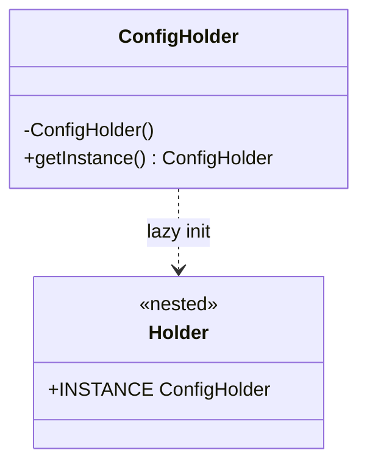
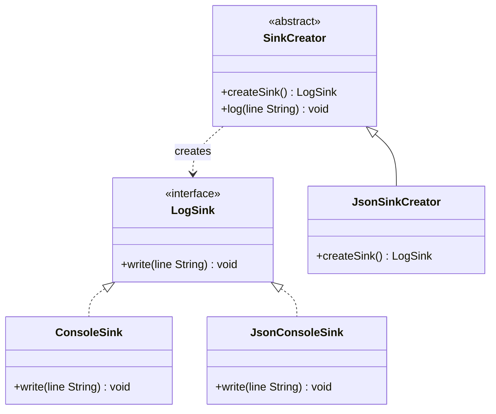
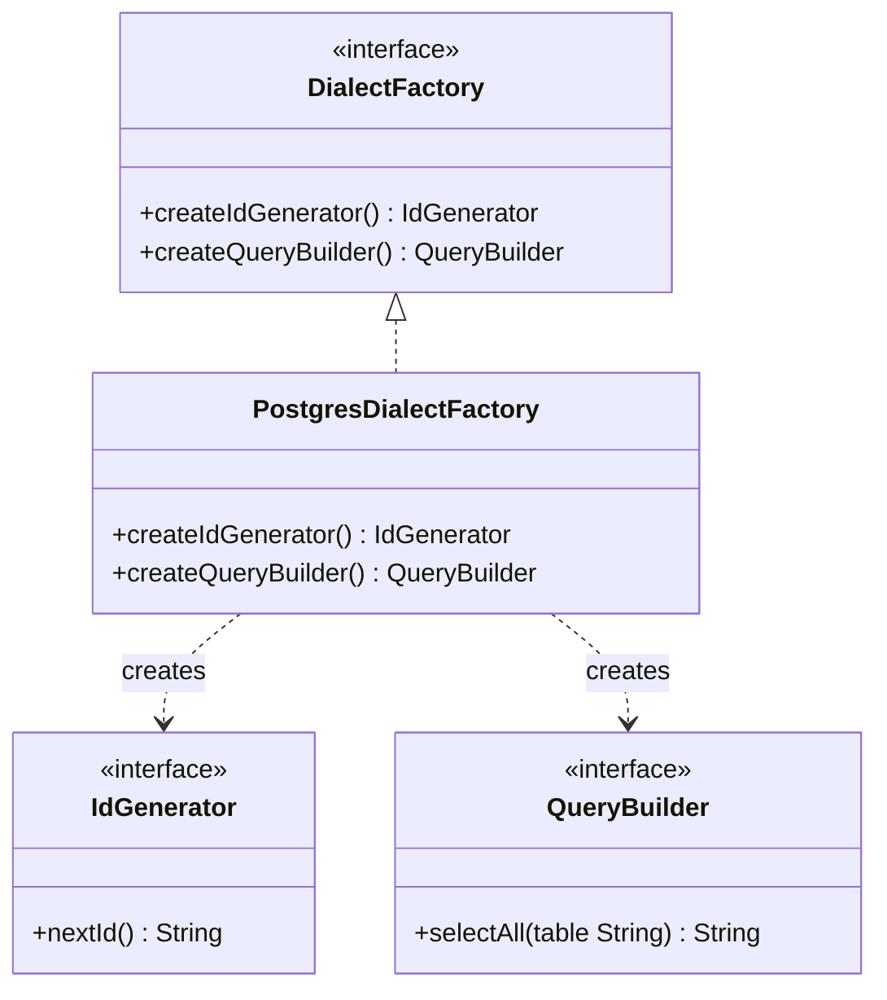
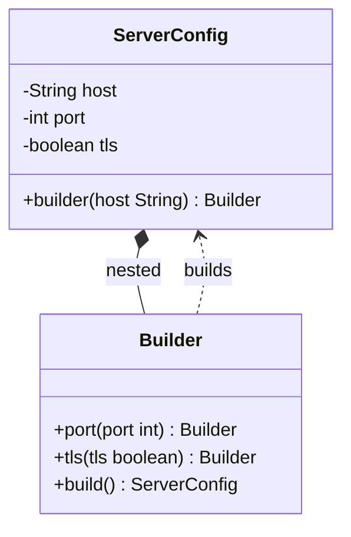
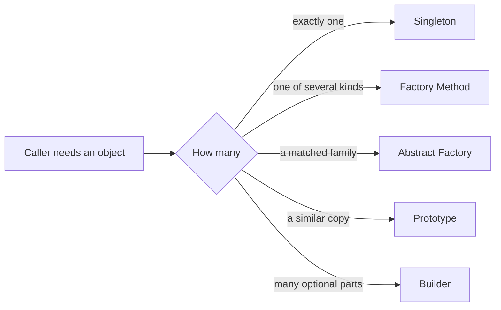

# Creational Design Patterns

Creational patterns control how objects are created. Interviewers ask about them to see whether you can separate "who needs the object" from "how the object is built", and whether you understand the cost of each choice.

!!! note "In simple words"
    Creational patterns are ways to make objects without the code that uses them having to know the messy details. The caller asks for "a logger" or "a config" and gets one, built the right way.

## Why it matters

Object creation is spread through a program. If every class calls `new` on a concrete type, changing that type means editing many files, and tests cannot swap in a fake. Creational patterns move the choice of concrete type into one place. They also solve practical problems, such as building an object with many optional settings or making sure only one shared object exists.

## How it works

### The five patterns at a glance

| Pattern | Problem it solves | Key mechanism |
|---------|-------------------|---------------|
| Singleton | Exactly one shared instance is needed | Private constructor and one static access point |
| Factory Method | A subclass should decide which product to create | Overridden creation method |
| Abstract Factory | Related products must match each other | A factory per product family |
| Prototype | Copying is cheaper than building from scratch | A copy operation on the object |
| Builder | Many optional parts, or validation before creation | A step-by-step builder that ends in `build()` |

### Singleton

A singleton guarantees one instance of a class in a JVM and gives code a single way to reach it. Use it for things that really are one per application, such as a configuration holder or a registry of metrics.

The simplest lazy version is not safe under concurrency. Two threads can both see `null` and both create an instance. Two thread-safe options are common.

```java
// Option 1: initialization-on-demand holder (lazy and thread-safe)
public final class ConfigHolder {

    private ConfigHolder() {
    }

    private static final class Holder {
        static final ConfigHolder INSTANCE = new ConfigHolder();
    }

    public static ConfigHolder getInstance() {
        return Holder.INSTANCE;
    }
}

// Option 2: enum (serialization-safe and resistant to reflection)
public enum AppMode {
    INSTANCE;

    public String describe() {
        return "running in " + name();
    }
}
```

Double-checked locking also works, but only with a `volatile` field. Without `volatile`, another thread can see a partially constructed object.

```java
public final class Registry {

    private static volatile Registry instance;

    private Registry() {
    }

    public static Registry getInstance() {
        Registry local = instance;
        if (local == null) {
            synchronized (Registry.class) {
                local = instance;
                if (local == null) {
                    instance = local = new Registry();
                }
            }
        }
        return local;
    }
}
```



### Factory Method

A factory method creates an object, and subclasses decide which concrete type to return. The caller works against an interface and never names the concrete class. The sample below compiles with Java 21 as a single file:

```java
interface LogSink {
    void write(String line);
}

class ConsoleSink implements LogSink {
    @Override
    public void write(String line) {
        System.out.println(line);
    }
}

class JsonConsoleSink implements LogSink {
    @Override
    public void write(String line) {
        System.out.println("{\"msg\": \"" + line + "\"}");
    }
}

abstract class SinkCreator {

    // The factory method. Subclasses choose the product.
    abstract LogSink createSink();

    void log(String line) {
        createSink().write(line);
    }
}

class JsonSinkCreator extends SinkCreator {
    @Override
    LogSink createSink() {
        return new JsonConsoleSink();
    }
}
```



A static method that switches on a string is sometimes called a simple factory. It is not a Gang of Four pattern, but it is common and often good enough. It becomes a problem when every new type means editing the same `switch`, which breaks the open/closed principle.

### Abstract Factory

An abstract factory creates a family of related objects that must be used together. The client picks one factory and gets consistent products from it. A database dialect is a typical case: a PostgreSQL factory must return PostgreSQL-style ID generators and query builders, never a mix of dialects. The sample below compiles with Java 21:

```java
interface IdGenerator {
    String nextId();
}

interface QueryBuilder {
    String selectAll(String table);
}

interface DialectFactory {
    IdGenerator createIdGenerator();
    QueryBuilder createQueryBuilder();
}

class PostgresIdGenerator implements IdGenerator {
    @Override
    public String nextId() {
        return "SELECT nextval('ids')";
    }
}

class PostgresQueryBuilder implements QueryBuilder {
    @Override
    public String selectAll(String table) {
        return "SELECT * FROM \"" + table + "\"";  // Postgres quotes identifiers with double quotes
    }
}

class PostgresDialectFactory implements DialectFactory {
    @Override
    public IdGenerator createIdGenerator() {
        return new PostgresIdGenerator();
    }

    @Override
    public QueryBuilder createQueryBuilder() {
        return new PostgresQueryBuilder();
    }
}
```



A MySQL factory would be built the same way, but it would quote identifiers with backticks. Adding a new kind of product, such as a menu, forces a change to every factory. That is the trade-off: a new family is easy to add, but a new kind of member is harder to add.

### Prototype

A prototype creates new objects by copying an existing one. It helps when building an object from scratch is expensive, or when the caller already holds an object and wants a similar one.

In Java, `Object.clone()` and `Cloneable` are error-prone. `clone()` makes a shallow copy by default, and its checked `CloneNotSupportedException` is awkward. A copy constructor or a static `copy()` method is usually clearer.

```java
import java.util.ArrayList;
import java.util.List;

class Template {

    private final String title;
    private final List<String> sections;

    Template(String title, List<String> sections) {
        this.title = title;
        // Copy the list so the new object does not share state with the original
        this.sections = new ArrayList<>(sections);
    }

    Template copy() {
        return new Template(title, sections);
    }

    void addSection(String section) {
        sections.add(section);
    }

    @Override
    public String toString() {
        return title + " " + sections;
    }

    public static void main(String[] args) {
        Template original = new Template("Weekly", List.of("Goals"));
        Template copy = original.copy();
        copy.addSection("Risks");
        System.out.println(original); // Weekly [Goals]
        System.out.println(copy);     // Weekly [Goals, Risks]
    }
}
```

The copy constructor copies the list, so adding a section to the copy leaves the original unchanged. If the list were shared, both objects would change together.

### Builder

A builder collects the parts of an object step by step, then creates the final object in one call, usually `build()`. It fixes the telescoping constructor problem, where a class has five constructors with overlapping parameter lists and callers cannot tell which `int` is which.

Builders suit classes with several optional settings, immutable objects, and objects that must be validated before they exist. The sample below compiles with Java 21:

```java
public final class ServerConfig {

    private final String host;
    private final int port;
    private final boolean tls;

    private ServerConfig(Builder builder) {
        this.host = builder.host;
        this.port = builder.port;
        this.tls = builder.tls;
    }

    public static Builder builder(String host) {
        return new Builder(host);
    }

    public static final class Builder {

        private final String host;
        private int port = 8080;
        private boolean tls = false;

        private Builder(String host) {
            this.host = host;
        }

        public Builder port(int port) {
            this.port = port;
            return this;
        }

        public Builder tls(boolean tls) {
            this.tls = tls;
            return this;
        }

        public ServerConfig build() {
            if (port <= 0 || port > 65535) {
                throw new IllegalStateException("Port out of range: " + port);
            }
            return new ServerConfig(this);
        }
    }

    @Override
    public String toString() {
        return (tls ? "https" : "http") + "://" + host + ":" + port;
    }

    public static void main(String[] args) {
        ServerConfig config = ServerConfig.builder("localhost").port(8443).tls(true).build();
        System.out.println(config); // https://localhost:8443
    }
}
```



Java records cover many data-only cases with less code. A builder is still useful when there are optional fields, validation rules, or defaults. Lombok's `@Builder` generates this boilerplate, and its generated code follows the same pattern. Knowing the hand-written version helps when you debug generated code.

### Step by step

| Step | Singleton | Factory Method | Abstract Factory | Prototype | Builder |
|------|-----------|----------------|------------------|-----------|---------|
| 1 | Make the constructor private | Declare a creator with a factory method | Declare an interface for each product | Declare a copy operation | Declare the product and its optional fields |
| 2 | Expose one static access point | Subclasses override the method | Implement a factory per family | Implement the copy | Add setter-like methods that return the builder |
| 3 | Create the instance once | The client calls the creator | The client picks one factory | The client copies instead of constructing | The client calls `build()` |



## Where it is used

- Logging frameworks create appenders and sinks through factories chosen by configuration.
- JDBC drivers and connection factories hide the vendor-specific classes behind a common interface.
- `Calendar.getInstance()` and `NumberFormat.getInstance()` are factory methods in the JDK.
- `StringBuilder` and `HttpRequest.newBuilder()` in the JDK use the builder style.
- Spring beans are singletons by default, managed by the container rather than by static fields.

## Benefits

- Callers depend on interfaces, so the concrete type can change without touching them.
- Families of related objects stay consistent, which prevents subtle mixing bugs.
- Builders make call sites readable and let objects be immutable.
- Singletons save repeated setup for expensive shared resources.
- Prototypes avoid repeating expensive initialisation.

## Cons and limits

- A singleton is effectively a global. It hides dependencies and makes tests harder to isolate.
- Abstract factories are heavy when only one product type is needed.
- A prototype copy is only as correct as the copy logic. Deep structures need deep copies.
- Builders add a class and some boilerplate, which is not worth it for a two-field object.
- Factories that switch on a type code bring back the open/closed problem.

## Best practices

- Prefer dependency injection over hand-written singletons. Let the container create one shared bean.
- Use the holder idiom or an enum when a true singleton is needed.
- Use copy constructors instead of `Cloneable`, and copy every mutable field.
- Validate in `build()` rather than in each setter, so the object is checked once with all values known.
- Start with a plain factory method. Move to an abstract factory only when families must match.
- Keep builders for objects that actually have many optional parts.

!!! tip "Interview tip"
    **Q: How would you make a singleton thread-safe?**
    Name the holder idiom or the enum, explain why a `volatile` field is needed for double-checked locking, and then say that dependency injection is usually a better answer in an application.

## Quick recap

- Singleton: one instance, made safe with a holder class or an enum.
- Factory Method: subclasses decide the concrete product, and the caller depends on the interface.
- Abstract Factory: creates families of products that must match.
- Prototype: copy an existing object, and prefer copy constructors to `Cloneable`.
- Builder: readable construction of objects with optional fields and validation.

## Official documentation

- [Spring Framework reference documentation](https://docs.spring.io/spring-framework/reference/)
- [JDK 21 API documentation](https://docs.oracle.com/en/java/javase/21/docs/api/index.html)
- [Java Language Specification, SE 21](https://docs.oracle.com/javase/specs/jls/se21/html/index.html)

**See also:** [Structural Patterns](structural-patterns.md), [Behavioural Patterns](behavioural-patterns.md), [SOLID and Anti-Patterns](solid-and-anti-patterns.md), [Dependency Injection](../08-spring-core/dependency-injection.md), [Design Patterns interview questions](../../interview-questions/technical/design-patterns-part-1.md)
