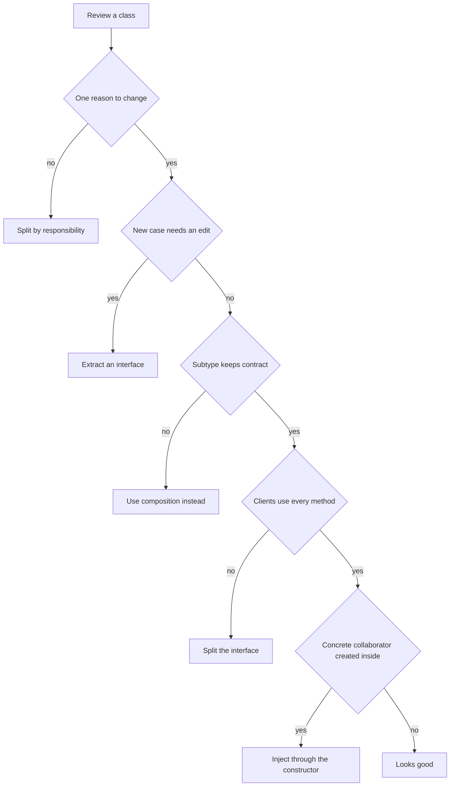
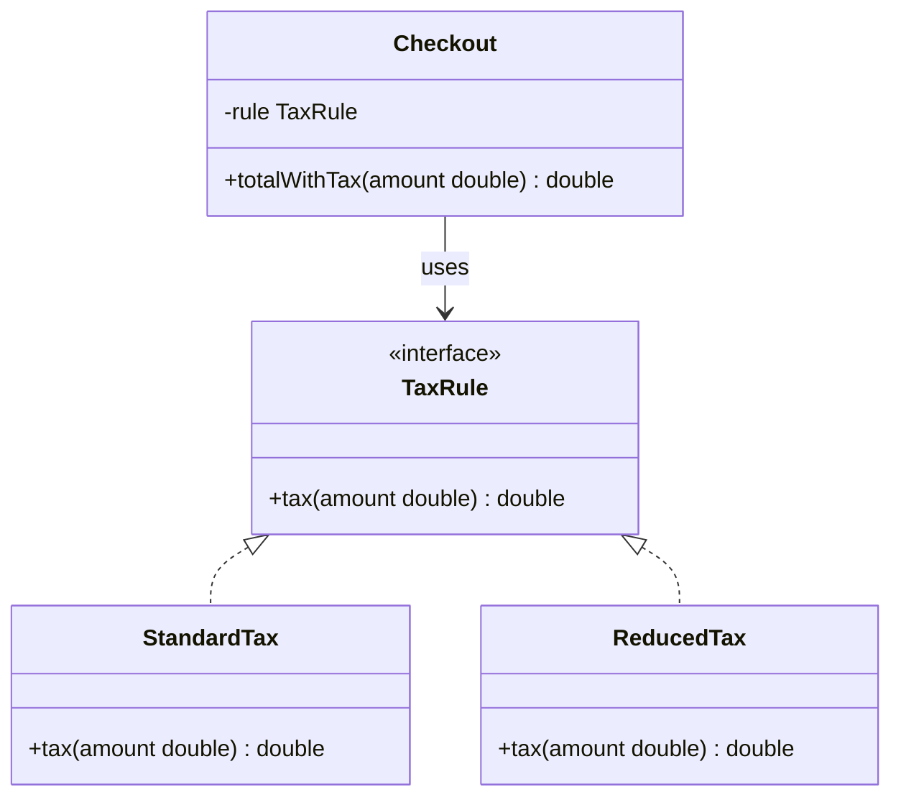

# SOLID Principles and Anti-Patterns

SOLID is a set of five object-oriented design principles that explain why good pattern use looks the way it does. Anti-patterns are common shortcuts that look helpful at first and cause trouble later. Interviewers ask about both to test judgement, not memory.

!!! note "In simple words"
    SOLID gives five checks for a class: does it do one job, can you add behaviour without editing it, can a subclass stand in for its parent, are its interfaces small, and does it depend on abstractions. Anti-patterns are the habits that break those checks.

## Why it matters

Patterns are tools, and SOLID tells you when a tool is needed. A class that serves three masters is hard to change, and every change risks the others. A design that uses singletons and global lookups everywhere is hard to test. Recognising these problems early is cheaper than rewriting a system later.

## How it works

### The five principles

| Letter | Principle | Question to ask |
|--------|-----------|-----------------|
| S | Single Responsibility | Does this class have one reason to change? |
| O | Open/Closed | Can new behaviour arrive as new code instead of edits? |
| L | Liskov Substitution | Can a subtype replace its parent without breaking callers? |
| I | Interface Segregation | Does each client depend only on the methods it uses? |
| D | Dependency Inversion | Does high-level code depend on abstractions it owns? |



### Single Responsibility Principle (SRP)

A class should have one reason to change. If a class formats a report, saves it to the database, and sends it by email, then a change to the email rules forces an edit to a class that also owns the report format.

```java
// Before: one class with three reasons to change (shown to illustrate the problem)
// class InvoiceManager {
//     void save(Invoice invoice) { /* database code */ }
//     String format(Invoice invoice) { return "Invoice " + invoice.id(); }
//     void email(Invoice invoice) { /* mail code */ }
// }

// After: each responsibility has its own class (compiles with Java 21)
record Invoice(String id) { }

class InvoiceRepository {
    void save(Invoice invoice) { System.out.println("saved " + invoice.id()); }
}

class InvoiceFormatter {
    String format(Invoice invoice) { return "Invoice " + invoice.id(); }
}
```

SRP is about reasons to change, not about making classes tiny. A class with one clear job can still have many methods.

### Open/Closed Principle (OCP)

Software entities should be open for extension and closed for modification. You add behaviour by adding new code, not by editing tested code. The Strategy pattern is the usual way to get this. The sample below compiles with Java 21:

```java
interface TaxRule {
    double tax(double amount);
}

class StandardTax implements TaxRule {
    @Override
    public double tax(double amount) {
        return amount * 0.2;
    }
}

// A new rule is a new class. Checkout does not change.
class ReducedTax implements TaxRule {
    @Override
    public double tax(double amount) {
        return amount * 0.05;
    }
}

class Checkout {

    private final TaxRule rule;

    Checkout(TaxRule rule) {
        this.rule = rule;
    }

    double totalWithTax(double amount) {
        return amount + rule.tax(amount);
    }
}
```



A `switch` on a type code is the classic sign that OCP is being broken. Each new case edits existing code.

### Liskov Substitution Principle (LSP)

A subtype must be usable anywhere its parent type is used, without the caller noticing a broken promise. The classic failure is a `Square` that extends `Rectangle` and enforces equal sides. Code that sets width and height independently gets surprising results. The sample below compiles with Java 21 as a single file:

```java
class Rectangle {
    protected int width;
    protected int height;

    void setWidth(int width) { this.width = width; }
    void setHeight(int height) { this.height = height; }
    int area() { return width * height; }
}

// Violates LSP: setting one side silently changes the other.
class Square extends Rectangle {
    @Override
    void setWidth(int width) { this.width = width; this.height = width; }

    @Override
    void setHeight(int height) { this.width = height; this.height = height; }
}

class LspDemo {
    static void stretch(Rectangle r) {
        r.setWidth(4);
        r.setHeight(5);
        System.out.println(r.area()); // expected 20
    }

    public static void main(String[] args) {
        stretch(new Rectangle()); // 20
        stretch(new Square());    // 25, the contract is broken
    }
}
```

The fix is to avoid the inheritance. Model shapes with a common interface, such as `area()`, and let each shape hold its own fields.

LSP also covers preconditions and postconditions. A subclass should never demand stronger input than its parent accepts, and it should never promise less in its results. If a subclass throws for inputs the parent accepts, it breaks substitution.

### Interface Segregation Principle (ISP)

Clients should not be forced to depend on methods they do not use. A large interface with many unrelated methods forces every implementation to stub out methods it cannot support.

```java
// Too broad: a read-only client must still see the write methods.
interface Store {
    String read(String key);
    void write(String key, String value);
    void delete(String key);
}

// Split by what callers need.
interface ReadableStore {
    String read(String key);
}

interface WritableStore {
    void write(String key, String value);
    void delete(String key);
}
```

A class can implement both small interfaces when it truly supports both roles. Callers then depend only on the role they use.

### Dependency Inversion Principle (DIP)

High-level code should depend on abstractions, and low-level details should depend on the same abstractions. In practice, a service asks for a `PaymentGateway` interface in its constructor, and the wiring code decides which implementation to pass in. Dependency injection is the mechanism that does this for you. The sample below compiles with Java 21:

```java
interface PaymentGateway {
    boolean charge(double amount);
}

class OrderService {

    private final PaymentGateway gateway;

    // The service does not create the gateway. It receives one.
    OrderService(PaymentGateway gateway) {
        this.gateway = gateway;
    }

    boolean placeOrder(double amount) {
        return gateway.charge(amount);
    }
}

class OrderServiceDemo {
    public static void main(String[] args) {
        OrderService service = new OrderService(amount -> true); // a fake gateway in a test
        System.out.println(service.placeOrder(25.0));            // true
    }
}
```

Constructor injection makes the dependency visible and easy to replace in tests. Spring's container does the wiring for you. See [Dependency Injection](../08-spring-core/dependency-injection.md).

### Design habits: immutability and equals and hashCode

Two habits support most of the patterns above. Immutable objects can be shared safely between threads, which is why Builder, Flyweight, and value classes benefit from them. Make fields `final`, do not expose mutable collections, and return copies.

`equals` and `hashCode` must agree. If two objects are equal, they must return the same hash code. A class used as a key in a `HashMap` that breaks this rule can appear to lose entries. Records generate both methods from their components, which makes them the safest default for value types.

### Anti-patterns

| Anti-pattern | What it looks like | Better option |
|--------------|-------------------|---------------|
| God object | One class that knows and does almost everything | Split by responsibility (SRP) |
| Singleton overuse | Global static access everywhere | Dependency injection with a singleton-scoped bean |
| Anemic domain model | Entities are plain data holders, and all logic sits in services | Move behaviour that belongs to the entity into it |
| Service locator | A global lookup that code calls to find its own dependencies | Constructor injection |
| Premature abstraction | Interfaces and factories for one implementation with no planned variation | Write the concrete class, and extract an interface when a second case appears |
| Pattern for its own sake | A pattern added because it has a name | Describe the problem first, then choose the pattern |
| Shotgun surgery | One change touches many classes | Group code that changes together |

Service locator is worth a closer look, because it hides dependencies from the class signature. The first version below looks convenient and hides its needs. The second states them.

```java
interface Clock {
    long nowMillis();
}

// Service locator: the dependency is hidden inside the method body.
class ReportServiceLocator {
    long stamp() {
        return Registry.get(Clock.class).nowMillis();
    }
}

// Constructor injection: the dependency is part of the contract.
class ReportService {
    private final Clock clock;

    ReportService(Clock clock) {
        this.clock = clock;
    }

    long stamp() {
        return clock.nowMillis();
    }
}

class Registry {
    static <T> T get(Class<T> type) {
        throw new UnsupportedOperationException("sketch only");
    }
}
```

The `Registry` class exists only to make the first version compile. Its method is a sketch, and it is not meant to run.

Each anti-pattern has a legitimate use in some case. A singleton is reasonable for a thread pool, and an interface with one implementation is fine at a module boundary. The problem is using them by default.

## Where it is used

- Code reviews, where a reviewer names the principle a change violates.
- Service and domain design in Spring applications, where constructor injection is the default.
- Refactoring legacy code, where SRP and ISP guide how to split large classes.
- Plugin systems, where OCP keeps new behaviour out of the core.

## Benefits

- Classes are smaller and easier to explain.
- Changes stay local, so one feature touches fewer files.
- Tests can substitute fakes for collaborators.
- Substitution is safe, so callers do not need to check concrete types.
- Anti-pattern awareness prevents slow decay of the codebase.

## Cons and limits

- Applying all five principles to a small script adds files and indirection without benefit.
- Each interface is a cost. Create one when there is a real second implementation, a test seam, or a module boundary.
- Strict immutability and value objects add copying and allocation.
- Dependency injection hides wiring, which can make startup failures harder to read.
- The principles conflict at times. Judgement decides which one wins.

## Best practices

- Name each class's responsibility in one sentence. If you need the word "and", consider SRP.
- Treat any `switch` or `instanceof` chain on types as a candidate for polymorphism.
- Check each subclass against its parent with a concrete sample call.
- Prefer composition over inheritance when the subtype is not a true kind of the parent.
- Inject dependencies through constructors, and avoid service locators.
- Watch for services that only call getters and setters on entities. Logic may have leaked out of the domain.

!!! tip "Interview tip"
    **Q: Which SOLID principle is most often broken in practice?**
    A good answer is SRP, because classes grow by accretion. Explain how you would notice it: a class that changes for several unrelated reasons, or a diff where one feature touches many unrelated methods.

## Quick recap

- SRP: one reason to change per class.
- OCP: add behaviour with new code, not by editing working code.
- LSP: subtypes must keep the promises of their parent types.
- ISP: keep interfaces small and focused on what clients use.
- DIP: depend on abstractions, and inject the concrete implementation.
- Immutability and consistent `equals` and `hashCode` make objects safer to share and to use as keys.
- Anti-patterns to watch for: god objects, overused singletons, anemic models, service locators, and premature abstraction.

## Official documentation

- [Spring Framework reference documentation](https://docs.spring.io/spring-framework/reference/)
- [JDK 21 API documentation](https://docs.oracle.com/en/java/javase/21/docs/api/index.html)
- [Java Language Specification, SE 21](https://docs.oracle.com/javase/specs/jls/se21/html/index.html)

**See also:** [Creational Patterns](creational-patterns.md), [Structural Patterns](structural-patterns.md), [Behavioural Patterns](behavioural-patterns.md), [Dependency Injection](../08-spring-core/dependency-injection.md), [Design Patterns interview questions](../../interview-questions/technical/design-patterns-part-1.md)
