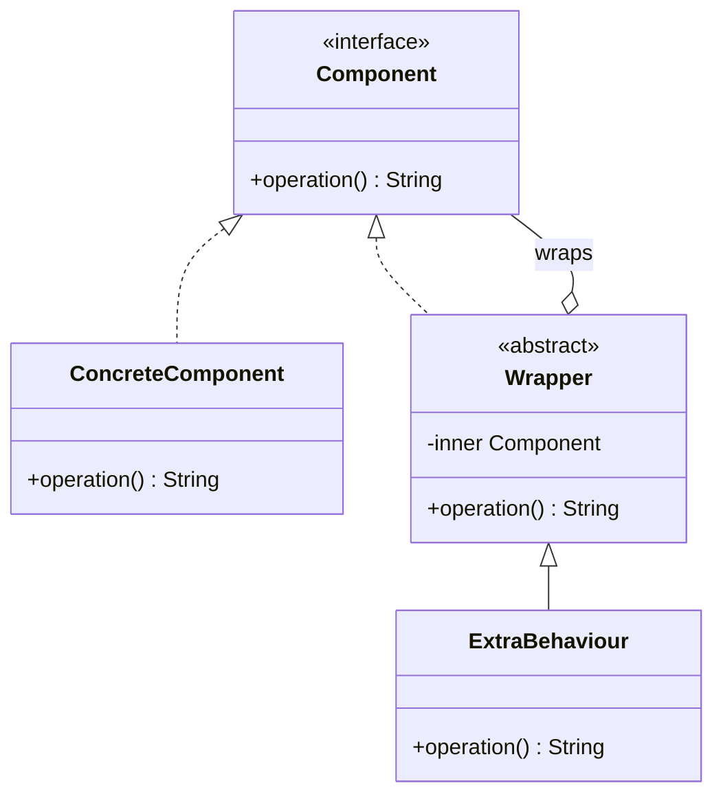
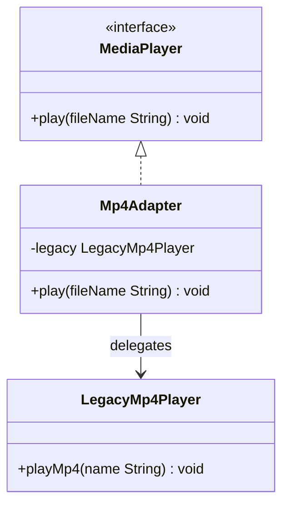
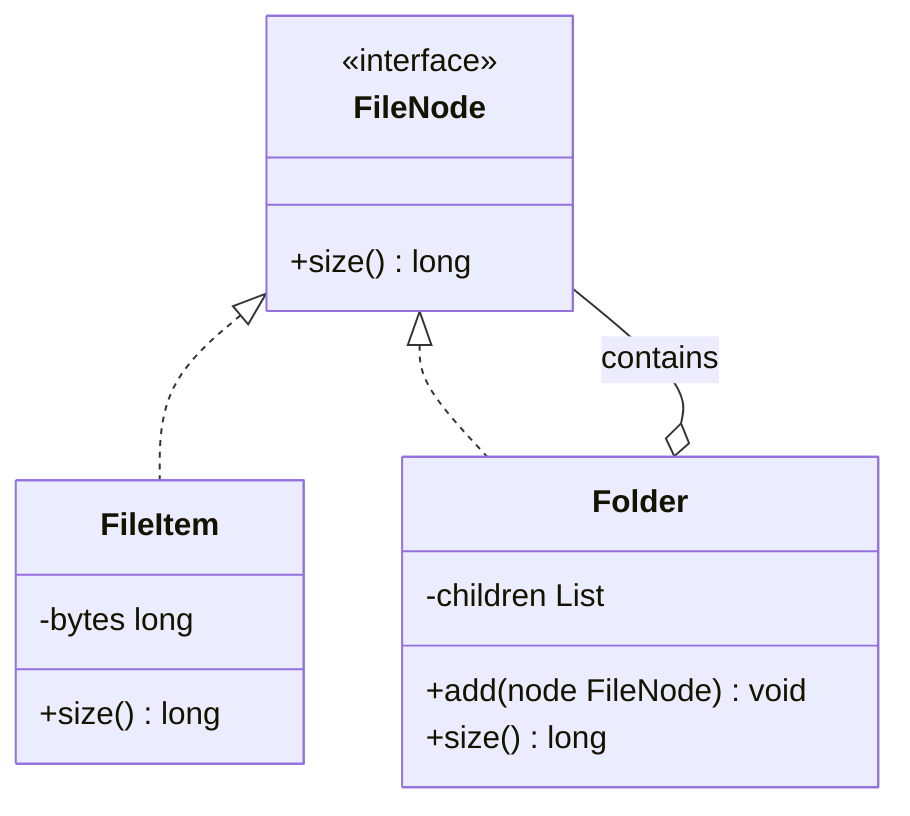
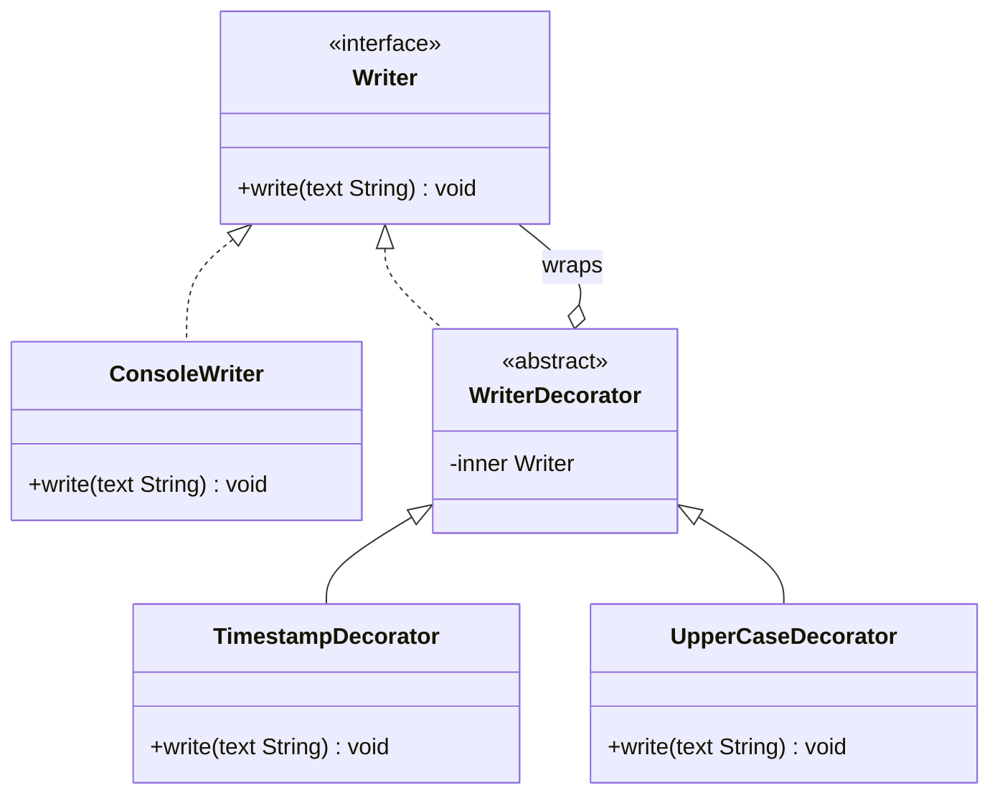
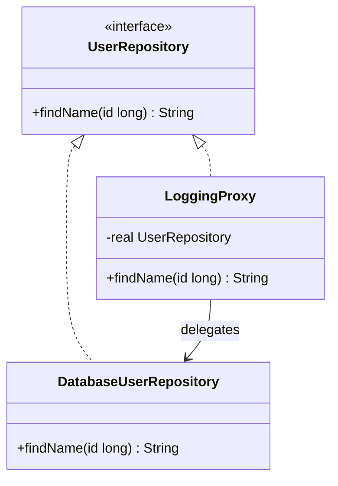
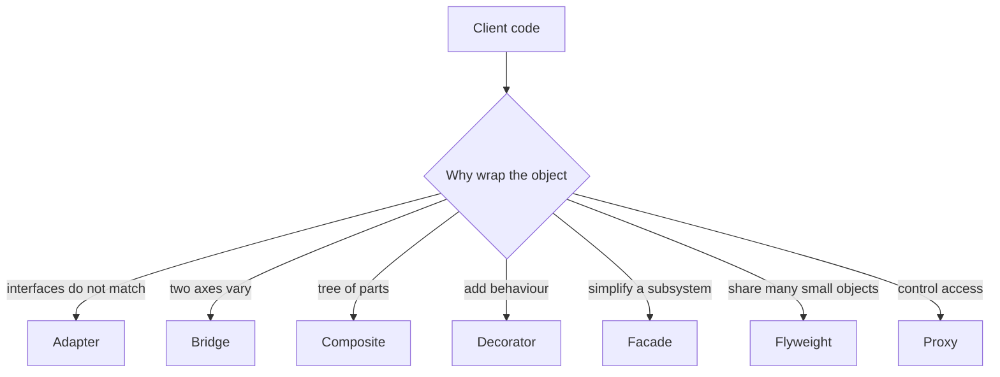

# Structural Design Patterns

Structural patterns describe how classes and objects are composed into larger structures. They answer questions such as how to make two incompatible APIs work together, how to treat a group of objects as one object, and how to add behaviour without editing the original class.

!!! note "In simple words"
    Structural patterns are ways to put pieces together. You wrap an object to change or add to what it does, or you put a simple front door in front of a messy group of objects.

## Why it matters

Real systems combine code from many sources: a third-party SDK with an odd interface, a legacy class you cannot change, a subsystem with twenty steps that most callers only need three of. Structural patterns let you connect these pieces without rewriting them. They also keep the wiring between parts explicit, which makes the system easier to test and replace.

## How it works

### Class diagram of the common shape

Most structural patterns share one shape: a client talks to an interface, and a class implements that interface while holding a reference to another object. The differences lie in why the wrapper exists.



### Adapter

An adapter lets a class with one interface be used where a different interface is expected. It wraps the incompatible object and translates the calls. Java's `InputStreamReader` is an adapter: it turns a byte stream into a character reader.

```java
interface MediaPlayer {
    void play(String fileName);
}

// An existing class with a different method name and signature
class LegacyMp4Player {
    void playMp4(String name) {
        System.out.println("Legacy MP4 player: " + name);
    }
}

class Mp4Adapter implements MediaPlayer {

    private final LegacyMp4Player legacy;

    Mp4Adapter(LegacyMp4Player legacy) {
        this.legacy = legacy;
    }

    @Override
    public void play(String fileName) {
        legacy.playMp4(fileName);
    }
}
```



### Bridge

A bridge separates an abstraction from its implementation, so both can vary independently. Without it, every combination of remote and device needs its own subclass. With it, the abstraction holds a reference to an implementation interface. The sample below compiles with Java 21:

```java
interface Device {
    void setPower(boolean on);
}

class Television implements Device {
    @Override
    public void setPower(boolean on) {
        System.out.println("TV " + (on ? "on" : "off"));
    }
}

abstract class RemoteControl {

    protected final Device device;

    RemoteControl(Device device) {
        this.device = device;
    }

    abstract void togglePower();
}

class BasicRemote extends RemoteControl {

    private boolean on;

    BasicRemote(Device device) {
        super(device);
    }

    @Override
    void togglePower() {
        on = !on;
        device.setPower(on);
    }
}
```

A new remote, such as an advanced one with a mute button, needs no new device class. A new device needs no new remote classes.

### Composite

A composite treats single objects and groups of objects through the same interface. A file system is the usual example: a file and a folder both report a size, and a folder's size is the sum of its children. The sample below compiles with Java 21:

```java
import java.util.ArrayList;
import java.util.List;

interface FileNode {
    long size();
}

class FileItem implements FileNode {

    private final long bytes;

    FileItem(long bytes) {
        this.bytes = bytes;
    }

    @Override
    public long size() {
        return bytes;
    }
}

class Folder implements FileNode {

    private final List<FileNode> children = new ArrayList<>();

    void add(FileNode node) {
        children.add(node);
    }

    @Override
    public long size() {
        return children.stream().mapToLong(FileNode::size).sum();
    }

    public static void main(String[] args) {
        Folder root = new Folder();
        root.add(new FileItem(120));
        Folder docs = new Folder();
        docs.add(new FileItem(300));
        root.add(docs);
        System.out.println(root.size()); // 420
    }
}
```

The folder's `size()` calls `size()` on each child. It does not care whether a child is a leaf or another folder. That recursion is the whole pattern.



### Decorator

A decorator wraps an object that implements an interface. It adds behaviour before or after it delegates, and it implements the same interface itself. Decorators can be stacked in any order at runtime. Java's I/O classes are the standard example: `new BufferedInputStream(new FileInputStream(path))` adds buffering on top of a file stream. The sample below compiles with Java 21:

```java
interface Writer {
    void write(String text);
}

class ConsoleWriter implements Writer {
    @Override
    public void write(String text) {
        System.out.println(text);
    }
}

abstract class WriterDecorator implements Writer {

    protected final Writer inner;

    WriterDecorator(Writer inner) {
        this.inner = inner;
    }
}

class TimestampDecorator extends WriterDecorator {

    TimestampDecorator(Writer inner) {
        super(inner);
    }

    @Override
    public void write(String text) {
        inner.write("[12:00] " + text);
    }
}

class UpperCaseDecorator extends WriterDecorator {

    UpperCaseDecorator(Writer inner) {
        super(inner);
    }

    @Override
    public void write(String text) {
        inner.write(text.toUpperCase());
    }

    public static void main(String[] args) {
        Writer writer = new UpperCaseDecorator(new TimestampDecorator(new ConsoleWriter()));
        writer.write("ready"); // prints [12:00] READY
    }
}
```



Inheritance and decorators solve the same problem in different ways. Inheritance fixes each combination at compile time, so every new combination needs a new class. Decorators compose at runtime, but they create many small objects, and the order of wrapping can change the result.

### Facade

A facade gives a simple entry point to a subsystem with many parts. The subsystem classes still exist and can still be used directly. The facade is a convenience for the common path. The sample below compiles with Java 21:

```java
class InventoryService {
    boolean reserve(String sku) {
        return true; // real code would check stock
    }
}

class PaymentService {
    boolean charge(double amount) {
        return amount > 0;
    }
}

class ShippingService {
    void schedule(String sku) {
        System.out.println("Shipping " + sku);
    }
}

class CheckoutFacade {

    private final InventoryService inventory = new InventoryService();
    private final PaymentService payment = new PaymentService();
    private final ShippingService shipping = new ShippingService();

    boolean placeOrder(String sku, double amount) {
        if (!inventory.reserve(sku)) {
            return false;
        }
        if (!payment.charge(amount)) {
            return false;
        }
        shipping.schedule(sku);
        return true;
    }
}
```

The client calls `placeOrder` and does not need to know the order of the three steps. A facade should not hide everything, or it becomes a bottleneck that every change must pass through.

### Flyweight

A flyweight shares state that many objects have in common, so thousands of objects do not each store their own copy. The shared part is called intrinsic state. The part that differs per use is extrinsic state, which the caller passes in. The sample below compiles with Java 21:

```java
import java.util.Map;
import java.util.concurrent.ConcurrentHashMap;

final class CharacterStyle {

    private static final Map<String, CharacterStyle> CACHE = new ConcurrentHashMap<>();

    private final String font;
    private final int size;

    private CharacterStyle(String font, int size) {
        this.font = font;
        this.size = size;
    }

    static CharacterStyle of(String font, int size) {
        return CACHE.computeIfAbsent(font + ":" + size, key -> new CharacterStyle(font, size));
    }

    @Override
    public String toString() {
        return font + " " + size;
    }

    public static void main(String[] args) {
        CharacterStyle a = CharacterStyle.of("Serif", 12);
        CharacterStyle b = CharacterStyle.of("Serif", 12);
        System.out.println(a == b); // true, one shared object
    }
}
```

Java already uses this idea. `Integer.valueOf` caches values from -128 to 127, and string literals are pooled. The flyweight pays off only when very many objects have few distinct states.

### Proxy

A proxy stands in for another object and controls access to it. The proxy has the same interface as the real object. It can add lazy loading, access checks, logging, caching, or remote calls. Java's dynamic proxies create a proxy at runtime from an interface. The sample below compiles with Java 21:

```java
import java.lang.reflect.Proxy;

interface UserRepository {
    String findName(long id);
}

class DatabaseUserRepository implements UserRepository {
    @Override
    public String findName(long id) {
        return "user-" + id;
    }

    public static void main(String[] args) {
        UserRepository real = new DatabaseUserRepository();
        UserRepository loggingProxy = (UserRepository) Proxy.newProxyInstance(
                UserRepository.class.getClassLoader(),
                new Class<?>[] {UserRepository.class},
                (proxy, method, methodArgs) -> {
                    System.out.println("Calling " + method.getName());
                    return method.invoke(real, methodArgs);
                });
        System.out.println(loggingProxy.findName(7L));
    }
}
```



Spring AOP creates proxies in a similar way. A `@Transactional` method call goes through a proxy before it reaches your code. That is why self-invocation, where a method in the same class calls an annotated method directly, skips the advice. See [AOP](../08-spring-core/aop.md).

### Step by step

| Pattern | Problem it solves | Key mechanism |
|---------|------------------|---------------|
| Adapter | Incompatible interfaces | Wrap and translate calls |
| Bridge | Two dimensions of variation | Hold a reference to the implementation interface |
| Composite | Part-whole trees | Same interface for leaves and branches |
| Decorator | Add behaviour at runtime | Wrap and delegate with the same interface |
| Facade | Complex subsystem | One simple entry point |
| Flyweight | Too many similar objects | Share intrinsic state through a cache |
| Proxy | Control access | Same interface, with extra logic around delegation |



## Where it is used

- Adapters in integration code, where a vendor SDK must fit an internal interface.
- Decorators in I/O, such as `BufferedReader` wrapping a `FileReader`.
- Composites for menus, UI component trees, and document structures.
- Facades at the edge of a module, such as a checkout service that hides inventory, payment, and shipping.
- Proxies in Spring for transactions, security, and lazy-loaded remote clients.
- Flyweights for shared glyphs, icons, or interned values in large collections.

## Benefits

- Existing code is reused without modification.
- Behaviour can be added or removed at runtime with decorators.
- Clients depend on one interface, which makes swapping implementations simple.
- Facades reduce coupling between a caller and a complicated subsystem.
- Proxies keep cross-cutting concerns such as logging and security out of business code.

## Cons and limits

- Many small wrappers make a call stack deep and hard to debug.
- Adapters and facades can hide problems in the underlying code if they are used too widely.
- Dynamic proxies work only with interfaces, so classes without interfaces need a class-based proxy mechanism.
- Flyweights add a cache and lifetime concerns, and they only help when many objects share state.
- Self-invocation bypasses a proxy, which surprises developers who expect annotations to apply everywhere.

## Best practices

- Keep the number of wrappers small, and give each one a clear name.
- Use an adapter to change an interface, and a facade to define a new, simpler one.
- Keep shared flyweight state immutable, so one caller cannot change what others see.
- Do not expose the subsystem through a facade for every call. Let callers reach it directly when they need to.
- When a proxy adds security or transactions, verify that calls actually go through it.

!!! tip "Interview tip"
    **Q: How is a proxy different from a decorator?**
    Both wrap an object with the same interface. A decorator is built by the code that wants extra behaviour, and it often stacks several wrappers. A proxy is about access control or lifecycle, such as lazy creation or security checks, and the client often does not know a proxy exists.

## Quick recap

- Adapter translates one interface into another.
- Bridge separates abstraction from implementation so each can grow on its own.
- Composite lets a group and a single item share one interface.
- Decorator adds behaviour by wrapping; Java I/O uses it heavily.
- Facade offers one simple entry point to a complex subsystem.
- Flyweight shares common state to save memory.
- Proxy controls access; Spring AOP and dynamic proxies rely on it.

## Official documentation

- [Spring Framework reference documentation](https://docs.spring.io/spring-framework/reference/)
- [JDK 21 API documentation](https://docs.oracle.com/en/java/javase/21/docs/api/index.html)
- [Java Language Specification, SE 21](https://docs.oracle.com/javase/specs/jls/se21/html/index.html)

**See also:** [Creational Patterns](creational-patterns.md), [Behavioural Patterns](behavioural-patterns.md), [AOP](../08-spring-core/aop.md), [Design Patterns interview questions](../../interview-questions/technical/design-patterns-part-1.md)
