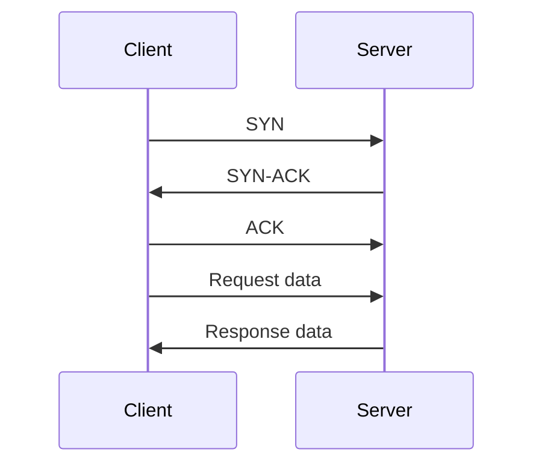
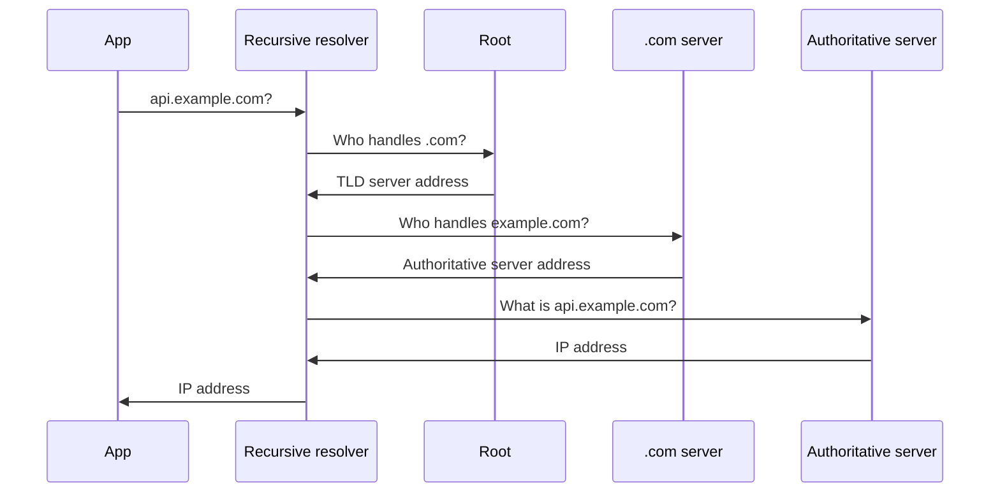

# Computer Networking

Networking explains how a request from a browser or service reaches the right machine, how the data is split and delivered, and why some calls are slow. Interviewers ask about the layered models, TCP versus UDP, DNS, and HTTP because nearly every backend bug eventually touches one of them.

## Core concepts

### OSI and TCP/IP models

The OSI model describes networking as seven layers. Each layer offers services to the layer above and uses the layer below. Engineers use it as a shared vocabulary; real stacks rarely map one-to-one onto it.

| OSI layer | Responsibility | Examples |
|-----------|----------------|----------|
| 7 Application | Protocols that applications speak | HTTP, DNS, SMTP |
| 6 Presentation | Encoding, encryption, translation | TLS, character encoding |
| 5 Session | Opening, managing, and closing sessions | Session management |
| 4 Transport | End-to-end delivery between processes | TCP, UDP |
| 3 Network | Addressing and routing between networks | IP |
| 2 Data link | Node-to-node frames on one local link | Ethernet, MAC addresses |
| 1 Physical | Bits on the medium | Cables, radio signals |

The TCP/IP model used in practice folds these into four layers: Application, Transport, Internet, and Link. Presentation and session concerns are usually handled inside the application or by TLS.

### TCP and UDP

Both are transport protocols that let processes address each other by port.

**TCP** is connection-oriented. Before data flows, the client and server complete a three-way handshake: the client sends SYN, the server replies SYN-ACK, and the client confirms with ACK. TCP then provides reliable, ordered delivery, retransmits lost segments, and applies flow control and congestion control. It suits web traffic, APIs, and database connections.

**UDP** is connectionless and best-effort. There is no handshake, no retransmission, and no ordering guarantee. Its low overhead suits DNS lookups, video calls, live streaming, and games, where a late packet is worse than a lost one.



### HTTP essentials

HTTP is a request-response protocol carried over TCP (HTTP/1.1 and HTTP/2) or QUIC (HTTP/3).

- **Methods** express intent. GET and HEAD are safe; GET, PUT, and DELETE are idempotent; POST is neither. PATCH applies partial changes and is not guaranteed to be idempotent.
- **Status classes** group responses: 2xx success, 3xx redirection, 4xx client error, 5xx server error. The detailed code list is in [Web Fundamentals](web-fundamentals.md).
- **Versions**: HTTP/1.1 sends one request at a time per connection in its basic form. HTTP/2 multiplexes many streams over one connection and compresses headers. HTTP/3 runs over QUIC, which is built on UDP and handles loss per stream.
- **HTTPS** is HTTP over TLS. TLS gives confidentiality (encryption), integrity (tamper detection), and server authentication through certificates issued by trusted authorities.

Runnable example with the JDK's built-in client (Java 11 and later):

```java
import java.net.URI;
import java.net.http.HttpClient;
import java.net.http.HttpRequest;
import java.net.http.HttpResponse;

public class HttpStatusDemo {
    public static void main(String[] args) throws Exception {
        HttpClient client = HttpClient.newHttpClient();
        HttpRequest request = HttpRequest.newBuilder(URI.create("https://example.com/"))
                .GET()
                .build();

        HttpResponse<String> response = client.send(request, HttpResponse.BodyHandlers.ofString());

        System.out.println("Status: " + response.statusCode());
        System.out.println("Version: " + response.version());
    }
}
```

### DNS

The Domain Name System turns a name such as `api.example.com` into an IP address. A recursive resolver, usually run by the network or the operating system, does the work by asking, in order:

1. A **root** server, which points to the top-level domain servers.
2. The **TLD** server for `.com`, which points to the domain's name servers.
3. The domain's **authoritative** server, which returns the answer.

The answer is cached for the record's time-to-live (TTL), which is why DNS changes can take time to spread.



Common record types:

| Record | Purpose |
|--------|---------|
| A | Maps a name to an IPv4 address |
| AAAA | Maps a name to an IPv6 address |
| CNAME | Makes one name an alias of another |
| MX | Lists mail servers for a domain |
| TXT | Holds free text, often used for verification and email policy |
| NS | Names the authoritative servers for a zone |

### Other essentials

- **Load balancers** spread traffic across instances. A Layer 4 balancer routes on IP and port; a Layer 7 balancer reads HTTP and can route by path, host, or header.
- **Well-known ports**: 80 for HTTP, 443 for HTTPS, 22 for SSH, 3306 for MySQL, and 5432 for PostgreSQL. Clients use ephemeral ports for their side of a connection.
- **Latency** is the time for one message to travel; **throughput** is how much data moves per unit of time. A link can have high throughput and still feel slow if each round trip is long.
- **CDNs** cache static content at edge locations near users, which cuts latency for repeated requests.
- **Round trips** matter more than bandwidth for small requests. Each TCP handshake and TLS handshake adds round trips before the first byte of application data.

## How it works / Step by step

When a client calls `https://api.example.com/orders`:

1. The client resolves the name through DNS, using the cache if the answer is fresh.
2. It opens a TCP connection to port 443, completing the three-way handshake.
3. It runs the TLS handshake, verifying the server certificate against a trusted authority.
4. It sends the HTTP request; the load balancer forwards it to a healthy instance.
5. The server responds, and the connection may be reused for later requests.

## Common pitfalls

- Assuming UDP is unreliable in a way that makes it unusable. Applications such as QUIC add their own reliability on top of it.
- Forgetting that DNS answers are cached, then expecting an immediate switch after a record change.
- Ignoring connection reuse. Opening a new TCP and TLS connection for each call adds latency that a pooled client avoids.
- Treating HTTP methods as only conventions. Clients, proxies, and caches rely on whether a method is safe or idempotent.
- Using a Layer 4 balancer when routing by URL path is needed.

!!! tip "Interview tip"
    **Q: What happens between typing a URL and seeing a page?**
    Walk through DNS resolution, the TCP handshake, the TLS handshake, the HTTP request and response, and then rendering. Mention caching at each step: the DNS cache, the browser cache, and any CDN in front of the origin.

## Quick recap

- The OSI model has seven layers; TCP/IP uses four in practice.
- TCP gives reliable ordered delivery after a handshake; UDP is connectionless and best-effort.
- HTTP/2 multiplexes streams; HTTP/3 runs over QUIC.
- HTTPS adds TLS for encryption, integrity, and server identity.
- DNS walks root, TLD, and authoritative servers, and caches answers by TTL.
- Latency, round trips, and connection reuse often matter more than raw bandwidth.

**See also:** [Web Fundamentals](web-fundamentals.md), [Software Design Principles](software-design-principles.md), [Cloud Compute and Storage](../18-cloud/compute-and-storage.md)
