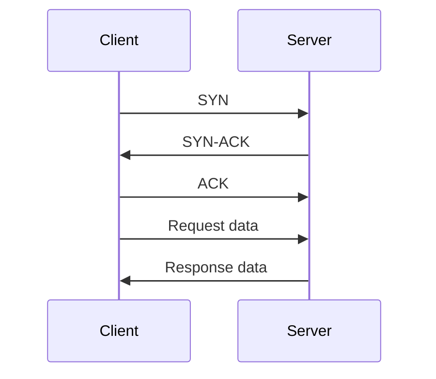
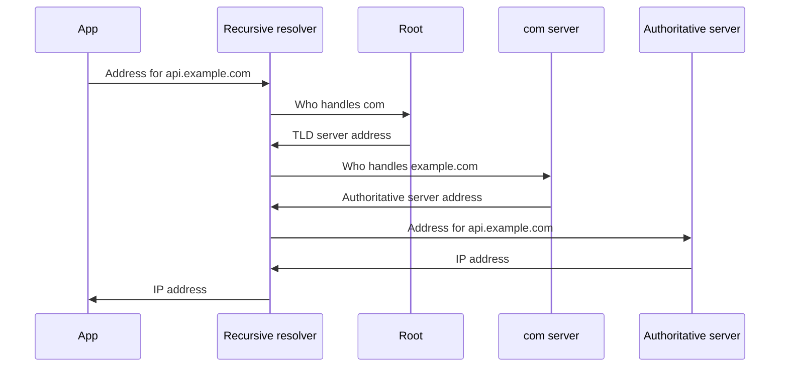
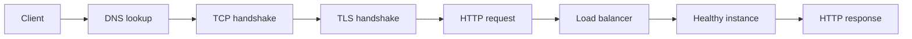

# Computer Networking

Networking explains how a request from a browser or service reaches the right machine, how data is cut into pieces and delivered, and why some calls feel slow. Interviewers ask about layered models, TCP versus UDP, DNS, and HTTP because most backend incidents touch at least one of them.

!!! note "In simple words"
    Networking works like a postal system for computers. An IP address says which machine to send to, a port says which program should receive the data, and the delivery rules decide what happens when a piece gets lost.

## Why it matters

Backend developers rarely write socket code, but the network decides timeouts, retries, connection limits, and how quickly a page loads. When a call fails, you need to tell apart a name that did not resolve, a connection that never opened, a handshake that failed, and a server that answered with an error. Each of those points to a different fix.

## How it works

### Layered models

A network stack is split into layers. Each layer offers a service to the layer above and relies on the layer below. The OSI model names seven layers and gives engineers a shared vocabulary. Real stacks rarely match it exactly.

| OSI layer | Responsibility | Examples |
|-----------|----------------|----------|
| 7 Application | Protocols that applications speak | HTTP, DNS, SMTP |
| 6 Presentation | Encoding, encryption, translation | TLS, character encoding |
| 5 Session | Opening, managing, and closing sessions | Session management |
| 4 Transport | End-to-end delivery between processes | TCP, UDP |
| 3 Network | Addressing and routing between networks | IP |
| 2 Data link | Node-to-node frames on one local link | Ethernet, MAC addresses |
| 1 Physical | Bits on the medium | Cables, radio signals |

In practice the TCP/IP model is used. It has four layers: Application, Transport, Internet, and Link. Presentation and session concerns are handled by the application itself or by TLS.

### TCP and UDP

Both are transport protocols. They let programs address each other by port number.

**TCP** is connection-oriented. Before application data flows, the client and server complete a three-way handshake: the client sends SYN, the server answers SYN-ACK, and the client confirms with ACK. After that TCP delivers bytes in order, retransmits lost segments, and adjusts its sending rate for flow control and congestion. It suits web traffic, API calls, and database connections.

**UDP** is connectionless and best-effort. There is no handshake, no retransmission, and no ordering guarantee. Its low overhead suits DNS lookups, video calls, live audio, and games, where a late packet is worse than a lost one.



### HTTP essentials

HTTP is a request-response protocol. HTTP/1.1 and HTTP/2 run over TCP, and HTTP/3 runs over QUIC, which is built on UDP.

- **Methods** express intent. GET and HEAD are safe, meaning they do not change server state. GET, PUT, and DELETE are idempotent, meaning repeating them leaves the same state. POST is neither. PATCH applies a partial change and is not guaranteed to be idempotent.
- **Status classes** group responses: 2xx success, 3xx redirection, 4xx client error, and 5xx server error. The full list of codes is covered in [Web Fundamentals](web-fundamentals.md).
- **Versions**: HTTP/1.1 handles one request at a time per connection in its basic form, so clients open several connections or pipeline carefully. HTTP/2 multiplexes many streams over one connection and compresses headers. HTTP/3 runs over QUIC, which handles loss per stream, so one lost packet does not stall the others.
- **HTTPS** is HTTP over TLS. TLS provides confidentiality through encryption, integrity through tamper detection, and server identity through certificates issued by trusted authorities. TLS 1.3 completes its handshake in one round trip for a new connection.

A short Java 21 client using the JDK's built-in `HttpClient` (available since Java 11). It compiles with the JDK alone:

```java
import java.net.URI;
import java.net.http.HttpClient;
import java.net.http.HttpRequest;
import java.net.http.HttpResponse;
import java.time.Duration;

public class HttpStatusDemo {
    public static void main(String[] args) throws Exception {
        HttpClient client = HttpClient.newBuilder()
                .connectTimeout(Duration.ofSeconds(5))
                .build();

        HttpRequest request = HttpRequest.newBuilder(URI.create("https://example.com/"))
                .timeout(Duration.ofSeconds(10))
                .GET()
                .build();

        HttpResponse<String> response = client.send(request, HttpResponse.BodyHandlers.ofString());

        System.out.println("Status: " + response.statusCode());
        System.out.println("Version: " + response.version());
    }
}
```

Reuse one `HttpClient` for the whole application. It pools connections internally, so a new client per call throws that benefit away.

### DNS

The Domain Name System turns a name such as `api.example.com` into an IP address. A recursive resolver, usually run by the network provider or the operating system, does the lookup. It asks servers in order:

1. A **root** server, which points to the server for the top-level domain.
2. The **TLD** server for `.com`, which points to the domain's name servers.
3. The domain's **authoritative** server, which holds the real answer.

Every answer carries a time-to-live (TTL). Resolvers and clients cache the answer until the TTL expires, which is why a DNS change can take a while to be seen everywhere.



Common record types:

| Record | Purpose |
|--------|---------|
| A | Maps a name to an IPv4 address |
| AAAA | Maps a name to an IPv6 address |
| CNAME | Makes one name an alias of another |
| MX | Lists mail servers for a domain |
| TXT | Holds free text, often used for domain verification and email policy |
| NS | Names the authoritative servers for a zone |

### Other essentials

- **Load balancers** spread traffic across instances. A Layer 4 balancer routes on IP address and port. A Layer 7 balancer reads HTTP and can route by path, host, or header.
- **Well-known ports** include 80 for HTTP, 443 for HTTPS, 22 for SSH, 3306 for MySQL, and 5432 for PostgreSQL. A client uses a temporary (ephemeral) port for its own side of each connection.
- **Latency** is the time one message takes to travel. **Throughput** is how much data moves per unit of time. A link can have high throughput and still feel slow when each round trip is long.
- **CDNs** keep copies of static content at edge locations near users, which cuts latency for repeat requests.
- **Round trips** often matter more than bandwidth for small requests. Each TCP handshake and each TLS handshake adds round trips before the first byte of application data arrives.

### Step by step

When a client calls `https://api.example.com/orders`:

1. The client resolves the host name through DNS, using the cache when the answer is still fresh.
2. It opens a TCP connection to port 443 and completes the three-way handshake.
3. It runs the TLS handshake and checks the server certificate against a trusted authority.
4. It sends the HTTP request. The load balancer forwards it to a healthy instance.
5. The server responds, and the connection may be reused for later requests.



## Where it is used

- Browsers loading pages and calling APIs.
- Microservices calling each other over HTTP or gRPC.
- Applications opening pooled connections to PostgreSQL, MySQL, Redis, or Kafka.
- Mobile apps reaching backends through CDNs and gateways.
- Email delivery, which relies on DNS MX records to find mail servers.

## Benefits

- Layering lets one protocol change, such as moving HTTP/2 to HTTP/3, without rewriting the layers around it.
- TCP gives applications reliable, ordered delivery without custom retry code.
- UDP gives low-latency delivery when the application can tolerate some loss.
- DNS and CDNs spread load and let a service move addresses without changing client configuration.
- Connection reuse removes repeated handshakes and makes each call faster.

## Cons and limits

- Every new connection costs round trips for TCP and TLS, which hurts short calls on slow links.
- TCP delivers in order, so one lost packet can delay everything behind it on that connection.
- DNS caching means a record change is not seen everywhere at once.
- UDP has no delivery guarantees, so the application must add its own checks if it needs them.
- Firewalls, NAT, and proxies can block or rewrite traffic, which makes problems harder to trace.

## Best practices

- Reuse HTTP clients and connection pools instead of opening a connection for each call.
- Set connect and read timeouts on every outbound call. A missing timeout can hold threads forever.
- Lower the DNS TTL a day before a planned address change, then raise it again after the move.
- Use a Layer 7 load balancer when routing depends on URL paths or headers.
- Never turn off certificate checks to make a test pass. Fix the trust store instead.
- Watch latency percentiles (p95 and p99) rather than only the average.

!!! tip "Interview tip"
    **Q: What happens between typing a URL and seeing a page?**
    Walk through DNS resolution, the TCP handshake, the TLS handshake, the HTTP request and response, and then rendering. Mention caching at each step: the DNS cache, the browser cache, and any CDN in front of the origin.

## Quick recap

- The OSI model has seven layers; TCP/IP is used in practice with four.
- TCP gives reliable, ordered delivery after a handshake; UDP is connectionless and best-effort.
- HTTP/2 multiplexes streams over one connection; HTTP/3 runs over QUIC.
- HTTPS adds TLS for encryption, integrity, and server identity.
- DNS walks root, TLD, and authoritative servers, and caches answers by TTL.
- Latency, round trips, and connection reuse often matter more than raw bandwidth.

## Official documentation

- [RFC 9110: HTTP Semantics](https://www.rfc-editor.org/rfc/rfc9110)
- [RFC 9293: Transmission Control Protocol](https://www.rfc-editor.org/rfc/rfc9293)
- [RFC 8446: TLS 1.3](https://www.rfc-editor.org/rfc/rfc8446)
- [JDK 21 API documentation](https://docs.oracle.com/en/java/javase/21/docs/api/index.html)

**See also:** [Web Fundamentals](web-fundamentals.md), [Software Design Principles](software-design-principles.md), [Cloud Compute and Storage](../18-cloud/compute-and-storage.md)
