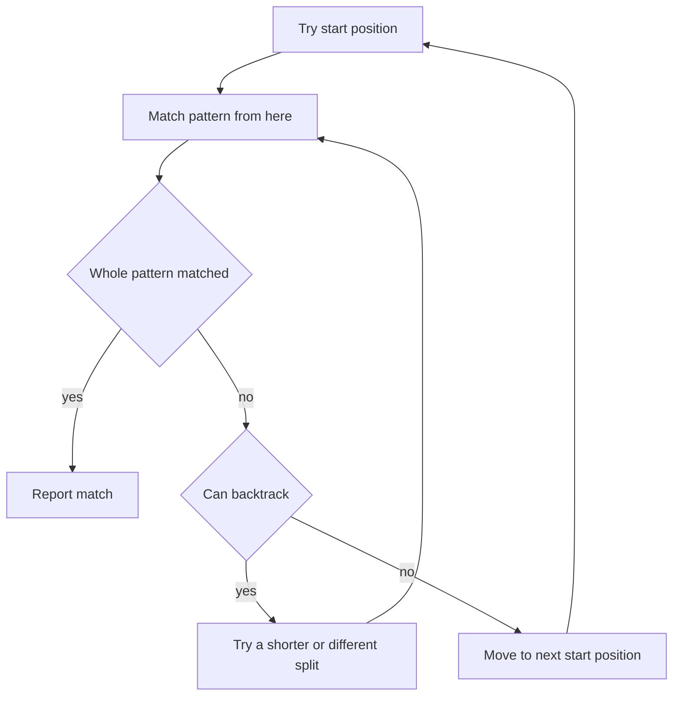

# Regular Expressions

A regular expression is a compact pattern that describes a set of strings. Developers use regular expressions for validation, searching logs, extracting fields, and rewriting text. Interviewers ask about them to check that you know the syntax, can escape correctly inside Java string literals, and understand the performance traps.

!!! note "In simple words"
    A regular expression is a short description of text, such as "three letters, a dash, then four digits". You give it to a tool that finds, checks, or changes every piece of text that matches the description.

## Why it matters

Text processing is everywhere in backend work: parsing log lines, validating input, pulling IDs out of messages, and rewriting templates. A correct pattern saves a lot of string-handling code. A badly written one can freeze a server, because some patterns take exponential time on unlucky input. Knowing both sides is what interviewers look for.

## How it works

### Character classes

A character class matches one character drawn from a set.

| Pattern | Matches |
|---------|---------|
| `.` | any character except a line terminator, unless the DOTALL flag is set |
| `\w`, `\d`, `\s` | a word character (letter, digit, or underscore), a digit, or a whitespace character |
| `\W`, `\D`, `\S` | the opposite of the three above |
| `[abc]` | `a`, `b`, or `c` |
| `[^abc]` | any character except `a`, `b`, or `c` |
| `[a-g]` | any character from `a` to `g` |

In Java, `\w` and `\d` match only ASCII characters by default. Use the `UNICODE_CHARACTER_CLASS` flag when you need Unicode-aware classes.

### Anchors and boundaries

Anchors match a position rather than a character.

- `^` matches the start of the input and `$` the end. With the `MULTILINE` flag they match at each line boundary.
- `\b` matches a word boundary, and `\B` matches a position that is not a boundary.

`^abc$` matches only the complete string `abc`. `\bcat\b` matches `cat` in "a cat sat" but not in "concatenate".

### Escaping

Characters with special meaning, such as `.`, `*`, `+`, `?`, `(`, `)`, `[`, `{`, `\`, `^`, `$`, and `|`, are escaped with a backslash to match them literally. Control characters are written as `\t`, `\n`, and `\r`.

In Java source, every backslash in the pattern must also be escaped inside the string literal. The pattern `\d+` is written `"\\d+"`.

### Groups and backreferences

- `(abc)` is a capturing group. Its match is available by number.
- `(?<name>abc)` is a named capturing group. Java lets you read it by name.
- `(?:abc)` is a non-capturing group. It groups without storing the match.
- `\1` refers back to what group 1 matched. `(\w)\1` finds a doubled letter such as "ll".

### Lookaround

Lookaround checks the text before or after a position without consuming it.

- `(?=abc)` is a positive lookahead: the text ahead must match `abc`.
- `(?!abc)` is a negative lookahead: the text ahead must not match `abc`.
- `(?<=abc)` and `(?<!abc)` are the lookbehind equivalents. Java supports lookbehind only with a bounded length.

A common use is checking several independent conditions at once. The pattern `(?=.*\d)(?=.*[a-z]).{8,}` requires at least eight characters, one digit, and one lowercase letter.

### Quantifiers

| Pattern | Meaning |
|---------|---------|
| `a*` | zero or more |
| `a+` | one or more |
| `a?` | zero or one |
| `a{5}` | exactly five |
| `a{2,}` | two or more |
| `a{1,3}` | one to three |

Quantifiers are **greedy** by default. They take as much as they can and give back only when the rest of the pattern needs it. Adding `?` makes a quantifier **lazy**, so it matches as little as possible. The pattern `<.+>` on `<a><b>` matches the whole string, while `<.+?>` matches only `<a>`.

### Alternation

`|` matches either side. `cat|dog` matches either word. Alternation has the lowest precedence, so `^cat|dog$` means "starts with cat, or ends with dog". Use a group to limit its scope: `^(cat|dog)$`.

### How the engine matches

The engine tries each start position from left to right. For each quantified part it tries the greedy option first. If the rest of the pattern fails, it backtracks and tries a shorter match.



Most everyday patterns finish quickly. Nested quantifiers over the same characters can make the number of attempts explode. That is catastrophic backtracking, covered below.

### Using regex in Java

The `java.util.regex` package has two main classes:

- `Pattern` holds a compiled regular expression. Compile it once and reuse it, because compiling has a cost.
- `Matcher` runs a pattern against a particular input.

The example below compiles with Java 21 and needs no dependencies:

```java
import java.util.regex.Matcher;
import java.util.regex.Pattern;

public class RegexDemo {
    private static final Pattern ORDER_ID = Pattern.compile("ORD-(?<year>\\d{4})-([A-Z]{2})");

    public static void main(String[] args) {
        String text = "Shipped ORD-2024-AB and ORD-1999-CD";

        Matcher matcher = ORDER_ID.matcher(text);
        while (matcher.find()) {
            System.out.println(matcher.group(0) + " year=" + matcher.group("year"));
        }

        System.out.println("2024".matches("\\d{4}"));       // true: the whole input must match
        System.out.println("x2024".matches("\\d{4}"));      // false
        System.out.println("a1b2".replaceAll("\\d", "#"));  // a#b#
    }
}
```

Key distinctions:

- `matches()` requires the whole input to match. `find()` looks for the pattern anywhere in the input.
- `String.matches`, `replaceAll`, and `split` compile a new `Pattern` on each call. That is fine for one-off use. Inside a loop, keep a precompiled `Pattern`.
- `String.split` takes a regex. `"a.b".split(".")` returns an empty array, because an unescaped `.` matches every character. Use `split("\\.")` instead.

### Common patterns

These are starting points for understanding. They are not production validators.

```java
import java.util.regex.Pattern;

class Patterns {

    // Simple email shape: not a full RFC 5322 check.
    static final Pattern EMAIL = Pattern.compile("^[\\w.+-]+@[\\w-]+\\.[\\w.-]+$");

    // Digits only, with an optional leading plus and spaces or dashes between groups.
    static final Pattern PHONE = Pattern.compile("^\\+?\\d[\\d\\- ]{6,14}\\d$");

    // Scheme and host of an http or https URL.
    static final Pattern URL = Pattern.compile("^https?://[^\\s/]+(/\\S*)?$");
}
```

For real validation of email addresses or URLs, use the platform parser, such as `java.net.URI`, or a dedicated library. Keep regular expressions for coarse checks such as "looks like an ID".

### Common pitfalls and their fixes

- **Catastrophic backtracking.** A pattern such as `(a+)+$` applied to `"aaaaaaaaaaaaaaaaaaaaaaaa!"` takes exponential time, because the engine tries every way to split the `a` characters before it fails. Avoid nested quantifiers over the same characters, and bound repetition with `{m,n}`.
- **Forgetting double escaping in Java.** `"\d"` does not compile. `"\\d"` is correct.
- **Assuming `.` matches newlines.** It does not, unless DOTALL is set.
- **Using `find()` where `matches()` was meant.** A validation with `find()` accepts input that merely contains a valid part.
- **Greedy matches that swallow too much.** Use a lazy quantifier or a negated class. `"[^\"]*"` is more precise than `".*"` for quoted strings.
- **Using a regex to parse nested structures.** HTML, JSON, and nested brackets need a real parser.
- **Recompiling in a loop.** Store the `Pattern` in a `static final` field.

## Where it is used

- Log processing, to extract timestamps, levels, and request IDs.
- Input validation at the edges of a system, as a first coarse filter.
- Search features, such as wildcard or pattern matching in a file or database query tool.
- Build and deployment scripts that rewrite configuration files.
- Routing rules in web frameworks, where path templates are compiled to patterns.

## Benefits

- A single pattern can express a rule that would take many lines of string code.
- Patterns are portable across many languages, although the dialects differ.
- A compiled `Pattern` is fast to reuse, and `Matcher` gives group access for extraction.
- Named groups make extracted fields readable.

## Cons and limits

- Dense patterns are hard to read and review. A comment or a named group helps.
- Regular expressions cannot match arbitrarily nested structures.
- Backtracking can run for a very long time on crafted input, which makes regex a denial-of-service risk.
- Dialects differ. Java, JavaScript, and Python do not agree on every feature, such as lookbehind length.
- Validation patterns for email and URLs are never complete, and they give false comfort.

## Best practices

- Compile reusable patterns once in a `static final` field.
- Prefer `matches()` for full validation and `find()` for search.
- Use named groups for extraction and comment anything non-obvious.
- Bound repetitions with `{m,n}` and avoid nested quantifiers.
- Test patterns with hostile input, such as long runs of one character followed by a mismatch.
- Use a real parser for structured formats such as JSON, XML, or HTML.

!!! tip "Interview tip"
    **Q: Why does `"a.b".split(".")` return an empty array?**
    `split` takes a regex, and an unescaped `.` matches any character. Every character is a delimiter, so all the pieces are empty, and trailing empty strings are removed. Escape the dot: `split("\\.")`.

## Quick recap

- Character classes match one character; anchors match positions.
- Groups capture; `(?:...)` groups without capturing; lookarounds test context without consuming text.
- Quantifiers are greedy by default, and a trailing `?` makes them lazy.
- In Java, escape each backslash in the string literal and compile reusable patterns once.
- `matches()` checks the whole input, and `find()` searches for a match inside it.
- Nested quantifiers can cause catastrophic backtracking.

## Official documentation

- [java.util.regex package summary (JDK 21)](https://docs.oracle.com/en/java/javase/21/docs/api/java.base/java/util/regex/package-summary.html)
- [JDK 21 API documentation](https://docs.oracle.com/en/java/javase/21/docs/api/index.html)
- [dev.java](https://dev.java/)

**See also:** [Web Fundamentals](web-fundamentals.md), [Software Design Principles](software-design-principles.md), [Secure Coding and Supply Chain](../10-security/secure-coding-and-supply-chain.md)
