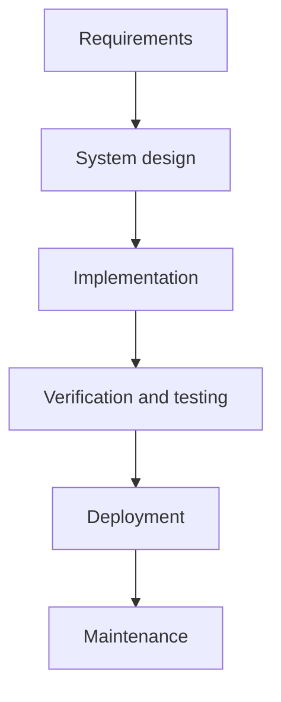
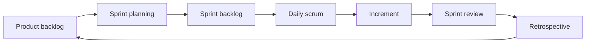
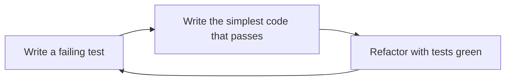
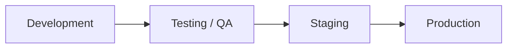

# SDLC and Software Development Methodologies

The software development life cycle (SDLC) describes how an idea becomes running software and how it is kept running. Interviewers ask about it to see whether you can explain why a team picks Waterfall or Agile, how work moves through environments, and how a version number tells consumers what changed.

## Core concepts

### Waterfall

Waterfall is a linear model. Each phase finishes before the next one starts, and the output of one phase is the input of the next.



The model works best when requirements are stable and well understood, as in many regulated or safety-critical projects. Its weakness is cost of change: once a phase is signed off, going back means reworking several phases, so feedback from users arrives late.

### Agile

Agile is a family of approaches built on the principles in the Agile Manifesto (2001). Its four value statements favour individuals and interactions, working software, customer collaboration, and responding to change over rigid process, exhaustive documentation, contract negotiation, and following a fixed plan. The items on the right still have value; Agile ranks the left-hand items higher.

Common traits of Agile teams:

- **Iterative delivery.** Work is split into short iterations, usually one to four weeks, and each one produces an increment that could be shipped.
- **Continuous feedback.** Stakeholders see working software often, so problems surface early.
- **Cross-functional teams.** Developers, testers, and designers work together and share ownership of quality.
- **Quality built in.** Automated tests, continuous integration, and test-driven development are normal practice.
- **Adaptive planning.** The backlog is re-prioritised as the team learns.

### Scrum

Scrum is the most widely used Agile framework. It defines three roles, three artifacts, and a fixed set of events.

| Element | Items |
|---------|-------|
| Roles | Scrum Master (guides the process and removes blockers), Product Owner (owns and orders the product backlog), Developers (self-organising team that builds the increment) |
| Artifacts | Product backlog, sprint backlog, increment |
| Events | Sprint (time box of two to four weeks), sprint planning, daily scrum (about 15 minutes), sprint review (demo to stakeholders), sprint retrospective (process improvement) |



Scrum rests on three pillars: transparency, inspection, and adaptation. A common interview follow-up is the difference between the sprint review (is the product right?) and the retrospective (is the way we work right?).

### Kanban

Kanban is a lean method for managing flow. Work items are cards on a board whose columns are workflow states such as Ready, Building, Testing, and Shipped. Its defining rules are:

1. **Visualise the work** on a board.
2. **Limit work in progress (WIP)** per column so that people finish things before starting new ones.
3. **Pull work** when there is capacity instead of pushing it onto people.
4. **Improve continuously** by finding bottlenecks in the flow.

Flow metrics are the main tool:

- **Lead time**: from the moment a request is made to delivery.
- **Cycle time**: from the moment work starts to delivery.
- **Throughput**: items finished per unit of time.

Kanban has no fixed iterations, which makes it a good fit for support teams and ongoing maintenance work.

### BDD and TDD

Both are development practices that put a test before the code. They differ in who takes part and what the test describes.

**Test-driven development (TDD)** is a developer practice focused on units of code. The cycle is red, green, refactor:



```java
import static org.junit.jupiter.api.Assertions.assertEquals;

import org.junit.jupiter.api.Test;

class StringUtils {
    static String reverse(String input) {
        return new StringBuilder(input).reverse().toString();
    }
}

class StringUtilsTest {
    @Test
    void reversesText() {
        // Written first; it fails until reverse() exists and works.
        assertEquals("cba", StringUtils.reverse("abc"));
    }
}
```

**Behaviour-driven development (BDD)** is a team practice. Developers, testers, and business stakeholders agree on behaviour written as plain-language scenarios, usually in a Given/When/Then form. Those scenarios become executable specifications, and tools such as Cucumber and JBehave run them. The focus is on what the system should do for a user, not on how one class is built.

| Aspect | TDD | BDD |
|--------|-----|-----|
| Main audience | Developers | Developers, testers, business |
| Starting point | A unit test | A scenario |
| Language | Programming language | Plain language |
| Focus | Correct implementation of units | Correct system behaviour |

### Semantic versioning

Semantic Versioning (SemVer) gives a version number the form `MAJOR.MINOR.PATCH`:

- Increase **MAJOR** for incompatible API changes.
- Increase **MINOR** for new functionality that stays backward compatible.
- Increase **PATCH** for backward-compatible bug fixes.

Pre-release labels are appended with a hyphen, for example `1.0.0-alpha.1` followed by `1.0.0-alpha.2`. Identifiers use letters, digits, and hyphens, and numeric identifiers must not have leading zeros. Build metadata after a plus sign, such as `1.0.0+build.7`, does not affect precedence.

Points that are often misremembered:

- A major version of zero (`0.y.z`) signals initial development. Anything may change at any time, so the public API is not yet stable.
- Version `1.0.0` defines the first stable public API. Starting at `0.1.0` is common practice but not required by the spec.
- A MINOR bump after a breaking change is a mistake. Breaking changes always require a MAJOR bump.

### Deployment models

Where software runs is a separate decision from how it is built. The main options are:

| Model | What it means | Trade-offs |
|-------|---------------|------------|
| On-premise | Software runs on servers the company owns | Full control and compliance; high cost and limited elasticity |
| Platform as a Service (PaaS) | You deploy code to a managed platform (for example Heroku, AWS Elastic Beanstalk, Google App Engine) | Little infrastructure work; less control and possible lock-in |
| Infrastructure as a Service (IaaS) | You rent virtual machines, storage, and networks (for example EC2, Compute Engine, Azure VMs) | Flexible and pay-as-you-go; you manage the OS and configuration |
| Software as a Service (SaaS) | You use a hosted application (for example a CRM or office suite) | No operations work; little customisation, and data sits with the vendor |
| Hybrid or multi-cloud | Mix of on-premise and one or more clouds | Resilience and flexibility; complex to operate |
| Serverless | Functions run on demand (for example AWS Lambda) | Scales to zero and bills per execution; cold starts and runtime limits |
| Containers on Kubernetes | Containers orchestrated by Kubernetes | Portable and scalable; steep learning curve |

### SDLC environments

Code normally moves through a chain of environments before reaching users:



- **Development**: developers write and test locally. Data can be reset at will, and the environment changes often.
- **Testing / QA**: automated unit, integration, and end-to-end tests run against stable builds. Data should be sanitised so that no personal data leaks into test systems.
- **Staging**: a production-like copy used for final checks such as blue-green or canary rehearsals, load tests, and disaster-recovery drills.
- **Production**: real users and real data. Priorities are availability, monitoring, log aggregation, rollback, and backups.

The closer an environment is to production, the more it should match production's configuration, data shape, and access controls.

## How it works / Step by step

A typical change under a Scrum team with CI moves like this:

1. The product owner ranks a story in the product backlog.
2. The team pulls it into a sprint and writes a failing test (TDD) or a scenario (BDD).
3. The developer implements, refactors, and opens a pull request.
4. CI runs the build and tests; a reviewer approves the change.
5. The artifact is promoted through QA and staging to production.
6. The sprint review shows the result and the retrospective records what to change.

## Common pitfalls

- Treating Scrum and Agile as the same thing. Agile is a set of values; Scrum is one framework that implements them.
- Running a sprint with no shippable increment, which turns the sprint into a plan with no feedback.
- Using a WIP limit so loose that it has no effect on flow.
- Confusing BDD scenarios with unit tests. Scenarios describe behaviour for the business; unit tests describe the internals of a class.
- Bumping a MINOR version for a breaking API change.
- Letting staging drift from production configuration, so tests pass in one place and fail in the other.

!!! tip "Interview tip"
    **Q: When would you choose Waterfall over Agile?**
    When requirements are fixed, compliance needs a documented sign-off per phase, and the cost of late change is very high. Otherwise, short iterations with frequent feedback usually reduce risk.

## Quick recap

- Waterfall is sequential; Agile delivers in short iterations with feedback.
- Scrum defines roles, artifacts, and events; Kanban limits WIP and pulls work.
- TDD writes the test first at unit level; BDD writes shared behaviour scenarios.
- SemVer: MAJOR for breaking changes, MINOR for compatible features, PATCH for fixes.
- Code moves Dev, QA, Staging, Production; each step should look more like production.
- Deployment models range from on-premise control to serverless convenience.

**See also:** [Software Design Principles](software-design-principles.md), [Testing and QA](testing-and-qa.md), [Git: Pull, Merge and Rebase](../17-cicd/git-pull-merge-rebase.md)
