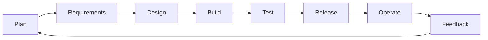
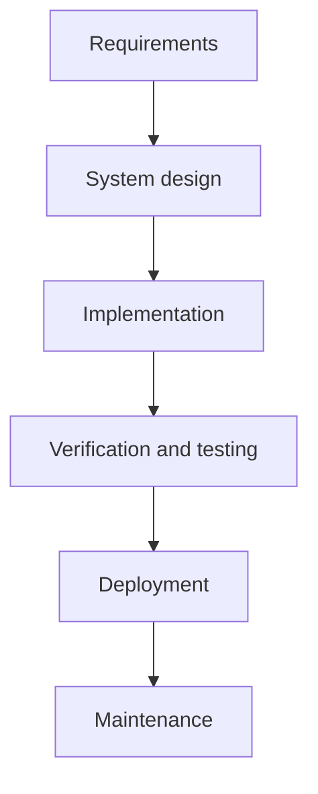
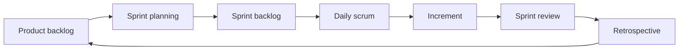
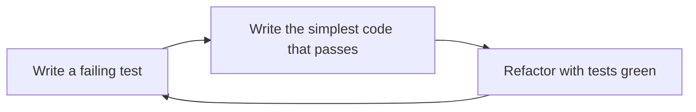
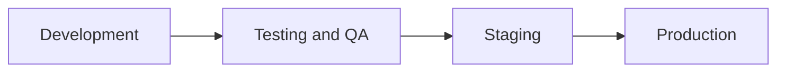

# SDLC and Software Development Methodologies

The software development life cycle (SDLC) describes how an idea becomes running software and how that software is kept running. Interviewers ask about it to see whether you can explain why a team picks Waterfall or Agile, how work moves through environments, and how a version number tells consumers what changed.

!!! note "In simple words"
    The SDLC is the path from "someone needs this" to "it runs for users and keeps working". A methodology is the set of habits a team uses to walk that path, such as short sprints or a visible board of work.

## Why it matters

Software takes many people, several environments, and a long life after release. Without a shared process, requirements drift, releases surprise people, and nobody knows which version is in production. A clear life cycle makes work visible, gives each stage a purpose, and puts checks where mistakes are cheapest to catch.

## How it works

### The software development life cycle

Every methodology moves through the same broad phases. The difference is how often the team loops back and how much it plans up front.



- **Plan**: decide what problem is worth solving and how much it may cost.
- **Requirements**: capture what the system must do, and the limits it must respect.
- **Design**: choose the structure, data model, interfaces, and technology.
- **Build**: write code, review it, and merge it.
- **Test**: check behaviour at unit, integration, system, and acceptance levels.
- **Release**: package and deploy the artefact through the environments.
- **Operate**: monitor, support, and fix the running system.
- **Feedback**: use metrics and user input to decide what to change next.

### Waterfall

Waterfall is a linear model. Each phase finishes before the next starts, and the output of one phase is the input of the next.



Waterfall works best when requirements are stable and well understood, as in many regulated or safety-critical projects. Its weakness is the cost of change. Once a phase is signed off, going back means reworking several phases, and users see the product only near the end.

### Agile

Agile is a family of approaches based on the Agile Manifesto (2001). The manifesto ranks individuals and interactions, working software, customer collaboration, and responding to change above process tools, comprehensive documentation, contract negotiation, and following a fixed plan. The items on the right still have value, but the left side comes first.

Common traits of Agile teams:

- **Iterative delivery.** Work is split into short iterations, often one to four weeks. Each one produces an increment that could be shipped.
- **Continuous feedback.** Stakeholders see working software often, so problems surface early.
- **Cross-functional teams.** Developers, testers, and designers work together and share ownership of quality.
- **Quality built in.** Automated tests, continuous integration, and test-driven development are normal practice.
- **Adaptive planning.** The backlog is reordered as the team learns.

### Scrum

Scrum is the most widely used Agile framework. It defines three roles, three artefacts, and a fixed set of events.

| Element | Items |
|---------|-------|
| Roles | Scrum Master, who coaches the process and removes blockers; Product Owner, who owns and orders the product backlog; Developers, a self-organising team that builds the increment |
| Artefacts | Product backlog, sprint backlog, increment |
| Events | Sprint, a time box of at most one month that is often two to four weeks; sprint planning; daily scrum of about 15 minutes; sprint review, a demo to stakeholders; sprint retrospective, a review of how the team works |



Scrum rests on three pillars: transparency, inspection, and adaptation. A common follow-up question is the difference between the sprint review, which asks whether the product is right, and the retrospective, which asks whether the way of working is right.

### Kanban

Kanban is a lean method for managing flow. Work items are cards on a board, and the columns are workflow states such as Ready, Building, Testing, and Shipped. Its core rules are:

1. **Visualise the work** on a board.
2. **Limit work in progress (WIP)** in each column, so people finish things before starting new ones.
3. **Pull work** when there is capacity, instead of pushing it onto people.
4. **Improve continuously** by finding the bottlenecks in the flow.

Flow metrics are the main tool:

- **Lead time**: from the moment a request is made to its delivery.
- **Cycle time**: from the moment work starts to its delivery.
- **Throughput**: the number of items finished per unit of time.

Kanban has no fixed iterations, which suits support teams and ongoing maintenance work.

### BDD and TDD

Both are development practices that put a test before the code. They differ in who takes part and what the test describes.

**Test-driven development (TDD)** is a developer practice aimed at units of code. The cycle is red, green, refactor:



A small Java 21 example compiles once JUnit 5 is on the test classpath. The test comes first. Before `StringUtils.reverse` exists, the test does not compile. Once the simplest method is written, the test passes.

```java
import static org.junit.jupiter.api.Assertions.assertEquals;

import org.junit.jupiter.api.Test;

class StringUtilsTest {
    @Test
    void reversesText() {
        assertEquals("cba", StringUtils.reverse("abc"));
    }
}

class StringUtils {
    static String reverse(String input) {
        return new StringBuilder(input).reverse().toString();
    }
}
```

**Behaviour-driven development (BDD)** is a team practice. Developers, testers, and business stakeholders agree on behaviour written as plain-language scenarios, usually in a Given, When, Then form. Tools such as Cucumber and JBehave run those scenarios as executable specifications. The focus is on what the system does for a user, not on how one class is built.

| Aspect | TDD | BDD |
|--------|-----|-----|
| Main audience | Developers | Developers, testers, business |
| Starting point | A unit test | A scenario |
| Language | Programming language | Plain language |
| Focus | Correct implementation of units | Correct system behaviour |

### Semantic versioning

Semantic Versioning (SemVer) gives a version the form `MAJOR.MINOR.PATCH`:

- Increase **MAJOR** for incompatible API changes.
- Increase **MINOR** for new functionality that stays backward compatible.
- Increase **PATCH** for backward-compatible bug fixes.

A pre-release label follows a hyphen, for example `1.0.0-alpha.1` then `1.0.0-alpha.2`. Identifiers use letters, digits, and hyphens, and numeric identifiers must not have leading zeros. Build metadata after a plus sign, such as `1.0.0+build.7`, does not affect precedence.

Points that are often misremembered:

- A major version of zero (`0.y.z`) signals initial development. Anything may change, so the public API is not yet stable.
- Version `1.0.0` defines the first stable public API. Starting at `0.1.0` is common practice, but the spec does not require it.
- A MINOR bump after a breaking change is a mistake. Breaking changes always require a MAJOR bump.

### Deployment models

Where software runs is a separate decision from how it is built. The main options are:

| Model | What it means | Trade-offs |
|-------|---------------|------------|
| On-premise | Software runs on servers the company owns | Full control and compliance; high cost and limited elasticity |
| Platform as a Service (PaaS) | Code is deployed to a managed platform, such as Heroku, AWS Elastic Beanstalk, or Google App Engine | Little infrastructure work; less control and possible lock-in |
| Infrastructure as a Service (IaaS) | Virtual machines, storage, and networks are rented, such as EC2, Compute Engine, or Azure VMs | Flexible and pay-as-you-go; the team manages the OS and configuration |
| Software as a Service (SaaS) | A hosted application is used, such as a CRM or office suite | No operations work; little customisation, and the vendor holds the data |
| Hybrid or multi-cloud | A mix of on-premise and one or more clouds | Resilience and flexibility; complex to operate |
| Serverless | Functions run on demand, such as AWS Lambda | Scales to zero and bills per execution; cold starts and runtime limits |
| Containers on Kubernetes | Containers orchestrated by Kubernetes | Portable and scalable; steep learning curve |

### Environments

Code normally moves through a chain of environments before it reaches users:



- **Development**: developers write and test locally. Data can be reset freely, and the environment changes often.
- **Testing and QA**: automated unit, integration, and end-to-end tests run against stable builds. Test data should be sanitised so that no personal data leaks into test systems.
- **Staging**: a production-like copy used for final checks, such as blue-green or canary rehearsals, load tests, and disaster-recovery drills.
- **Production**: real users and real data. The priorities are availability, monitoring, log aggregation, rollback, and backups.

The closer an environment is to production, the more it should match production's configuration, data shape, and access controls.

### Step by step

A typical change under a Scrum team with continuous integration:

1. The product owner ranks a story at the top of the product backlog.
2. The team pulls the story into a sprint and writes a failing test (TDD) or a scenario (BDD).
3. The developer implements, refactors, and opens a pull request.
4. CI runs the build and the tests, and a reviewer approves the change.
5. The artefact is promoted through QA and staging to production.
6. The sprint review shows the result, and the retrospective records what to change.

## Where it is used

- Regulated industries, such as banking and medical devices, often use phase-gated delivery with documented sign-off.
- Product teams in technology companies run Scrum or Kanban with continuous delivery.
- Operations and support teams use Kanban boards to manage incoming requests.
- Public libraries use SemVer so that consumers know when an upgrade may break their code.

## Benefits

- A shared life cycle makes work visible and gives each stage a clear exit condition.
- Short iterations surface wrong assumptions early, when they are cheap to fix.
- Environments that mirror production reduce surprises at release time.
- SemVer gives consumers a contract they can read from the version number alone.
- Methods can be mixed. A team can use Scrum for planning and Kanban for flow.

## Cons and limits

- Waterfall delays feedback and makes late changes expensive.
- Agile can drift into constant change with no shippable result if the team has no discipline.
- Heavy process can slow small teams. Ceremonies should earn their time.
- Environments drift apart over time, so a test that passes in staging may fail in production.
- SemVer depends on honest version bumps. A wrong label breaks consumers silently.

## Best practices

- Treat Scrum and Agile as different things. Agile is a set of values, and Scrum is one framework that implements them.
- Make sure every sprint ends with a shippable increment, otherwise the sprint gives no real feedback.
- Set a WIP limit that actually changes behaviour. A limit that is never reached does nothing for flow.
- Keep BDD scenarios for behaviour and unit tests for the internals of a class. Do not swap their roles.
- Bump MINOR for compatible features and MAJOR for breaking changes, and document the change in release notes.
- Keep staging close to production in configuration, data shape, and access controls.

!!! tip "Interview tip"
    **Q: When would you choose Waterfall over Agile?**
    When requirements are fixed, compliance needs a documented sign-off per phase, and the cost of late change is very high. Otherwise, short iterations with frequent feedback usually reduce risk.

## Quick recap

- The SDLC runs plan, requirements, design, build, test, release, operate, and feedback, and feedback feeds the next cycle.
- Waterfall is sequential; Agile delivers in short iterations with feedback.
- Scrum defines roles, artefacts, and events. Kanban limits WIP and pulls work.
- TDD writes the test first at unit level; BDD writes shared behaviour scenarios.
- SemVer: MAJOR for breaking changes, MINOR for compatible features, PATCH for fixes.
- Code moves through Dev, QA, staging, and production, and each step should look more like production.
- Deployment models range from on-premise control to serverless convenience.

## Official documentation

- [Agile Manifesto](https://agilemanifesto.org/)
- [The Scrum Guide](https://scrumguides.org/)
- [Semantic Versioning 2.0.0](https://semver.org/)
- [Git documentation](https://git-scm.com/doc)

**See also:** [Software Design Principles](software-design-principles.md), [Testing and QA](testing-and-qa.md), [Git: Pull, Merge and Rebase](../17-cicd/git-pull-merge-rebase.md)
