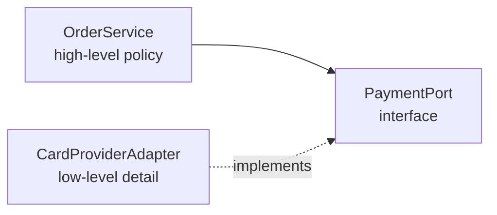

# Software Design Principles

Design principles are guidelines for keeping code easy to change, test, and reason about. Interviewers use SOLID as a shared vocabulary, and they often probe paradigms to see whether you know when object-oriented, functional, or declarative styles fit a problem.

## Core concepts

### SOLID

SOLID is an acronym for five object-oriented design principles. The letters were gathered into the acronym by Michael Feathers, and the principles themselves were popularised by Robert C. Martin ("Uncle Bob"). None of them is a law; each one names a tension that good designs usually resolve in a particular direction.

| Letter | Principle | One-line test |
|--------|-----------|---------------|
| S | Single Responsibility | Does the class have one reason to change? |
| O | Open/Closed | Can new behaviour be added without editing existing code? |
| L | Liskov Substitution | Can a subtype stand in for its parent without surprising callers? |
| I | Interface Segregation | Do clients depend only on the methods they use? |
| D | Dependency Inversion | Do high-level policies depend on abstractions rather than details? |

### Single Responsibility Principle

A class with several responsibilities changes for several reasons. A change made for one reason can break behaviour that another part relied on. Separating the responsibilities isolates that risk.

```java
// Responsibility 1: business rule for an invoice total
class Invoice {
    private final double[] lineAmounts;

    Invoice(double... lineAmounts) {
        this.lineAmounts = lineAmounts;
    }

    double total() {
        double sum = 0;
        for (double amount : lineAmounts) {
            sum += amount;
        }
        return sum;
    }
}

// Responsibility 2: presentation. Changes when the output format changes.
class InvoiceFormatter {
    String format(Invoice invoice) {
        return String.format("Total: %.2f", invoice.total());
    }
}
```

### Open/Closed Principle

Code should be extended through new implementations rather than edited each time a case is added. An abstraction plus new classes keeps the existing, tested code untouched.

```java
interface DiscountPolicy {
    double apply(double price);
}

class NoDiscount implements DiscountPolicy {
    public double apply(double price) {
        return price;
    }
}

class SeasonalDiscount implements DiscountPolicy {
    public double apply(double price) {
        return price * 0.9;
    }
}

class Checkout {
    // Adding a new policy means a new class, not a new branch in this method.
    double finalPrice(double price, DiscountPolicy policy) {
        return policy.apply(price);
    }
}
```

### Liskov Substitution Principle

If `S` is a subtype of `T`, code written against `T` must keep working when given an `S`. A subclass that throws on an inherited method, or quietly ignores a contract, breaks that promise even if the compiler accepts it.

The classic counter-example is a square that extends a rectangle. Setting the width of a square also changes its height, so code that assumes width and height are independent gets the wrong area.

```java
class Rectangle {
    protected int width;
    protected int height;

    void setWidth(int width) { this.width = width; }
    void setHeight(int height) { this.height = height; }
    int area() { return width * height; }
}

// Violates LSP: it changes the meaning of setWidth and setHeight.
class Square extends Rectangle {
    @Override
    void setWidth(int width) { this.width = width; this.height = width; }

    @Override
    void setHeight(int height) { this.width = height; this.height = height; }
}
```

A better design makes `Shape` the abstraction with an `area()` method and gives each shape its own fields.

### Interface Segregation Principle

Large interfaces force implementers to supply methods they do not need. Splitting the interface lets each client depend on exactly what it uses.

```java
// Too broad: a basic printer would have to implement scan() and fax().
interface MultiFunctionDevice {
    void print(String document);
    void scan(String document);
    void fax(String document);
}

// Split into small roles.
interface Printer {
    void print(String document);
}

interface Scanner {
    void scan(String document);
}

class SimplePrinter implements Printer {
    @Override
    public void print(String document) {
        System.out.println("Printing: " + document);
    }
}
```

### Dependency Inversion Principle

High-level modules (code that expresses a business policy) should not depend on low-level modules (code that does the technical work). Both should depend on an abstraction, and the abstraction should not reveal implementation details.



```java
interface PaymentPort {
    boolean charge(String customerId, long amountInCents);
}

class OrderService {
    private final PaymentPort payments;

    // The service receives the abstraction; it never names a concrete provider.
    OrderService(PaymentPort payments) {
        this.payments = payments;
    }

    boolean placeOrder(String customerId, long amountInCents) {
        return payments.charge(customerId, amountInCents);
    }
}
```

This is the idea behind dependency injection and why tests can pass a fake `PaymentPort` in place of a real provider.

### Programming paradigms

A paradigm is a style of thinking about programs. Most modern languages, Java included, mix several.

**Imperative** programming describes how to reach a result, step by step, by changing state. Procedural and object-oriented code are both imperative. Order of statements matters, and state changes are visible.

**Declarative** programming describes what result is wanted and leaves the control flow to the runtime. Its main branches are:

- **Functional**: functions as values, avoidance of mutable state, composition of transformations.
- **Logic**: facts and rules, with the engine searching for answers (Prolog is the usual example).
- **Database / query**: SQL states the rows wanted, and the database planner chooses how to fetch them.

The same task in both styles:

```java
import java.util.List;

class Paradigms {
    // Imperative: spell out the loop and the running total.
    static int sumEvenImperative(List<Integer> numbers) {
        int total = 0;
        for (int n : numbers) {
            if (n % 2 == 0) {
                total += n;
            }
        }
        return total;
    }

    // Declarative: describe the filter and the reduction.
    static int sumEvenDeclarative(List<Integer> numbers) {
        return numbers.stream()
                .filter(n -> n % 2 == 0)
                .mapToInt(Integer::intValue)
                .sum();
    }
}
```

Declarative code is shorter and easier to parallelise, because the runtime is free to reorder independent work. It can be harder to debug, and it is less natural when the algorithm itself depends on step order.

### Other guidelines you will hear

- **DRY (Don't Repeat Yourself)**: each piece of knowledge should have one authoritative home. Duplicated logic drifts apart over time.
- **KISS (Keep It Simple)**: prefer the simplest design that meets today's requirements.
- **YAGNI (You Aren't Gonna Need It)**: do not build for speculative future needs.

These guidelines pull against each other. Removing duplication can create an abstraction nobody needs; keeping things simple can mean accepting some repetition. Judgement decides which one wins.

## How it works / Step by step

To apply the principles to a feature:

1. Name the responsibilities in the change and split any class that owns more than one.
2. Look at the code that will vary. Put the variation behind an interface so new cases are new classes.
3. Check each subtype or implementation against the base contract, including edge cases.
4. Keep interfaces small and focused on the caller's needs.
5. Pass dependencies in, so high-level code can be tested with fakes.
6. Revisit the design when a second case appears; do not generalise after one.

## Common pitfalls

- Creating interfaces for every class "for SOLID" when there is only one implementation and no need for a seam.
- Applying Open/Closed by adding flags and switch statements instead of new types.
- Using inheritance for code reuse when the subtype does not truly satisfy the parent's contract.
- Writing a "god" interface and then wondering why most implementations throw `UnsupportedOperationException`.
- Confusing dependency inversion with dependency injection. Inversion is about which way the dependency points; injection is one way to wire it.

!!! tip "Interview tip"
    **Q: How do SOLID and dependency injection relate?**
    Dependency Inversion says policy should depend on abstractions. Dependency injection is the mechanism that supplies a concrete implementation to that abstraction at construction time. Spring's container is one way to do it; constructor calls in `main` are another.

## Layered, hexagonal, and clean architecture

These three styles answer one question: which way do dependencies point? Layered architecture stacks presentation, business logic, and persistence, with each layer calling the one below. Hexagonal architecture (ports and adapters) puts the domain at the centre, defines ports (interfaces) that the core needs, and attaches adapters for HTTP, databases, and messaging. Clean architecture uses rings with a dependency rule: source code dependencies point only inward, towards entities and use cases.

| Style | Shape | Dependency direction | Good fit |
|---|---|---|---|
| Layered | Stacked layers | Downward, often down to persistence | Simple CRUD services |
| Hexagonal | Core with ports and adapters | Adapters depend on the core | Several inputs and outputs, testable rules |
| Clean | Concentric rings | Everything points inward | Large domains that must outlive frameworks |

The key idea behind hexagonal and clean is that persistence is an outside detail. The use case depends on an interface it owns, and an adapter implements it:

```java
import java.util.Optional;

record Order(String id) {}

interface OrderRepository {              // port, owned by the core
    Optional<Order> findById(String id);
    void save(Order order);
}

class PlaceOrderUseCase {                // depends only on the port
    private final OrderRepository orders;

    PlaceOrderUseCase(OrderRepository orders) {
        this.orders = orders;
    }

    void place(Order order) {
        orders.save(order);
    }
}
```

A JPA repository adapter would implement `OrderRepository` in the infrastructure package, so the use case can be tested with a simple in-memory fake.

!!! tip "Interview tip"
    **Q: What is the difference between layered, hexagonal, and clean architecture?**
    Layered is organised by technical role and is simple, but business code often ends up depending on persistence. Hexagonal and clean invert the dependency for outside systems, so the domain has no framework imports. They differ mostly in vocabulary: hexagonal talks about ports and adapters, clean names concentric rings and a use case layer. Choose the simplest style that keeps the domain testable.

## Quick recap

- SOLID covers single responsibility, open/closed, Liskov substitution, interface segregation, and dependency inversion.
- Liskov breaks when a subtype changes the contract its parent promised.
- Interface segregation prefers several small interfaces over one broad one.
- Dependency inversion points high-level code at an abstraction it owns.
- Imperative code says how; declarative code says what. Java supports both.
- DRY, KISS, and YAGNI are useful guidelines that can conflict.

**See also:** [SDLC and Methodologies](sdlc-methodologies.md), [Testing and QA](testing-and-qa.md), [Annotations and Reflection](../03c-tooling-utilities/annotations-and-reflection.md)
