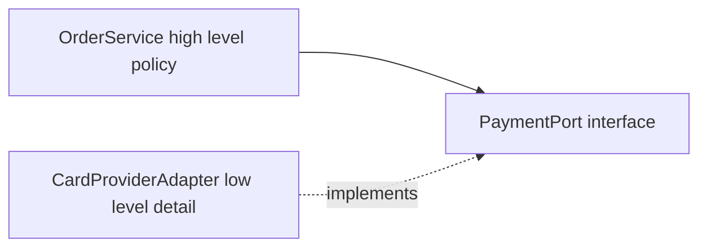
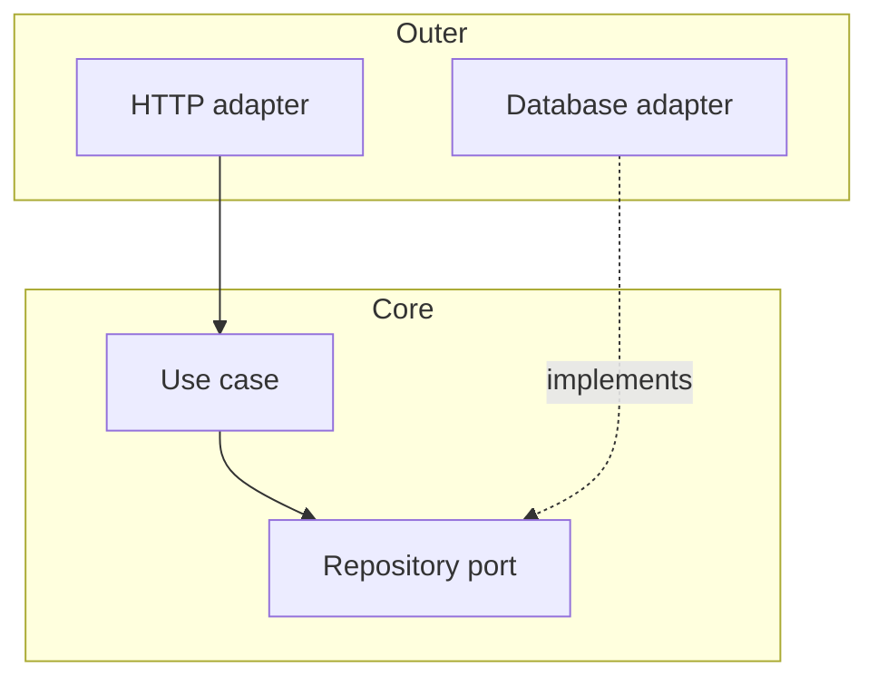

# Software Design Principles

Design principles are guidelines for keeping code easy to change, test, and reason about. Interviewers use SOLID as a shared vocabulary, and they often probe programming paradigms and architecture styles to see whether you know when a given style fits a problem.

!!! note "In simple words"
    Good design keeps each piece of code doing one job, lets new behaviour arrive as new code instead of edits to old code, and makes the core business rules independent of frameworks and databases.

## Why it matters

Most of the cost of software comes after the first release, when people change it under pressure. Code with clear responsibilities and clean boundaries is cheaper to change and easier to test. Code that mixes business rules, database calls, and HTTP handling forces every change to touch everything. Principles give a team words for these problems and a way to spot them early.

## How it works

### SOLID

SOLID is an acronym for five object-oriented design principles. The acronym was coined by Michael Feathers, and Robert C. Martin ("Uncle Bob") popularised the principles. None of them is a law. Each names a tension, and good designs usually resolve it in a particular direction.

| Letter | Principle | One-line test |
|--------|-----------|---------------|
| S | Single Responsibility | Does the class have one reason to change? |
| O | Open/Closed | Can new behaviour be added without editing existing code? |
| L | Liskov Substitution | Can a subtype stand in for its parent without surprising callers? |
| I | Interface Segregation | Do clients depend only on the methods they use? |
| D | Dependency Inversion | Do high-level policies depend on abstractions rather than details? |

### Single Responsibility Principle

A class with several responsibilities changes for several reasons. A change made for one reason can break behaviour another part relies on. Separating the responsibilities isolates that risk.

```java
// Responsibility 1: the business rule for an invoice total
class Invoice {
    private final double[] lineAmounts;

    Invoice(double... lineAmounts) {
        this.lineAmounts = lineAmounts;
    }

    double total() {
        double sum = 0;
        for (double amount : lineAmounts) {
            sum += amount;
        }
        return sum;
    }
}

// Responsibility 2: presentation. Changes when the output format changes.
class InvoiceFormatter {
    String format(Invoice invoice) {
        return String.format("Total: %.2f", invoice.total());
    }
}
```

SRP is about reasons to change, not about making classes tiny. A class with one clear job can still have many methods.

### Open/Closed Principle

Code should be extended through new implementations rather than edited each time a case is added. An abstraction plus new classes leaves the existing, tested code untouched.

```java
interface DiscountPolicy {
    double apply(double price);
}

class NoDiscount implements DiscountPolicy {
    public double apply(double price) {
        return price;
    }
}

class SeasonalDiscount implements DiscountPolicy {
    public double apply(double price) {
        return price * 0.9;
    }
}

class Checkout {
    // A new policy is a new class, not a new branch in this method.
    double finalPrice(double price, DiscountPolicy policy) {
        return policy.apply(price);
    }
}
```

### Liskov Substitution Principle

If `S` is a subtype of `T`, code written against `T` must keep working when it is given an `S`. A subclass that throws on an inherited method, or quietly breaks the parent's contract, breaks that promise even when the compiler accepts it.

The classic counter-example is a square that extends a rectangle. Setting the width of a square also changes its height, so code that assumes width and height are independent gets the wrong area.

```java
class Rectangle {
    protected int width;
    protected int height;

    void setWidth(int width) { this.width = width; }
    void setHeight(int height) { this.height = height; }
    int area() { return width * height; }
}

// Violates LSP: it changes the meaning of setWidth and setHeight.
class Square extends Rectangle {
    @Override
    void setWidth(int width) { this.width = width; this.height = width; }

    @Override
    void setHeight(int height) { this.width = height; this.height = height; }
}
```

A better design makes `Shape` the abstraction, with an `area()` method, and gives each shape its own fields.

### Interface Segregation Principle

Large interfaces force implementers to supply methods they do not need. Splitting the interface lets each client depend on exactly what it uses.

```java
// Too broad: a basic printer would have to implement scan() and fax().
interface MultiFunctionDevice {
    void print(String document);
    void scan(String document);
    void fax(String document);
}

// Split into small roles.
interface Printer {
    void print(String document);
}

interface DocumentScanner {
    void scan(String document);
}

class SimplePrinter implements Printer {
    @Override
    public void print(String document) {
        System.out.println("Printing: " + document);
    }
}
```

### Dependency Inversion Principle

High-level modules, which express business policy, should not depend on low-level modules, which do the technical work. Both should depend on an abstraction, and that abstraction should not reveal implementation details.



```java
interface PaymentPort {
    boolean charge(String customerId, long amountInCents);
}

class OrderService {
    private final PaymentPort payments;

    // The service receives the abstraction. It never names a concrete provider.
    OrderService(PaymentPort payments) {
        this.payments = payments;
    }

    boolean placeOrder(String customerId, long amountInCents) {
        return payments.charge(customerId, amountInCents);
    }
}
```

This is the idea behind dependency injection. It also explains why a test can pass a fake `PaymentPort` in place of a real provider.

### Programming paradigms

A paradigm is a style of thinking about programs. Most modern languages, Java included, mix several.

**Imperative** programming says how to reach a result, step by step, by changing state. Procedural and object-oriented code are both imperative. The order of statements matters, and state changes are visible.

**Declarative** programming says what result is wanted and leaves control flow to the runtime. Its main branches are:

- **Functional**: functions as values, avoidance of mutable state, and composition of transformations.
- **Logic**: facts and rules, with an engine that searches for answers. Prolog is the usual example.
- **Database and query**: SQL states which rows are wanted, and the database planner decides how to fetch them.

The same task in both styles:

```java
import java.util.List;

class Paradigms {
    // Imperative: spell out the loop and the running total.
    static int sumEvenImperative(List<Integer> numbers) {
        int total = 0;
        for (int n : numbers) {
            if (n % 2 == 0) {
                total += n;
            }
        }
        return total;
    }

    // Declarative: describe the filter and the reduction.
    static int sumEvenDeclarative(List<Integer> numbers) {
        return numbers.stream()
                .filter(n -> n % 2 == 0)
                .mapToInt(Integer::intValue)
                .sum();
    }
}
```

Declarative code is shorter and easier to parallelise, because the runtime can reorder independent work. It can be harder to debug, and it is less natural when the algorithm depends on the order of its steps.

### Other guidelines

- **DRY (Don't Repeat Yourself)**: each piece of knowledge should have one authoritative home. Duplicated logic drifts apart over time.
- **KISS (Keep It Simple)**: prefer the simplest design that meets today's requirements.
- **YAGNI (You Aren't Gonna Need It)**: do not build for speculative future needs.

These guidelines can pull against each other. Removing duplication can create an abstraction nobody needs, and keeping things simple can mean accepting some repetition. Judgement decides which one wins.

### Layered, hexagonal, and clean architecture

These three styles answer one question: which way do dependencies point?

- **Layered** architecture stacks presentation, business logic, and persistence. Each layer calls the one below it.
- **Hexagonal** architecture (ports and adapters) puts the domain at the centre. The core defines ports, which are interfaces it needs, and adapters for HTTP, databases, and messaging plug into those ports.
- **Clean** architecture uses concentric rings with one dependency rule: source code dependencies point only inward, towards entities and use cases.



| Style | Shape | Dependency direction | Good fit |
|---|---|---|---|
| Layered | Stacked layers | Downward, often down to persistence | Simple CRUD services |
| Hexagonal | Core with ports and adapters | Adapters depend on the core | Several inputs and outputs, testable rules |
| Clean | Concentric rings | Everything points inward | Large domains that must outlive frameworks |

The key idea in hexagonal and clean architecture is that persistence is an outside detail. The use case depends on an interface it owns, and an adapter implements that interface. The sample below compiles with Java 21 as a single file:

```java
import java.util.Optional;

record Order(String id) {}

interface OrderRepository {              // port, owned by the core
    Optional<Order> findById(String id);
    void save(Order order);
}

class PlaceOrderUseCase {                // depends only on the port
    private final OrderRepository orders;

    PlaceOrderUseCase(OrderRepository orders) {
        this.orders = orders;
    }

    void place(Order order) {
        orders.save(order);
    }
}
```

A JPA-based repository adapter would implement `OrderRepository` in the infrastructure package. The use case can be tested with a simple in-memory fake instead.

### Step by step

To apply the principles to a feature:

1. Name the responsibilities in the change, and split any class that owns more than one.
2. Find the code that will vary. Put the variation behind an interface, so new cases become new classes.
3. Check each subtype or implementation against the base contract, including edge cases.
4. Keep interfaces small and shaped by the caller's needs.
5. Pass dependencies in, so high-level code can be tested with fakes.
6. Revisit the design when a second case appears. Do not generalise after only one.

## Where it is used

- Service classes in Spring applications, where constructor injection supplies collaborators.
- Domain models in finance or logistics, where business rules must outlive a framework upgrade.
- Plug-in systems, where new payment methods or export formats arrive as new implementations.
- Code reviews, where SOLID gives reviewers a shared language for "this class does too much".

## Benefits

- Small classes with one reason to change are easier to read and review.
- Depending on abstractions makes testing with fakes simple.
- New behaviour arrives as new code, which lowers the risk of breaking tested behaviour.
- Clean boundaries let the core outlast frameworks and databases.
- The vocabulary speeds up design discussions.

## Cons and limits

- Over-applied SOLID adds interfaces, indirection, and files that make a small program harder to follow.
- Abstractions guessed too early are often wrong, and changing them later is costly.
- Hexagonal and clean styles add layers and mapping code between the domain and persistence.
- Declarative code can be harder to debug, and stream pipelines hide intermediate state.
- Principles are guides, so they can conflict. Deciding which to honour is judgement, not arithmetic.

## Best practices

- Name each class's responsibility in one sentence. If you need the word "and", consider SRP.
- Create an interface when a second implementation, a test seam, or a module boundary is real.
- Use inheritance only when the subtype truly satisfies the parent's contract. Otherwise prefer composition.
- Keep high-level code free of framework and persistence imports.
- Inject dependencies through constructors. Make the dependency visible and easy to replace.
- Watch for `instanceof` chains and type-code switches. They usually signal a missing abstraction.

!!! tip "Interview tip"
    **Q: How do SOLID and dependency injection relate?**
    Dependency Inversion says policy should depend on abstractions. Dependency injection is the mechanism that supplies a concrete implementation to that abstraction, usually at construction time. Spring's container is one way to do it. Constructor calls in `main` are another.

!!! tip "Interview tip"
    **Q: What is the difference between layered, hexagonal, and clean architecture?**
    Layered is organised by technical role and is simple, but business code often ends up depending on persistence. Hexagonal and clean invert the dependency for outside systems, so the domain has no framework imports. Hexagonal talks about ports and adapters, and clean names concentric rings and a use case layer. Choose the simplest style that keeps the domain testable.

## Quick recap

- SOLID covers single responsibility, open/closed, Liskov substitution, interface segregation, and dependency inversion.
- Liskov breaks when a subtype changes the contract its parent promised.
- Interface segregation prefers several small interfaces over one broad one.
- Dependency inversion points high-level code at an abstraction it owns.
- Imperative code says how; declarative code says what. Java supports both.
- DRY, KISS, and YAGNI are useful guidelines that can conflict.

## Official documentation

- [Spring Framework reference documentation](https://docs.spring.io/spring-framework/reference/)
- [JDK 21 API documentation](https://docs.oracle.com/en/java/javase/21/docs/api/index.html)
- [Java Language Specification, SE 21](https://docs.oracle.com/javase/specs/jls/se21/html/index.html)

**See also:** [SDLC and Methodologies](sdlc-methodologies.md), [Testing and QA](testing-and-qa.md), [Annotations and Reflection](../03c-tooling-utilities/annotations-and-reflection.md)
