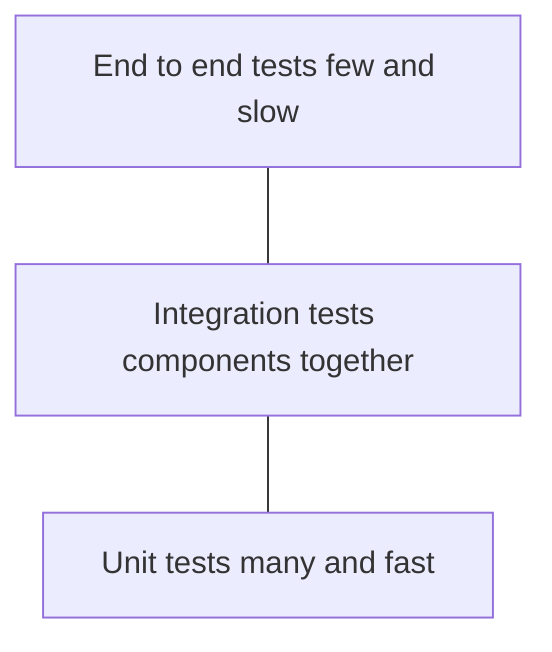

# Testing and QA

Testing is how a team gains confidence that software does what it should, and keeps that confidence as the code changes. Interviewers ask about the test pyramid, the kinds of testing, and mocking because the answers show whether you can pick the right level of test and keep the suite fast and trustworthy.

!!! note "In simple words"
    A test is a small program that checks your code gives the answer you expect. Write many fast small tests, a few bigger ones that cover real flows, and keep the slow tests for the last stage.

## Why it matters

Without tests, every change is a gamble, and the only check is production. Good tests let developers refactor with confidence, catch a broken rule within minutes, and document how the code is meant to behave. Poor tests, such as slow end-to-end suites or tests that break on every refactor, teach the team to ignore failures. The goal is a suite that is fast, reliable, and tells you exactly what broke.

## How it works

### Test pyramid

The test pyramid is a guide for how many tests of each kind to write. The base is wide and cheap. The top is narrow and expensive.



- **Unit tests** check one class or function in isolation. They run in milliseconds, and their dependencies are replaced with test doubles.
- **Integration tests** check that parts work together, such as a repository against a real database or a controller through the web layer. Testcontainers can start a real database in a disposable container for these tests.
- **End-to-end tests** drive the whole system through its UI or public API. They catch wiring problems, but they are slow and brittle, so keep them few and focused on critical journeys.

An inverted pyramid, with many slow UI tests and few unit tests, takes a long time to run and fails in ways that are hard to diagnose.

### Black-box and white-box testing

- **Black-box testing** checks behaviour through the external interface. The tester knows the inputs and expected outputs but not the code. Equivalence partitioning and boundary value analysis are the usual techniques. For a field that accepts 1 to 100, test 0, 1, 100, and 101, and one value from the middle.
- **White-box testing** uses knowledge of the internals, such as branches and conditions. Coverage tools help here, but a high coverage number does not prove the assertions are correct.

### Kinds of testing

| Kind | Purpose |
|------|---------|
| Unit | Confirm that each unit behaves as designed |
| Integration | Expose faults where units interact |
| System | Evaluate the complete system against specified requirements |
| Acceptance | Judge whether the system meets business needs and can be released |
| Regression | Confirm that new changes have not broken existing behaviour |
| Smoke | Quick check that basic functions work, such as logging in, before deeper testing |
| Performance and load | Measure behaviour under expected traffic |
| Stress | Observe behaviour under unfavourable conditions, such as overload or a failing dependency |

Smoke tests are usually the first gate in a pipeline. Regression tests are the ones most often automated.

### TDD and BDD

Test-driven and behaviour-driven development both write tests before the code. The cycles and tools are described in [SDLC and Methodologies](sdlc-methodologies.md#bdd-and-tdd). In short, TDD is a developer practice at unit level, and BDD writes scenarios that stakeholders can read.

### Principles

- **Arrange, Act, Assert (AAA).** Set up inputs, perform one action, and check the outcome. Keep the three parts visible.
- **Test behaviour, not implementation.** A test that breaks on every internal refactor measures the wrong thing.
- **Deterministic and independent.** A test must pass or fail the same way on every run, and it must not depend on the order in which other tests run.
- **Fast.** Slow tests get skipped. Move anything slow to a later stage of the pipeline.
- **Coverage is a guide.** A coverage tool such as JaCoCo shows untested code. A high percentage with weak assertions gives false comfort.

### Test doubles

A test double stands in for a real dependency. The names differ by how much they simulate:

- **Dummy**: passed around but never used.
- **Stub**: returns canned answers.
- **Spy**: records calls and may run the real code.
- **Mock**: verifies that expected interactions happened.
- **Fake**: a working but simplified implementation, such as an in-memory repository.

### JUnit 5 in Java

JUnit 5 (Jupiter) is the standard Java test framework. Add the `junit-jupiter` artifact in test scope, or use the Spring Boot starter test, which brings it in. Let your build tool manage the version rather than copying one from an old article.

The file below compiles with Java 21 when JUnit 5 is on the test classpath:

```java
import static org.junit.jupiter.api.Assertions.assertEquals;
import static org.junit.jupiter.api.Assertions.assertThrows;

import org.junit.jupiter.api.AfterEach;
import org.junit.jupiter.api.BeforeEach;
import org.junit.jupiter.api.DisplayName;
import org.junit.jupiter.api.Test;

class CalculatorTest {

    private Calculator calculator;

    @BeforeEach
    void createCalculator() {
        calculator = new Calculator();
    }

    @AfterEach
    void releaseResources() {
        calculator = null;
    }

    @Test
    @DisplayName("adds two numbers")
    void addsTwoNumbers() {
        int result = calculator.add(5, 3);       // Act
        assertEquals(8, result);                  // Assert
    }

    @Test
    void rejectsDivisionByZero() {
        assertThrows(ArithmeticException.class, () -> calculator.divide(10, 0));
    }
}

class Calculator {
    int add(int a, int b) {
        return a + b;
    }

    int divide(int a, int b) {
        return a / b;   // integer division by zero throws ArithmeticException
    }
}
```

Lifecycle annotations:

| Annotation | When it runs |
|------------|--------------|
| `@BeforeEach` and `@AfterEach` | Before and after every test; use them for fresh fixtures |
| `@BeforeAll` and `@AfterAll` | Once per class; the methods must be `static` unless the class uses `@TestInstance(Lifecycle.PER_CLASS)` |
| `@Disabled` | Skips a test; give the reason in the annotation |

`@DisplayName` sets a readable label for reports. `@Tag` groups tests so a build can run a subset. When JUnit 5 is used with Surefire, `-Dgroups=<tag>` selects a tag.

### Assertions

- **Equality and nulls**: `assertEquals`, `assertNotEquals`, `assertNull`, `assertNotNull`.
- **Booleans**: `assertTrue` and `assertFalse`.
- **Exceptions**: `assertThrows` returns the exception so you can check its message. `assertDoesNotThrow` documents that no exception is expected.
- **Grouped**: `assertAll` runs every assertion and reports all failures together, which is more useful than stopping at the first.
- **Timeouts**: `assertTimeout` waits for the block to finish. `assertTimeoutPreemptively` runs the block in another thread and aborts it when time runs out.
- **Messages**: pass a `String` or a `Supplier<String>` as the last argument. A supplier is evaluated only on failure, so building the message costs nothing when the test passes.

```java
import static org.junit.jupiter.api.Assertions.assertAll;
import static org.junit.jupiter.api.Assertions.assertEquals;
import static org.junit.jupiter.api.Assertions.assertNotNull;

import java.util.List;
import org.junit.jupiter.api.Test;

class AssertionsExampleTest {
    @Test
    void checksSeveralThingsAtOnce() {
        List<Integer> numbers = List.of(1, 2, 3);

        assertAll("numbers",
                () -> assertEquals(3, numbers.size()),
                () -> assertEquals(1, numbers.get(0).intValue()),
                () -> assertNotNull(numbers));
    }
}
```

### Mockito

Mockito creates test doubles, so a unit can be tested without its real collaborators. Mock external dependencies such as databases, HTTP clients, and message brokers. Do not mock the class under test.

The example below compiles with Java 21 when JUnit 5 and Mockito are on the test classpath:

```java
import static org.junit.jupiter.api.Assertions.assertEquals;
import static org.mockito.ArgumentMatchers.anyLong;
import static org.mockito.Mockito.mock;
import static org.mockito.Mockito.verify;
import static org.mockito.Mockito.when;

import org.junit.jupiter.api.Test;

interface NameRepository {
    String findName(long id);
}

class GreetingService {
    private final NameRepository names;

    GreetingService(NameRepository names) {
        this.names = names;
    }

    String greet(long id) {
        return "Hello, " + names.findName(id);
    }
}

class GreetingServiceTest {
    @Test
    void greetsStoredName() {
        NameRepository names = mock(NameRepository.class);       // mock
        when(names.findName(anyLong())).thenReturn("Ada");        // stub

        String greeting = new GreetingService(names).greet(1L);

        assertEquals("Hello, Ada", greeting);
        verify(names).findName(1L);                                // verify the interaction
    }
}
```

Points to know:

- **Stubbing** uses `when(...).thenReturn(...)`. Use `thenThrow` to simulate failures, and chained `thenReturn` calls to give successive answers.
- **Argument matchers** such as `anyLong()` and `eq(...)` must be used for every argument of a call, or for none of them.
- **Void methods** are stubbed with `doNothing()` or `doThrow()`. `doAnswer` runs custom code.
- **Verification** with `verify`, `times`, `never`, and `InOrder` checks that collaborators were called as expected. Verify the calls that matter. Over-verifying makes tests brittle.
- **Spies** wrap a real object, so unstubbed methods run the real code. They help with legacy classes but can hide design problems.

In a Spring Boot test, the application context can inject a mock in place of a bean. Recent Spring releases prefer `@MockitoBean`. The annotation is Spring specific, so this line is not compiled here; check it against the Spring version your project uses.

The deeper treatment of these tools lives in [Unit Testing with JUnit](../11-testing/unit-testing-junit.md) and [Mockito](../11-testing/mockito.md).

### Step by step

A reasonable workflow for a new feature:

1. Write a failing unit test for the smallest behaviour (TDD), or write the scenario (BDD).
2. Implement until the test passes, then refactor while the tests stay green.
3. Add integration tests for the database and web layers.
4. Add or extend a small number of end-to-end tests for the critical path.
5. Run smoke and regression suites in the pipeline on every change, and run load tests before a release.


## Where it is used

- Every pull request in a CI pipeline runs unit and integration tests before merge.
- Release pipelines run smoke tests after deployment to confirm the service starts and answers.
- Load and stress tests run before big launches or on a schedule in a staging environment.
- Contract tests check that an API consumer and provider still agree on message shapes.
- Testcontainers run real databases and message brokers inside integration tests.

## Benefits

- Fast unit tests give feedback in seconds, which keeps developers moving.
- A layered suite locates faults: a unit failure points to a class, an end-to-end failure points to a flow.
- Tests act as living documentation of expected behaviour.
- Refactoring becomes safer because the suite shows when behaviour changes.
- Mocks let teams test code that depends on services they do not control.

## Cons and limits

- Mocks encode assumptions about collaborators. If the real collaborator changes, a mocked test can still pass.
- Integration and end-to-end tests are slower and need infrastructure, such as containers or test environments.
- Flaky tests erode trust. A flaky test that fails at random is worse than none, because people learn to rerun it.
- High coverage does not guarantee good assertions, and chasing a percentage can produce hollow tests.
- Test code is code. It needs design, review, and maintenance.

## Best practices

- Mock external systems, not the class under test.
- Keep each test focused on one behaviour and independent of the others.
- Prefer real objects or fakes when they are cheap and simple.
- Verify interactions that belong to the contract, such as sending an event or writing a row.
- Do not test private methods directly. Test the public behaviour that uses them. If a private method needs its own tests, it may belong in its own class.
- Replace `Thread.sleep` with explicit waits or synchronisation when testing asynchronous code.
- Do not leave tests disabled indefinitely. Fix them or delete them.
- Avoid over-mocking. A test that restates the implementation line by line breaks on every change.

!!! tip "Interview tip"
    **Q: What is the difference between a mock and a stub?**
    A stub provides canned answers so the code under test can proceed. A mock also records calls so you can assert that the expected interactions happened. In Mockito the same object can do both.

## Quick recap

- The pyramid favours many fast unit tests, fewer integration tests, and a few end-to-end tests.
- Smoke, regression, load, and stress testing answer different questions.
- Write tests with the AAA shape, and test behaviour rather than implementation.
- JUnit 5 provides lifecycle hooks, assertions, grouping, and tags.
- Mockito stubs answers and verifies interactions; use spies sparingly.
- Coverage shows where tests are missing, not whether they are good.

## Official documentation

- [JUnit 5 User Guide](https://junit.org/junit5/docs/current/user-guide/)
- [Mockito documentation](https://site.mockito.org/)
- [Spring Boot reference documentation](https://docs.spring.io/spring-boot/reference/index.html)

**See also:** [SDLC and Methodologies](sdlc-methodologies.md), [Software Design Principles](software-design-principles.md), [Unit Testing with JUnit](../11-testing/unit-testing-junit.md), [Integration Testing](../11-testing/integration-testing.md)
