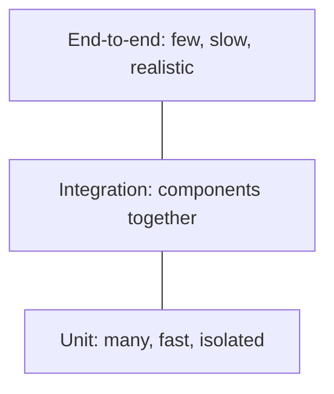

# Testing and QA

Testing is how a team gains confidence that software does what it should, and keeps that confidence as the code changes. Interviewers ask about the test pyramid, the kinds of testing, and mocking because they reveal whether you can choose the right level of test and keep the suite fast and trustworthy.

## Core concepts

### Test pyramid

The test pyramid is a guide for how many tests of each kind to write.



- **Unit tests** check one class or function in isolation. They run in milliseconds and dependencies are replaced with test doubles.
- **Integration tests** check that components work together, for example a repository against a real database, or a controller against the web layer. Testcontainers can supply real databases in a disposable container.
- **End-to-end tests** drive the whole system through its UI or public API. They catch wiring problems but are slow and brittle, so keep them few and focused on critical journeys.

A suite shaped like an inverted pyramid, with many slow UI tests and few unit tests, takes long to run and fails for reasons that are hard to diagnose.

### Black-box and white-box testing

- **Black-box testing** checks behaviour through the external interface. The tester knows inputs and expected outputs, not the code. Equivalence partitioning and boundary value analysis are typical techniques.
- **White-box testing** uses knowledge of the internals, such as branches and conditions. Coverage tools help here, though coverage does not prove the assertions are right.

### Levels and kinds of testing

| Kind | Purpose |
|------|---------|
| Unit | Verify that each unit behaves as designed |
| Integration | Expose faults in the interaction between units |
| System | Evaluate the complete system against specified requirements |
| Acceptance | Judge whether the system meets business needs and is ready for delivery |
| Regression | Confirm that new changes have not broken existing behaviour |
| Smoke | Quick check that basic functions work, such as logging in, before deeper testing |
| Performance and load | Measure run-time behaviour under expected load |
| Stress | See how the system behaves under unfavourable conditions, such as overload or failing dependencies |

Smoke tests are usually the first gate in a pipeline; regression tests are the ones automated most heavily.

### TDD and BDD

Test-driven and behaviour-driven development put tests first. The approaches, their cycles, and their tools are described in [SDLC and Methodologies](sdlc-methodologies.md#bdd-and-tdd). In short, TDD is a developer practice at unit level, and BDD writes shared scenarios that stakeholders can read.

### Principles

- **Arrange, Act, Assert (AAA).** Set up inputs, perform one action, check the outcome. Keep each part visible.
- **Test behaviour, not implementation.** A test that breaks on every internal refactor is measuring the wrong thing.
- **Deterministic and independent.** A test must pass or fail the same way every run and must not depend on the order in which other tests run.
- **Fast.** Slow tests get skipped. Move anything slow to a later stage of the pipeline.
- **Coverage is a guide, not a goal.** JaCoCo or a similar tool shows untested code; a high percentage with weak assertions gives false comfort.

### Test doubles

A test double stands in for a real dependency. The names differ in how much they simulate:

- **Dummy**: passed around but never used.
- **Stub**: returns canned answers.
- **Spy**: records calls and may run the real code.
- **Mock**: verifies that expected interactions happened.
- **Fake**: a working but simplified implementation, such as an in-memory repository.

## JUnit 5 in Java

JUnit 5 (Jupiter) is the standard Java test framework. Add the `junit-jupiter` artifact in test scope, or use the Spring Boot starter test, which brings it in. Pick the version your build tool manages; avoid hard-coding a version copied from an old article.

A test class follows the AAA shape:

```java
import static org.junit.jupiter.api.Assertions.assertEquals;
import static org.junit.jupiter.api.Assertions.assertThrows;

import org.junit.jupiter.api.AfterEach;
import org.junit.jupiter.api.BeforeEach;
import org.junit.jupiter.api.DisplayName;
import org.junit.jupiter.api.Test;

class CalculatorTest {

    private Calculator calculator;

    @BeforeEach
    void createCalculator() {
        calculator = new Calculator();
    }

    @AfterEach
    void releaseResources() {
        calculator = null;
    }

    @Test
    @DisplayName("adds two numbers")
    void addsTwoNumbers() {
        int result = calculator.add(5, 3);       // Act
        assertEquals(8, result);                  // Assert
    }

    @Test
    void rejectsDivisionByZero() {
        assertThrows(ArithmeticException.class, () -> calculator.divide(10, 0));
    }
}

class Calculator {
    int add(int a, int b) {
        return a + b;
    }

    int divide(int a, int b) {
        return a / b;   // integer division by zero throws ArithmeticException
    }
}
```

Lifecycle annotations:

| Annotation | When it runs |
|------------|--------------|
| `@BeforeEach` / `@AfterEach` | Before and after every test; use for fresh fixtures |
| `@BeforeAll` / `@AfterAll` | Once per class; methods must be `static` unless the class uses `@TestInstance(Lifecycle.PER_CLASS)` |
| `@Disabled` | Skips a test; give a reason in the annotation |

Descriptive names help reports. `@DisplayName` sets a readable label, and `@Tag` groups tests so a build can run a subset. Surefire can filter by tag with `-Dgroups=<tag>` when JUnit 5 is in use.

### Assertions

- **Equality and nulls**: `assertEquals`, `assertNotEquals`, `assertNull`, `assertNotNull`.
- **Booleans**: `assertTrue`, `assertFalse`.
- **Exceptions**: `assertThrows` returns the exception so you can check its message; `assertDoesNotThrow` documents that no exception is expected.
- **Grouped**: `assertAll` runs every assertion and reports all failures together, which beats stopping at the first.
- **Timeouts**: `assertTimeout` waits for the block to finish; `assertTimeoutPreemptively` runs it in another thread and aborts it when the time is up.
- **Messages**: pass a `String` or a `Supplier<String>` as the last argument. A supplier is only evaluated on failure.

```java
import static org.junit.jupiter.api.Assertions.assertAll;
import static org.junit.jupiter.api.Assertions.assertEquals;
import static org.junit.jupiter.api.Assertions.assertNotNull;

import java.util.List;
import org.junit.jupiter.api.Test;

class AssertionsExampleTest {
    @Test
    void checksSeveralThingsAtOnce() {
        List<Integer> numbers = List.of(1, 2, 3);

        assertAll("numbers",
                () -> assertEquals(3, numbers.size()),
                () -> assertEquals(1, numbers.get(0).intValue()),
                () -> assertNotNull(numbers));
    }
}
```

## Mockito

Mockito creates test doubles so a unit can be tested without its real collaborators. Mock external dependencies such as databases, HTTP clients, and message brokers.

```java
import static org.junit.jupiter.api.Assertions.assertEquals;
import static org.mockito.ArgumentMatchers.anyLong;
import static org.mockito.Mockito.mock;
import static org.mockito.Mockito.verify;
import static org.mockito.Mockito.when;

import org.junit.jupiter.api.Test;

interface NameRepository {
    String findName(long id);
}

class GreetingService {
    private final NameRepository names;

    GreetingService(NameRepository names) {
        this.names = names;
    }

    String greet(long id) {
        return "Hello, " + names.findName(id);
    }
}

class GreetingServiceTest {
    @Test
    void greetsStoredName() {
        NameRepository names = mock(NameRepository.class);       // mock
        when(names.findName(anyLong())).thenReturn("Ada");        // stub

        String greeting = new GreetingService(names).greet(1L);

        assertEquals("Hello, Ada", greeting);
        verify(names).findName(1L);                                // verify interaction
    }
}
```

Points to know:

- **Stubbing** with `when(...).thenReturn(...)`. Use `thenThrow` to simulate failures and chained `thenReturn` calls for successive answers.
- **Argument matchers** such as `anyLong()` and `eq(...)` must be used for every argument of a call, or none of them.
- **Void methods** are stubbed with `doNothing()` or `doThrow()`, and `doAnswer` runs custom code.
- **Verification** with `verify`, `times`, `never`, and `InOrder` checks that collaborators were called as expected. Verify the calls that matter; over-verifying makes tests brittle.
- **Spies** wrap a real object, so unstubbed methods run the real code. They are useful for legacy classes but can hide design problems.

In a Spring Boot test, the container can inject a mock in place of a bean. Recent Spring releases prefer `@MockitoBean` over `@MockBean`; check the version your project uses.

Mockito and JUnit each have their own deeper treatment in [Unit Testing with JUnit](../11-testing/unit-testing-junit.md) and [Mockito](../11-testing/mockito.md).

### Practices

Do:

- Mock external systems, not the class under test.
- Keep tests focused and independent.
- Prefer real objects or fakes when they are cheap and simple.
- Verify interactions that are part of the contract.

Do not:

- Over-mock until the test describes the implementation line by line.
- Verify details that do not affect behaviour.
- Forget to verify side effects of void methods, such as sending an email.
- Use a mock where a simple value object is enough.

## How it works / Step by step

A reasonable workflow for a new feature:

1. Write a failing unit test for the smallest behaviour (TDD) or the scenario (BDD).
2. Implement until it passes; refactor with the tests green.
3. Add integration tests for the database and web layer.
4. Add or extend a small number of end-to-end tests for the critical path.
5. Run smoke and regression suites in the pipeline on every change; run load tests before release.

## Common pitfalls

- Testing private methods directly. Test the public behaviour that uses them; if a private method needs its own tests, it may deserve to be a separate class.
- Sharing mutable state between tests, so results depend on order.
- Using `Thread.sleep` to wait for asynchronous work. Use explicit waits or synchronisation instead.
- Chasing a coverage percentage while asserting nothing.
- Mocking types you do not own, such as an entire framework client, when a thin adapter would be easier to test.
- Leaving tests `@Disabled` indefinitely.

!!! tip "Interview tip"
    **Q: What is the difference between a mock and a stub?**
    A stub provides canned answers so the code under test can proceed. A mock also records calls so you can assert that the expected interactions happened. In Mockito the same object can do both.

## Quick recap

- The pyramid favours many fast unit tests, fewer integration tests, and a few end-to-end tests.
- Smoke, regression, load, and stress testing answer different questions.
- Write tests with the AAA shape and test behaviour, not implementation.
- JUnit 5 provides lifecycle hooks, assertions, grouping, and tags.
- Mockito stubs answers and verifies interactions; use spies sparingly.
- Coverage shows where tests are missing, not whether they are good.

**See also:** [SDLC and Methodologies](sdlc-methodologies.md), [Software Design Principles](software-design-principles.md), [Unit Testing with JUnit](../11-testing/unit-testing-junit.md), [Integration Testing](../11-testing/integration-testing.md)
