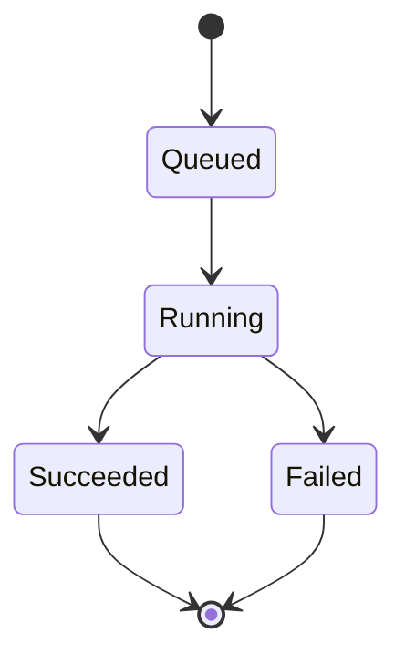
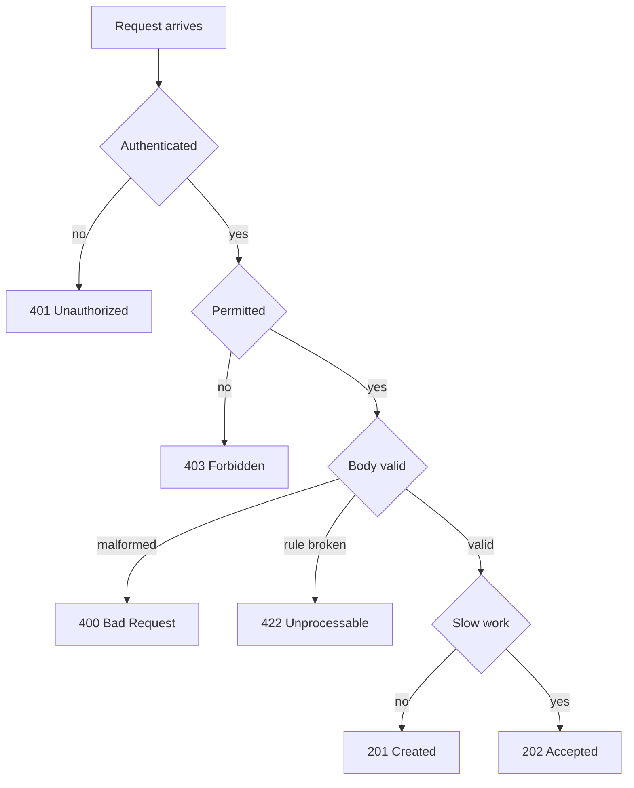

# Web Fundamentals

Web fundamentals cover the HTTP contract that every API depends on: methods, status codes, headers, caching, and the REST style built on them. Interviewers use these topics to check whether you can design an endpoint, choose the right status code, and explain how a request is secured and observed.

!!! note "In simple words"
    HTTP is a conversation with a fixed grammar. The method says what you want to do, the status code says how it went, and headers carry the extra details such as who you are and what format you speak.

## Why it matters

Clients, proxies, caches, and monitoring tools all read the same signals: the method, the status code, and the headers. If an API returns 200 with an error inside the body, a cache may store it, a retry may repeat it, and an alert may never fire. Getting the contract right is what lets many different systems work with your API without special handling.

## How it works

### HTTP methods

Each method states the intent of a request. Two properties matter for design:

- **Safe** means the request does not change server state.
- **Idempotent** means repeating the request leaves the server in the same state as doing it once.

| Method | Purpose | Safe | Idempotent | Typical use |
|--------|---------|------|------------|-------------|
| GET | Read a resource | Yes | Yes | Fetch data |
| HEAD | Same as GET without the body | Yes | Yes | Check existence or metadata |
| OPTIONS | Describe what the server allows | Yes | Yes | CORS preflight |
| POST | Process or create | No | No | Create a resource, submit a form |
| PUT | Replace a resource completely | No | Yes | Full update |
| PATCH | Change part of a resource | No | Not guaranteed | Partial update |
| DELETE | Remove a resource | No | Yes | Delete |

Idempotency describes the resulting state, not the response. A second DELETE may return 404, but the resource is still deleted, so DELETE stays idempotent.

### HTTP status codes

**2xx: success**

- **200 OK**: success with a body.
- **201 Created**: a resource was created. The `Location` header gives its URL.
- **202 Accepted**: the request was queued for asynchronous work and may not be finished yet.
- **204 No Content**: success with no body, common after DELETE.
- **206 Partial Content**: a byte range was returned, used for resumable downloads.

**3xx: redirection**

- **301 Moved Permanently**: clients and caches may remember the new location.
- **302 Found** and **307 Temporary Redirect**: temporary. 307 keeps the method, while many clients turn a 302 into GET.
- **304 Not Modified**: the cached copy is still valid, so no body is sent.

**4xx: client error**

- **400 Bad Request**: malformed syntax, such as invalid JSON or a missing required field.
- **401 Unauthorized**: no valid credentials were sent. Despite the name, it means unauthenticated.
- **403 Forbidden**: the caller is authenticated but lacks permission.
- **404 Not Found**: the resource does not exist, or the server hides that it exists.
- **409 Conflict**: the request clashes with current state, such as a duplicate unique key.
- **422 Unprocessable Content** (called Unprocessable Entity in older specifications): the syntax is valid, but the data breaks a business rule.
- **429 Too Many Requests**: a rate limit was exceeded. Often sent with a `Retry-After` header.
- **431 Request Header Fields Too Large**: the headers alone exceed the server limit.

**5xx: server error**

- **500 Internal Server Error**: an unexpected failure on the server.
- **502 Bad Gateway**: a gateway or proxy received an invalid response from upstream.
- **503 Service Unavailable**: temporarily unable to serve, such as during maintenance or overload.
- **504 Gateway Timeout**: the upstream did not answer in time.

Telling 401 from 403, and 400 from 422, is a frequent interview check.

### HTTP headers

Headers the client sends:

```
Authorization: Bearer <token>        # credentials
Content-Type: application/json       # format of the body being sent
Accept: application/json             # format the client wants back
Accept-Encoding: gzip, deflate       # compression the client understands
If-None-Match: "33a64df551425fcc"    # ETag from a previous response
```

Headers the server sends:

```
Content-Type: application/json       # format of the body returned
Cache-Control: max-age=3600          # how long caches may keep the response
ETag: "33a64df551425fcc"             # version identifier for the representation
Location: /users/123                 # new resource URL after 201, or redirect target
Set-Cookie: session=abc123           # cookie for the client to store
Access-Control-Allow-Origin: *       # CORS permission for browsers
```

### HTTP caching

`Cache-Control` directives say who may store a response and when it must be checked again:

- `public, max-age=3600`: shared caches may store the response for one hour.
- `private, max-age=1800`: only the user's browser may store it, for 30 minutes.
- `no-cache`: the response may be stored, but it must be revalidated before reuse.
- `no-store`: never store it. Use this for sensitive data.
- `must-revalidate`: once stale, the response must not be used without a check.

An **ETag** is a validator. The server returns it, the client sends it back in `If-None-Match`, and if nothing changed the server replies 304 with no body. That saves bandwidth without skipping the freshness check.

### REST

REST (Representational State Transfer) is an architectural style, not a protocol. A RESTful API:

1. Separates client concerns from server concerns.
2. Is **stateless**: each request carries everything the server needs, so any instance can handle it.
3. Uses a **uniform interface**: resources are named by URLs, changed through representations (usually JSON), with standard methods.
4. Allows responses to be **cacheable** where appropriate.
5. Works in **layers**, so proxies, gateways, and load balancers can sit in between.
6. Optionally supports **code on demand**, where the server sends executable code to the client. This is rare in APIs.

Resource names are nouns in plural collections. The HTTP method carries the verb:

```
GET    /api/orders             list orders
GET    /api/orders/731         read order 731
POST   /api/orders             place a new order
PUT    /api/orders/731         replace order 731
PATCH  /api/orders/731         change the shipping address of order 731
DELETE /api/orders/731         cancel and remove order 731
GET    /api/orders/731/lines   nested collection of line items
GET    /api/lines?sku=SKU-88   filter by query parameter
```

Keep nesting shallow. Two levels is usually enough. Deeper relationships are better expressed as filters.

**POST needs an idempotency key** if a client may retry it. The client sends a unique key, commonly in an `Idempotency-Key` header. The server stores the outcome for that key and replays it for a retry instead of creating a duplicate. The header name is a convention rather than a settled standard, so check what each API documents.

### Versioning, pagination, and filtering

**Versioning** can sit in the path (`/api/v1/users`), in a custom media type sent through `Accept`, or in a query parameter. Path versioning is easiest to see and route. Header versioning keeps URLs stable but is harder to test in a browser.

**Pagination** keeps responses bounded:

```
GET /api/products?page=2&size=50&sort=price,asc

{
  "items": [ ... ],
  "total": 412,
  "page": 2,
  "size": 50,
  "hasMore": true
}
```

Offset paging is simple, but it gets slow on large tables and shifts when rows are inserted. Cursor-based paging, which passes the last seen key, is the usual alternative for feeds.

**Filtering and searching** use query parameters, for example `GET /api/users?role=ADMIN&status=active`.

**HATEOAS** (Hypermedia as the Engine of Application State) puts navigation links in each response, so a client can follow them instead of hard-coding URLs:

```json
{
  "id": 731,
  "status": "PAID",
  "links": {
    "self": { "href": "/api/orders/731", "method": "GET" },
    "cancel": { "href": "/api/orders/731", "method": "DELETE" }
  }
}
```

HATEOAS is part of the full REST definition but is rarely built in practice. Mention that trade-off if asked.

### Web service styles

- **SOAP**: XML messages described by a WSDL contract, with WS-* standards for security and reliability. It is strictly typed and verbose, and it remains in enterprise and legacy integrations.
- **REST**: resources and HTTP methods, usually with JSON. It is simple, cache-friendly, and the default for public APIs and mobile backends.
- **GraphQL**: one endpoint, often `POST /graphql`, where the client asks for exactly the fields it needs. The schema is strongly typed. It reduces over-fetching and under-fetching, but caching and rate limiting need more care.
- **gRPC**: HTTP/2 with Protocol Buffers defined in `.proto` files. It is binary, strongly typed, and supports streaming in both directions. It suits internal service-to-service calls.
- **WebSocket**: a persistent, two-way connection that starts with an HTTP upgrade. It fits chat, live dashboards, and notifications where the server pushes data.

### Error handling

Return errors in one consistent shape, with a stable machine-readable code, a human message, and enough detail to act on. RFC 9457 (Problem Details for HTTP APIs) defines a standard JSON shape with `type`, `title`, `status`, `detail`, and `instance`. It replaced RFC 7807.

```json
{
  "type": "https://api.example.com/problems/insufficient-stock",
  "title": "Insufficient stock",
  "status": 409,
  "detail": "Only 2 units of SKU-88 remain",
  "instance": "/api/orders/731/lines/4"
}
```

A Java 21 record models a simple error payload. It compiles with the JDK alone:

```java
import java.time.Instant;

record ApiError(String code, String message, String path, Instant timestamp) {
}

class ApiErrorDemo {
    public static void main(String[] args) {
        ApiError error = new ApiError(
                "NOT_FOUND",
                "User 123 does not exist",
                "/api/users/123",
                Instant.parse("2024-01-15T10:30:00Z"));

        System.out.println(error.code() + " at " + error.path());
        System.out.println(error);
    }
}
```

### Rate limiting

Servers announce limits in headers so clients can slow down. Common names are `X-RateLimit-Limit`, `X-RateLimit-Remaining`, and `X-RateLimit-Reset`. The IETF is standardising `RateLimit` header fields. When a limit is exceeded, return 429 with a `Retry-After` hint.

### Asynchronous work and bulk operations

- **202 Accepted** means the work is queued. Return a `Location` header that points to a status resource, such as `/api/jobs/abc123`. The status resource answers while the job runs and returns 200 with the result once it completes.
- **Bulk operations** accept many items in one request. The response can use 207 Multi-Status with a result for each item, so one failure does not hide the others.



### Deprecation

Announce retirement before you remove an endpoint. A `Deprecation` header marks the endpoint as deprecated. A `Sunset` header gives the date it stops working. A `Link` header with `rel="successor-version"` points to the replacement.

### Security

- **TLS everywhere** in production. Encrypt in transit and validate certificates. Never disable verification to make a test pass.
- **Authentication** establishes identity. API keys suit simple server-to-server access. Bearer tokens, often JWTs, are self-contained and stateless. OAuth 2.0 delegates access to a third party. Mutual TLS authenticates services with certificates.
- **Authorisation** decides what an identity may do. Role-based access control (RBAC) grants permissions through roles. Attribute-based access control (ABAC) evaluates policies over attributes. Never trust authorisation data supplied by the client.
- **Input validation** checks size, type, and format, then rejects bad input early with 400 or 422.
- **CORS** is enforced by browsers, not servers. A cross-origin call that is not "simple" triggers a preflight OPTIONS request. The server answers with the allowed origin, methods, and headers. A credentialed request cannot use a wildcard origin.

```
OPTIONS /api/orders
Origin: https://shop.example.org
Access-Control-Request-Method: PATCH
Access-Control-Request-Headers: Content-Type, X-Request-Id

Response:
Access-Control-Allow-Origin: https://shop.example.org
Access-Control-Allow-Methods: GET, POST, PATCH
Access-Control-Allow-Headers: Content-Type, X-Request-Id
Access-Control-Max-Age: 600
```

### Observability

- **Logs** record each request with method, path, status, and duration. Never log secrets or personal data.
- **Traces** follow one request across services. All hops share a trace ID, and each operation gets its own span ID. The W3C `traceparent` header carries them.
- **Metrics** capture request rate, error rate, latency, and payload size. Read latency as percentiles (p50, p95, p99), because averages hide slow tails.

### Step by step

Designing an endpoint, for example "create an order":

1. Pick the resource and URL: `POST /api/orders`.
2. Validate the body. Return 400 for malformed JSON and 422 for rule violations.
3. Require authentication (401) and check permission (403).
4. Create the order and return 201 with `Location: /api/orders/{id}`.
5. If processing is slow, return 202 with a job URL instead.
6. Document the error shape, the idempotency key rules, and the paging and rate-limit rules.



## Where it is used

- Public and partner APIs, such as payment, shipping, and identity services.
- Mobile and single-page app backends that need predictable caching.
- Internal service APIs behind an API gateway that handles TLS, auth, and rate limits.
- Webhooks and callbacks, which rely on the same status code and retry rules.

## Benefits

- Standard methods and status codes let generic clients, proxies, and caches work without custom rules.
- Safe and idempotent methods make retries and caching predictable.
- A consistent error shape makes client code and monitoring simpler.
- Stateless requests scale horizontally, since any instance can answer.
- Caching headers can cut server load and latency with no application code.

## Cons and limits

- REST over-fetches or under-fetches for some screens. GraphQL or purpose-built endpoints address that.
- Caching works well for GET but not for personalised or frequently changing responses.
- Offset paging degrades on large tables and shows duplicates when rows change during paging.
- Versioning creates a maintenance cost, because old versions must keep working until clients move.
- Strict REST purity, such as full HATEOAS, adds effort that many teams never recover.

## Best practices

- Return the right status code. Clients, proxies, and monitoring rely on it. Do not return 200 with an error body.
- Use 401 when identity is missing and 403 when the user is known but not allowed.
- Add an idempotency key to POST calls that a client may retry after a timeout.
- Avoid verbs in URLs such as `/api/getUsers`. Let the method carry the action.
- Never combine a wildcard CORS origin with credentials. Browsers reject it.
- Hide stack traces from error responses. Log them on the server instead.
- Use `no-store` for sensitive responses. `no-cache` still allows storage.

!!! tip "Interview tip"
    **Q: PUT or PATCH for an update?**
    Use PUT when the client sends the full representation and the server replaces the resource. PUT is idempotent. Use PATCH when the client sends only the changed fields. PATCH is not idempotent by definition, although a particular PATCH call can be made idempotent.

## Quick recap

- Know which methods are safe and idempotent. They drive retries and caching.
- Use 401 for missing identity, 403 for insufficient permission, 400 for bad syntax, and 422 for rule violations.
- ETags and `Cache-Control` let clients and caches avoid repeat downloads.
- REST is a set of constraints: stateless, uniform interface, cacheable, and layered.
- Use one error shape. RFC 9457 is the standard to point to.
- CORS is a browser rule enforced through headers and preflight requests.

## Official documentation

- [RFC 9110: HTTP Semantics](https://www.rfc-editor.org/rfc/rfc9110)
- [RFC 9457: Problem Details for HTTP APIs](https://www.rfc-editor.org/rfc/rfc9457)
- [OpenAPI Specification](https://spec.openapis.org/oas/latest.html)
- [Fetch Standard (CORS)](https://fetch.spec.whatwg.org/)

**See also:** [Computer Networking](computer-networking.md), [Testing and QA](testing-and-qa.md), [Secure Coding and Supply Chain](../10-security/secure-coding-and-supply-chain.md), [API Design](../21-api-design/index.md)
