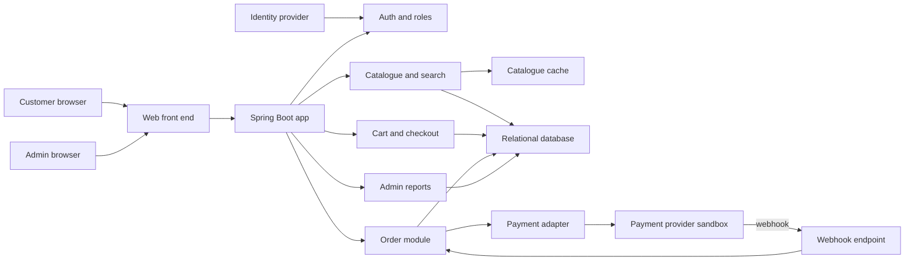
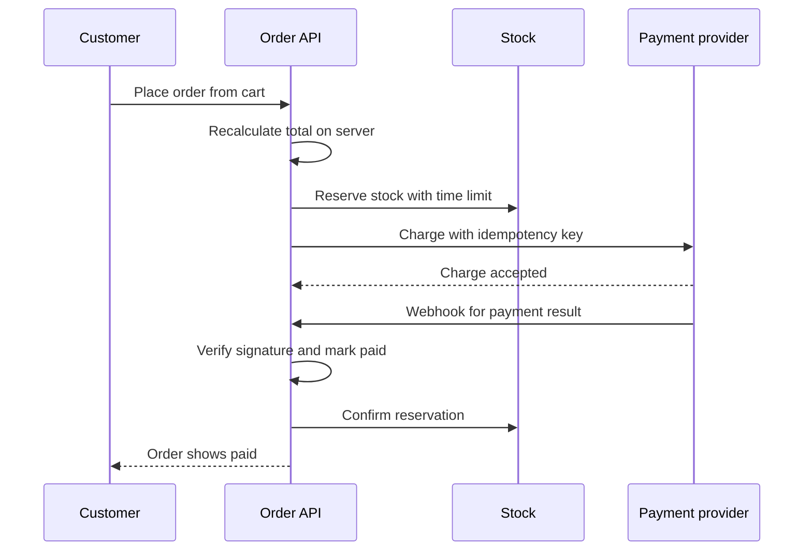

# Project 1: E-Commerce Platform

!!! note "In simple words"
    You build an online shop from start to finish. Customers search, buy, and track their orders, while staff manage the products and check the sales numbers.

## Why it matters

This project pulls together most of what a backend engineer is expected to handle: login and access rules, a data model, search, transactions that must not half-succeed, a call to an outside payment company, cloud deployment, and speed tuning. Each piece affects the others, so building it shows whether you can connect the parts rather than only knowing each one on its own. Finish the Spring, database, and API design topics before you start.

### Scope

Begin with one deployable Spring Boot application backed by a relational database. Split it into separate services only when you have a concrete reason, such as a team boundary or a load problem that one app cannot handle. The first goal is a single purchase that works from the first click to the paid order. Trying to ship every feature at once usually delays that goal.

## How it works

### Feature list

- **Authentication and authorisation:** registration and login, JWT access tokens, OAuth 2.0 sign-in through a third-party identity provider, and two roles, customer and administrator
- **Product catalogue:** categories, variants, prices, stock levels, and images stored by reference
- **Search, filtering, and sorting:** keyword search, filters by category and price, sorting by price and rating, and pagination with keyset cursors
- **Shopping cart:** add, update, and remove items, keep the cart for logged-in users, and recalculate totals on the server
- **Order management:** place an order from the cart, reserve stock, move through the statuses placed, paid, shipped, delivered, and cancelled, and show the history
- **Payments:** integration with a payment provider's sandbox, webhooks for payment results, and idempotent charge requests
- **Admin dashboard:** manage products and orders, and show sales totals, top products, and conversion figures
- **Deployment and monitoring:** a cloud deployment with HTTPS, logs, metrics, and health checks
- **Performance work:** query tuning, caching for catalogue reads, and load-test results

### Architecture diagram

The application is one deployable unit with internal modules. The identity provider, the payment provider, and the database sit outside it and are reached through defined connections.



### Purchase flow

The sequence below shows what happens between the moment a customer places an order and the moment the order is marked paid.



The same flow in numbered steps:

1. The customer submits the cart. The server ignores any total the browser sends and recomputes every line from the stored prices.
2. The service creates the order in a pending state and reserves stock for a fixed window.
3. The service calls the payment provider with an idempotency key, so a retried request cannot charge the customer twice.
4. The provider sends a webhook when the result is known. The service verifies the signature and processes each event ID only once.
5. On success the order becomes paid and the reservation is confirmed. If the reservation expires first, the stock returns to the pool.
6. If a webhook never arrives, a scheduled reconciliation job asks the provider about orders that are still pending.

### Server-side totals

Money is a common place for bugs, so the sketch below keeps arithmetic in `BigDecimal` and recomputes the cart total from stored line items. It uses only the standard library.

```java
import java.math.BigDecimal;
import java.util.List;

public class CartTotals {

    record LineItem(String sku, BigDecimal unitPrice, int quantity) {
        LineItem {
            if (quantity <= 0) {
                throw new IllegalArgumentException("quantity must be positive");
            }
        }

        BigDecimal lineTotal() {
            return unitPrice.multiply(BigDecimal.valueOf(quantity));
        }
    }

    static BigDecimal total(List<LineItem> items) {
        return items.stream()
                .map(LineItem::lineTotal)
                .reduce(BigDecimal.ZERO, BigDecimal::add);
    }

    public static void main(String[] args) {
        List<LineItem> cart = List.of(
                new LineItem("BOOK-1", new BigDecimal("12.50"), 2),
                new LineItem("PEN-7", new BigDecimal("1.25"), 4));
        System.out.println(total(cart)); // prints 30.00
    }
}
```

### Webhook deduplication

Providers may deliver the same event more than once. This in-memory sketch shows the core check. A real service stores processed event IDs in the database under a unique constraint, so the check survives restarts and works across several instances.

```java
import java.util.Set;
import java.util.concurrent.ConcurrentHashMap;

public class WebhookDeduplicator {

    private final Set<String> seenEventIds = ConcurrentHashMap.newKeySet();

    /** Returns true only the first time an event ID is offered. */
    public boolean shouldProcess(String eventId) {
        return seenEventIds.add(eventId);
    }

    public static void main(String[] args) {
        WebhookDeduplicator dedupe = new WebhookDeduplicator();
        System.out.println(dedupe.shouldProcess("evt_1")); // true
        System.out.println(dedupe.shouldProcess("evt_1")); // false
    }
}
```

### Webhook endpoint

Spring example (not compiled). The controller accepts the raw body and the signature header, then hands both to a service that you write. The service must verify the signature before it parses anything, and it should return a success status only after the event is stored, so the provider retries when something fails.

```java
// Spring example (not compiled)
@RestController
@RequestMapping("/api/webhooks/payments")
class PaymentWebhookController {

    private final PaymentEventService events;

    PaymentWebhookController(PaymentEventService events) {
        this.events = events;
    }

    @PostMapping
    ResponseEntity<Void> receive(
            @RequestHeader("Payment-Signature") String signature,
            @RequestBody String rawBody) {
        events.handle(signature, rawBody);
        return ResponseEntity.ok().build();
    }
}
```

### Build milestones

1. **Domain and persistence.** Model products, customers, carts, and orders. Write the schema as migrations. Add repository tests that run against a real database.
2. **Accounts and security.** Build registration, login, token issuing and validation, and role-based access. Test that a customer cannot read another customer's orders.
3. **Catalogue and search.** Build create, read, update, and delete for products, plus keyword search, filters, sorting, and cursor-based pagination. Index the columns used by filters.
4. **Cart and checkout.** Keep the cart on the server, calculate prices there, and reserve stock inside a transactional boundary. Write the order in a single transaction.
5. **Payments.** Connect to the sandbox, handle webhooks with signature checks, send idempotency keys on charge requests, and add a retry path for failed webhooks.
6. **Admin and analytics.** Provide admin endpoints and screens for products and orders, plus aggregate queries for sales. Consider a read replica or a separate reporting table.
7. **Deployment and observability.** Containerise the app, deploy it to a managed cloud, and add HTTPS, health checks, metrics, and tracing.
8. **Performance.** Run a load test against realistic data volumes, find the slowest endpoints, fix them, and record the numbers before and after each fix.

## Where it is used

The shape of this project matches online shops, marketplaces, and retail back offices. The same building blocks appear in ticket sales, subscription billing, and booking systems, where a customer pays for something that is limited in quantity. In interviews, a project like this gives you concrete examples of stock conflicts, payment retries, and access control, which are the topics that separate candidates who have built something from those who have only read about it.

## Benefits

- **Full-stack practice:** every backend layer is used in one codebase, from HTTP endpoints down to deployment.
- **Security:** you practise JWT validation, OAuth 2.0 flows, and object-level checks, so each order can be seen only by its owner (see [API security](../21-api-design/api-security.md)).
- **API design:** you use resource URLs, correct status codes, Problem Details error bodies, and idempotent payment calls (see [pagination, errors, and idempotency](../21-api-design/pagination-errors-idempotency.md)).
- **Data:** you design a schema, add indexes, use transactions correctly, and tune slow queries.
- **Integration:** you call an external provider with timeouts and retries, and you verify its webhooks.
- **Testing:** you write unit tests for pricing and business rules, integration tests for checkout, and contract tests for the payment adapter.
- **Operations:** you deploy to the cloud and read logs, metrics, and health checks (see [observability](../20-observability/index.md)).
- **Performance:** you run load tests, add caching, and analyse query plans, and you finish with numbers that show the effect of each change.

## Cons and limits

- **Scope creep:** adding features before one purchase works end to end is the most common way this project stalls.
- **Sandbox only:** a provider's sandbox does not cover real refunds, chargebacks, tax rules, fraud checks, or settlement timing. Treat those as known gaps.
- **One app limits scaling:** a single deployable unit cannot scale parts of the system independently. That is acceptable for the first version and is worth discussing in an interview.
- **Sketches are not production code:** the in-memory deduplicator and the webhook controller above show the idea only. They lack persistence, retries, and monitoring.

### Common pitfalls

- Building every feature before a single purchase works end to end
- Trusting client-side prices or stock counts
- Double charging after a timeout because the charge call was not idempotent
- Filter queries with no supporting indexes, which fail under load
- Storing secrets in the repository instead of a secrets manager

## Best practices

### Design notes

- Compute prices and totals on the server. Never trust a total sent by the client.
- Reserve stock with a time limit, so abandoned carts do not hold inventory forever.
- Keep the payment provider behind an adapter interface. Tests use a fake, and the sandbox can be replaced without changing the order logic.
- Make every webhook handler idempotent, because providers deliver events more than once.
- Do not store card data yourself. Use the provider's hosted fields or tokens.

### Definition of done

- A customer can register, search, buy with a sandbox payment, and see the order status change.
- An administrator can add a product and see the new order in the dashboard.
- Access rules are tested, and an object-level authorisation test exists for orders.
- A load-test report exists that records the scenario, the data size, and the results before and after tuning.
- The service is deployed with HTTPS, has a live URL, and has dashboards for latency and errors.

!!! tip "Interview tip"
    **Q: Walk me through what happens when a customer pays for an order.**
    A: Checkout first saves the order as pending and holds the stock. The charge request carries an idempotency key, so a retry is safe. When the provider reports the result through a webhook, the service checks the signature and applies the event at most once. That moves the order to paid and confirms the stock hold. If the webhook is lost, a scheduled reconciliation job asks the provider about orders that are still pending.

## Quick recap

- Build one working purchase flow first, then widen it
- Keep prices and stock decisions on the server
- Make payment calls and webhooks idempotent
- Prove security and performance with tests and load-test numbers
- Deploy with HTTPS, health checks, and dashboards

## Official documentation

- [Spring Boot reference documentation](https://docs.spring.io/spring-boot/reference/index.html)
- [Spring Security reference documentation](https://docs.spring.io/spring-security/reference/index.html)
- [PostgreSQL documentation](https://www.postgresql.org/docs/current/)
- [RFC 7519: JSON Web Token (JWT)](https://www.rfc-editor.org/rfc/rfc7519)

**See also:** [Social Feed System](social-feed-system.md), [Multi-Tenant SaaS Application](saas-application.md), [Portfolio Requirements](portfolio-requirements.md)
