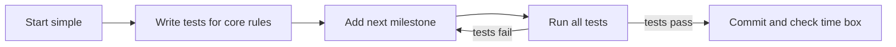
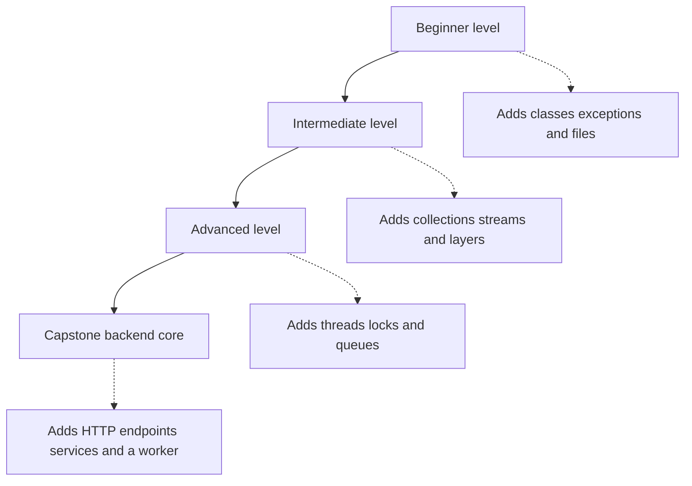

# Hands-On Project Ladder

!!! note "In simple words"
    Build small programs first, then bigger ones. Each project teaches a skill that the next project needs, so you do not hit a wall later.

Work through the projects in order. Each small project prepares you for the ones after it, and the capstone combines everything into a backend core. You can start the large projects before you finish the ladder, but skipping levels usually leaves gaps in exception handling, concurrency, and design.

## Why it matters

Interviewers rarely ask only about syntax. They ask how you would design something, how you handled a failure, and what happens when two threads touch the same data. Projects give you a place to practise those answers with real code. A ladder raises the difficulty in controlled steps: you meet one new idea at a time, and each finished project is evidence of what you can do.

## How it works

### Using the ladder

Follow these steps for every project:

1. Read the build goal and the milestones.
2. Build the smallest working version first, even if it is rough.
3. Write tests for the core rules before you add new features.
4. Move to the next milestone only after the current tests pass.
5. Write a README in your own words. You can keep it in your repository; it does not need to live in this playbook.
6. Finish with a short list of what you would change if you rebuilt the project.

Commit in small steps so the history shows the design evolving. Give each project a time box. If a project runs much longer than planned, write down what was hard, then either move on or come back to it later.



### Architecture diagram

The levels build on each other. Each level keeps the parts from the level before it and adds new system parts. The capstone uses all of them together.



### Beginner projects

#### CLI banking system

- **Build:** accounts that support deposits, withdrawals, and transfers; a menu-driven command-line interface; balances written to a file and loaded again at startup.
- **Milestones:** model the account class and validate its input; define exceptions for insufficient funds and invalid amounts; add file storage; write tests for transfers.
- **Skills practised:** object-oriented design (encapsulation and class design), exceptions (checked and unchecked, custom types), file storage.

Account sketch (Java 21) that shows validation and a checked custom exception:

```java
import java.math.BigDecimal;

public class Account {
    private final String id;
    private BigDecimal balance;

    public Account(String id, BigDecimal opening) {
        if (id == null || id.isBlank()) {
            throw new IllegalArgumentException("id must not be blank");
        }
        if (opening.signum() < 0) {
            throw new IllegalArgumentException("opening balance must not be negative");
        }
        this.id = id;
        this.balance = opening;
    }

    public BigDecimal balance() {
        return balance;
    }

    public void withdraw(BigDecimal amount) throws InsufficientFundsException {
        if (amount.signum() <= 0) {
            throw new IllegalArgumentException("amount must be positive");
        }
        if (balance.compareTo(amount) < 0) {
            throw new InsufficientFundsException(id, amount);
        }
        balance = balance.subtract(amount);
    }
}

class InsufficientFundsException extends Exception {
    InsufficientFundsException(String id, BigDecimal amount) {
        super("account " + id + " cannot cover " + amount);
    }
}
```

Use `BigDecimal` for money, not `double`, because binary floating point cannot store values such as 0.10 exactly.

#### String utility toolkit

- **Build:** a library of functions that reverse a string, count characters, check for palindromes, and encode or decode text in UTF-8 and Base64.
- **Milestones:** implement each function with unit tests for edge cases such as empty input, `null`, and surrogate pairs; write down each function's contract (its inputs, its outputs, and what it does with `null`).
- **Skills practised:** strings and `StringBuilder`, character encodings, test design, handling `null`.

A simple `char` loop breaks surrogate pairs, which are two `char` values that form one emoji or rare character. `new StringBuilder(text).reverse()` keeps each pair intact, so use it or work with code points.

#### Array analytics tool

- **Build:** read numbers from a file or from command-line arguments, then print the mean, median, mode, minimum, maximum, and standard deviation.
- **Milestones:** implement with plain arrays and loops first; then compare your results with a library call in tests; handle empty input and integer overflow when you sum (use `long` or `double` accumulators, or `Math.addExact` to detect overflow).
- **Skills practised:** arrays, loops, basic statistics, numeric types and their limits.

### Intermediate projects

#### Employee management system

- **Build:** a console or small web app that adds, searches, updates, and removes employees, and produces reports by department and by salary band.
- **Milestones:** pick a collection for each query; add search methods that return `Optional`; build reports with streams; keep the data layer separate from the console code.
- **Skills practised:** collections (List, Map, Set), streams and lambdas, `Optional`, layering.

#### File-based task manager

- **Build:** tasks with due dates, priorities, and status, saved to disk in a format you can read back later.
- **Milestones:** begin with a plain text format, then move to serialisation or JSON; detect and recover from corrupted files; keep a backup copy on each save.
- **Skills practised:** I/O streams and `Files`, serialisation trade-offs, data versioning.

Java's built-in object serialization is fragile across class changes and has security risks, so prefer JSON or an explicit text format with a version field for data you keep long term.

#### Multithreaded file downloader

- **Build:** download several files in parallel, report progress, allow cancellation, and resume a partial download.
- **Milestones:** build a single download first; then use an executor with a fixed thread pool; then add progress reporting; then add cancellation through interruption; then resume using HTTP range requests.
- **Skills practised:** threads, executors, futures, I/O, cancellation and interruption.

### Advanced projects

#### In-memory order processing engine

- **Build:** accept orders from many producers, match or fill them against inventory, and report the results. The engine must stay correct under concurrent access.
- **Milestones:** define the order model; write a single-threaded version with tests first; add concurrency with locks or concurrent collections; measure throughput before and after the change.
- **Skills practised:** concurrency (locks, atomic types, concurrent collections), streams for batch processing, avoiding deadlock by ordering locks consistently.

A deadlock forms when two threads each hold a lock the other one needs. Always acquiring locks in one agreed order, for example by account ID, removes that cycle.

#### Generic cache framework

- **Build:** a cache with `get` and `put`, a size limit, and pluggable eviction policies. Start with least recently used (LRU), then add one more policy of your choice, such as first in, first out (FIFO).
- **Milestones:** use generic types with bounded wildcards; build the LRU on a linked hash map or with a hand-built list; add thread safety; expire entries on access; run benchmarks.
- **Skills practised:** generics, maps, eviction policies, interfaces for pluggable strategies, testing with a controllable clock.

LRU sketch (Java 21). The `LinkedHashMap` access-order mode moves each entry to the end when it is read, and `removeEldestEntry` evicts the oldest one. This version is not thread-safe; that is one of the milestones.

```java
import java.util.LinkedHashMap;
import java.util.Map;

public class LruCache<K, V> {
    private final int capacity;
    private final Map<K, V> map;

    public LruCache(int capacity) {
        this.capacity = capacity;
        this.map = new LinkedHashMap<>(16, 0.75f, true) {
            @Override
            protected boolean removeEldestEntry(Map.Entry<K, V> eldest) {
                return size() > LruCache.this.capacity;
            }
        };
    }

    public V get(K key) {
        return map.get(key);
    }

    public void put(K key, V value) {
        map.put(key, value);
    }
}
```

#### Producer-consumer messaging system

- **Build:** several producers publish messages into an in-process channel, consumers process them, and the system applies back pressure when consumers fall behind.
- **Milestones:** implement with a blocking queue; add graceful shutdown using a poison pill or interrupts; expose metrics for queue depth; test with more producers than consumers.
- **Skills practised:** blocking queues, thread coordination, back pressure, graceful shutdown.

Poison pill sketch (Java 21). A bounded `ArrayBlockingQueue` makes `put` wait when the queue is full, which is the back pressure. With several consumers, send one poison pill per consumer.

```java
import java.util.concurrent.ArrayBlockingQueue;
import java.util.concurrent.BlockingQueue;

public class PoisonPillDemo {
    private static final String POISON = "__STOP__";

    public static void main(String[] args) throws InterruptedException {
        BlockingQueue<String> queue = new ArrayBlockingQueue<>(10);

        Thread consumer = new Thread(() -> {
            try {
                while (true) {
                    String message = queue.take();
                    if (message.equals(POISON)) {
                        break;
                    }
                    System.out.println("processed " + message);
                }
            } catch (InterruptedException e) {
                Thread.currentThread().interrupt();
            }
        });
        consumer.start();

        for (int i = 1; i <= 3; i++) {
            queue.put("message " + i);
        }
        queue.put(POISON);
        consumer.join();
    }
}
```

### Capstone project

#### Mini Java backend core

- **Build:** a small backend with a layered design: HTTP endpoints, DTOs, services, a data access layer, and consistent exception handling. Include a concurrent job that processes queued work, and a streams-based reporting endpoint.
- **Milestones:** domain model and service layer with tests; DTO mapping and validation at the boundary; a global error handler that returns Problem Details (RFC 9457); a background worker with bounded concurrency; a short performance note on the JVM settings and hot spots you measured.
- **Skills practised:** layered architecture, DTOs, services, exception handling, streams, concurrency, JVM performance notes. For the error format, see [API design](../../learning/21-api-design/pagination-errors-idempotency.md).

Spring example (not compiled), showing the error handler idea with `ProblemDetail`:

```java
// Spring example (not compiled)
import org.springframework.http.HttpStatus;
import org.springframework.http.ProblemDetail;
import org.springframework.web.bind.annotation.ExceptionHandler;
import org.springframework.web.bind.annotation.RestControllerAdvice;

@RestControllerAdvice
public class ApiErrorHandler {

    @ExceptionHandler(InsufficientFundsException.class)
    public ProblemDetail handleInsufficientFunds(InsufficientFundsException ex) {
        ProblemDetail problem = ProblemDetail.forStatusAndDetail(
                HttpStatus.UNPROCESSABLE_ENTITY, ex.getMessage());
        problem.setTitle("Insufficient funds");
        return problem;
    }
}
```

## Where it is used

- **Interview preparation:** each finished project gives you a concrete example to discuss, including the trade-offs you made.
- **Portfolio:** a README, tests, and a list of what you would change show how you think, not only what you built.
- **Team onboarding:** the ladder maps closely to what a developer learns on the job, from small utilities to services that handle concurrent work.
- **Next steps:** larger designs such as the [E-Commerce Platform](ecommerce-platform.md) reuse the same ideas at a bigger scale.

## Benefits

- Each step builds on the one before it, so gaps show up early instead of late.
- You practise writing tests before features and measuring before tuning.
- You end up with examples you can explain in detail, with the reasons behind each choice.
- Small, time-boxed projects keep motivation high and make progress visible.

## Cons and limits

- Projects can grow past their time box. The time limit helps, but it needs discipline.
- Skipping levels hides gaps in exceptions, concurrency, and design.
- Toy projects do not show production concerns such as deployment, monitoring, or security at scale.
- Performance numbers depend on your machine. Compare before and after on the same machine, with the same inputs.

## Best practices

- Write the test for a rule before you write the code that enforces it.
- Keep each commit small and name it after one change.
- Keep the README honest: list what is missing as well as what works.
- Measure before you tune, and record the baseline numbers.
- Use `BigDecimal` for money and an explicit, versioned format for stored data.
- Prefer one clear owner for each shared resource, so you do not need many locks.

## Level check

Before moving on, you should be able to explain:

| Level | You can explain |
|---|---|
| Beginner | Why a field should be private, when a checked exception is right, how a `String` is stored internally (immutable, with Latin-1 or UTF-16 contents) |
| Intermediate | Why a stream pipeline is lazy, how `HashMap` resizes (when size passes capacity times the load factor, the table doubles), when to use a blocking queue |
| Advanced | How a deadlock forms, why a cache needs thread safety, what back pressure achieves |
| Capstone | Where each layer's responsibility ends, and how you measured one performance change |

## Official documentation

- [java.util.concurrent package summary (Java 21)](https://docs.oracle.com/en/java/javase/21/docs/api/java.base/java/util/concurrent/package-summary.html)
- [java.util.stream package summary (Java 21)](https://docs.oracle.com/en/java/javase/21/docs/api/java.base/java/util/stream/package-summary.html)
- [JUnit 5 User Guide](https://junit.org/junit5/docs/current/user-guide/)
- [RFC 9457: Problem Details for HTTP APIs](https://www.rfc-editor.org/rfc/rfc9457)

**See also:** [Projects overview](index.md), [E-Commerce Platform](ecommerce-platform.md), [Portfolio Requirements](portfolio-requirements.md)
