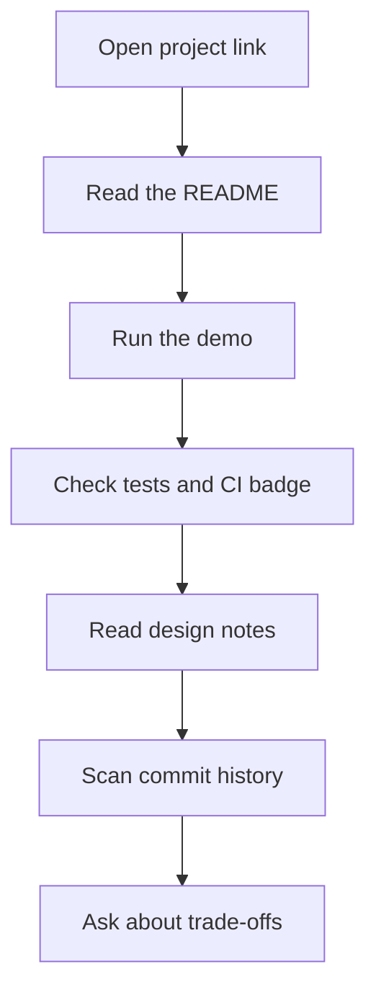
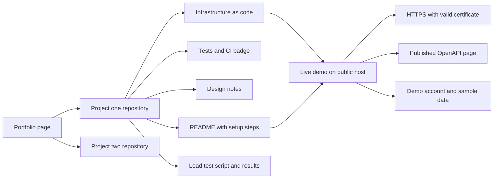

# Portfolio Requirements

!!! note "In simple words"
    A portfolio is a small set of projects that shows a hiring team how you think and work. Each project you share should be easy to run, easy to read, and backed by proof for every claim you make.

## Why it matters

Hiring managers rarely have time to read every line of your code. They look at a repository for a few minutes, decide whether it looks professional, and then use it to guide the interview. That first impression comes from the README, the commit history, the working demo, and the way the code is laid out. The code itself matters, but the surrounding material tells the reviewer whether you can ship software that other people can use and maintain.

A good portfolio also gives you talking points. When an interviewer asks why you chose a design, you can point to a note you already wrote, a number you already measured, and a limit you already named.

## How it works

A reviewer usually follows the same path through a project. Build your repository so that each step of that path is quick and clear.

1. The reviewer opens the project link from your CV or profile.
2. They read the README to learn what the project does and how to start it.
3. They open the live demo, or run the project locally with the commands from the README.
4. They look at the test directory and the CI badge to see whether tests run automatically.
5. They read the design notes and the architecture diagram to understand the main parts.
6. They scan the commit history to see how the code changed over time.
7. They ask questions about the trade-offs. Your case study should prepare you for these.



### Architecture diagram

The architecture diagram shows how the pieces of a portfolio fit together. Each project has its own repository. The repository holds the code, the README, the tests, the design notes, and the deployment scripts. The deployed demo and the published API page are linked from the README, so a reviewer can reach them without searching.



### Checklist

Run through this list before sending anyone a link. Each group below covers one area that reviewers check.

#### Code quality

- Readable code with steady naming and short methods
- Layers kept apart: web handling, business logic, and database access
- Nothing unused left behind: no dead code, disabled blocks, or stray debug prints
- A formatter and a static analyser run automatically and pass
- Core rules have unit tests, and database and web calls have integration tests

#### Documentation

- A README covering the purpose, local startup, and test commands
- API docs produced from an OpenAPI (Swagger) file, including sample calls and replies
- Diagrams of the main parts and how data moves (Mermaid or an image both work)
- A brief design note for each major choice, such as how tenants are separated or how messages are fanned out

#### Git history

- Commit messages that state the change and its reason, phrased as commands such as "Add retry to payment call"
- Compact commits that reveal how the design grew
- Secrets, bulky generated output, and compiled binaries kept out of the repository
- A tidy main branch and an easy-to-follow merge or pull-request trail

#### Live demo

- Running on a public server reachable through a domain name
- Encrypted connections with a trusted certificate
- A demo login or seed data so visitors can explore right away
- Anyone can rebuild the hosting from the repository, using infrastructure definitions or scripts

#### Performance

- Execution plans reviewed for the slowest routes, with indexes added where they help
- Caching for frequently read, rarely changed data, with a stated plan for clearing stale entries
- A load-test script committed alongside a summary of the scenario, data volume, and latency percentiles
- Measured before and after figures for at least one improvement

#### Security

- No secrets written into code; settings come from environment variables or a secrets vault
- Incoming data checked where it enters; outgoing data escaped for where it lands
- Login and permission checks tested, including cases where access must be refused
- Third-party libraries checked for known flaws, plus a routine for upgrading them
- Error replies that hide internal details such as stack traces and query text

#### Scalability

- A written forecast of how the design copes with heavier traffic and which part fails first
- Data volumes big enough to expose the gap between a sound design and a weak one
- Services that hold no per-user state, so more copies can be started freely

### Configuration without secrets

Read settings from the environment instead of writing them into the source code. The sample below is plain Java 21 and reads a database address from an environment variable. If the variable is missing, the program fails early with a clear message.

```java
public final class AppConfig {

    private AppConfig() {
    }

    public static String databaseUrl() {
        String url = System.getenv("DATABASE_URL");
        if (url == null || url.isBlank()) {
            throw new IllegalStateException("DATABASE_URL is not set");
        }
        return url;
    }
}
```

Spring example (not compiled): the same idea in a Spring Boot class uses a property placeholder instead of a direct environment call.

```java
// Spring example (not compiled)
import org.springframework.beans.factory.annotation.Value;
import org.springframework.stereotype.Component;

@Component
public class DatabaseSettings {

    @Value("${app.db.url}")
    private String databaseUrl;

    public String getDatabaseUrl() {
        return databaseUrl;
    }
}
```

### How to evidence each item

A reviewer trusts proof more than assertions. For each item in the checklist, link to something they can open and check.

| Claim | Evidence to link |
|---|---|
| Tests cover business rules | CI badge and the test folder |
| API is documented | Published OpenAPI page |
| Performance improved | Results file with before and after numbers |
| Security is handled | Access refusal tests and a dependency scan report |
| Demo works | Live URL and a sample login |
| Design is scalable | Design note covering trade-offs and limits |

### Presenting the project

Write a short case study for each project. It should fit on a single page and cover these parts:

- The problem the project solves
- Your constraints, such as budget, time, or the size of the team
- The key decisions and their trade-offs
- What you measured, with real numbers
- What you would do next

Follow-up questions in interviews target these same areas. Prepare an answer to "why this and not that?" for every major decision.

## Where it is used

- Job applications, where a reviewer reads your public repositories before deciding on an interview
- Take-home assignments, where the reviewer checks the README, the tests, and the commit history
- Technical interviews, where you walk through a project and answer questions about it
- Personal profiles on code-hosting sites, where the README and pinned repositories act as a summary

## Benefits

- A reviewer can judge your code quality in minutes instead of guessing from a résumé line
- A working demo removes doubt about whether the project really runs
- Measured results and written trade-offs give you specific answers in interviews
- A clean commit history shows how you reason about change, not only what the final code looks like
- The habit of writing tests, docs, and security checks carries over into your day-to-day work

## Cons and limits

Building a portfolio to this standard takes real time. Keep these limits in mind:

- A portfolio shows what you built alone. It does not prove how you work inside a large team.
- Hosting a live demo can cost money, and the demo can expire or break when a dependency changes.
- Public code is visible to everyone, so any leaked secret is a real incident.
- Load-test numbers depend on the machine and data size used. Always state the setup.
- A checklist can encourage ticking boxes instead of building something useful. Focus on the decisions behind the items.

### Common pitfalls

- A README silent on how to start the project
- A demo that runs only locally or has lapsed
- Tests present in the repository but never executed by the pipeline
- Speed claims without any measurements
- Vague commit messages such as fix or update
- Credentials pushed and then deleted in a later commit. They still live in the history, so they must be replaced.

## Best practices

- Walk through all seven areas, from scalability down to code quality, before sharing
- Back each claim with something a reviewer can open
- Document setup and tests in the README, and keep the demo running
- Purge leaked secrets from the history at once, then issue new ones
- Pair each project with a brief case study that covers decisions and measurements
- Check the demo and links before every application, and set a reminder to renew any hosting or certificate
- Keep the scope of each project small enough to finish, then improve it in later commits

!!! tip "Interview tip"
    **Q: Which project matters most to you, and what would you redo?**
    A: Pick one project and explain the problem and your main trade-off. Then share one concrete measured result and one candid limitation. Closing with what you would redo shows that you can critique your own design, and that often impresses interviewers more than the build alone.

## Official documentation

- [Git documentation](https://git-scm.com/doc)
- [Maven guides](https://maven.apache.org/guides/)
- [OpenAPI Specification](https://spec.openapis.org/oas/latest.html)
- [The Twelve-Factor App](https://12factor.net/)

## Quick recap

- Walk through each area of the checklist before you share a link
- Make every claim checkable, with a link a reviewer can open
- Keep the README current on setup and tests, and keep the demo alive
- Purge leaked secrets from history quickly, then rotate them
- Write a compact case study that explains decisions and results

**See also:** [Projects overview](index.md), [Hands-On Project Ladder](hands-on-project-ladder.md), [E-Commerce Platform](ecommerce-platform.md)
