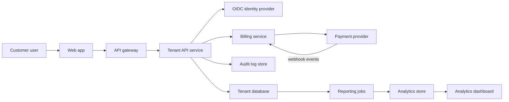
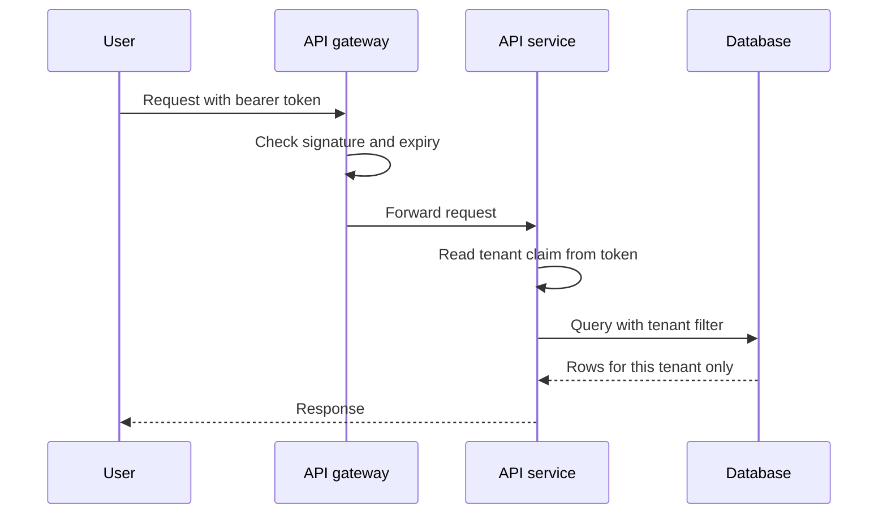
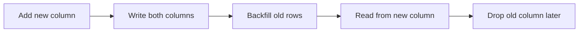

# Project 3: Multi-Tenant SaaS Application

!!! note "In simple words"
    One software product serves many customer companies, called tenants, from the same running system. Each tenant must see only its own data, pays a subscription, and reaches the product through a documented API that is delivered automatically.

## Why it matters

Interviewers at enterprise companies ask about this area because it decides whether a SaaS product is safe, sellable, and easy to maintain. This project practises four concerns together: multi-tenancy, billing, API design, and delivery. The business domain is kept small on purpose, so the attention stays on the platform around it.

## How it works

### Scope

Pick a simple domain for the business logic, such as a project tracker, a booking tool, or a small CRM. The point is the platform around it: tenancy, billing, API, tests, and delivery. A small domain keeps these concerns in focus.

### Feature list

- **Tenant onboarding:** sign up an organisation, create its first admin, and provision its data
- **Multi-tenant data isolation:** every row belongs to a tenant, the rule is enforced in the data layer, and tests check it
- **Authentication:** single sign-on for enterprise customers through an OpenID Connect (OIDC) provider, for example Microsoft Entra ID, plus email login for smaller accounts
- **Subscription management and billing:** plans, seat or usage limits, upgrades and downgrades, and invoices, all running in a payment provider's test mode
- **Analytics dashboard:** per-tenant usage and activity charts, plus platform-wide figures for internal staff
- **API-first design:** an OpenAPI specification written before the code, with generated or hand-checked documentation, versioning, and per-tenant rate limits
- **Audit log:** a record of who changed what, per tenant, that administrators can query
- **Testing:** unit tests for domain rules, integration tests against a real database, and end-to-end tests for onboarding and billing
- **CI/CD:** build, test, scan, and deploy automatically on merge, with a staged rollout
- **Infrastructure as code:** cloud resources described in Terraform and applied from version control
- **Database migrations:** versioned, reviewed, reversible where possible, and applied automatically in each environment

### Architecture diagram

The diagram shows the main services and how they connect. Each arrow is a request or an event. The identity provider issues tokens, the billing service talks to the payment provider, and the audit and analytics stores receive data from the API service.



### Request flow

A single API call goes through several checks before any data is read. The tenant comes from the verified token, not from the request body or URL.



Step by step:

1. The user signs in through the identity provider and receives a token. The token carries the user's identity, roles, and tenant.
2. The gateway checks the token signature, issuer, audience, and expiry before forwarding the call.
3. The API service reads the tenant from the verified claims and stores it for the rest of the request.
4. Every database query includes the tenant filter. The filter is applied in one shared place, not repeated by hand in each query.
5. The response is returned, and the write path also records an audit event.

### Isolation model

Choose one model deliberately and write down why in a decision record.

| Model | How data is kept apart | Strength | Cost |
|---|---|---|---|
| Shared schema | A tenant column on every table | Cheapest to run | Needs strict filtering everywhere |
| Schema per tenant | Each tenant gets its own schema | Clearer separation | More migrations to manage |
| Database per tenant | Each tenant gets its own database | Strongest separation | Highest operating cost |

### Tenant-scoped query (plain Java)

This small example is plain Java 21 with no libraries. It was checked by reading it, not by compiling it. The tenant ID is passed in from the verified token, and only matching rows are returned.

```java
import java.util.List;
import java.util.Objects;

public class TenantScopedStore {

    public record Project(long id, String tenantId, String name) {}

    private final List<Project> rows;

    public TenantScopedStore(List<Project> rows) {
        this.rows = List.copyOf(rows);
    }

    // The tenant comes from the verified token, never from the request body.
    public List<Project> findProjects(String verifiedTenantId) {
        Objects.requireNonNull(verifiedTenantId, "tenant is required");
        return rows.stream()
                .filter(p -> p.tenantId().equals(verifiedTenantId))
                .toList();
    }
}
```

### Tenant claim in a Spring controller (Spring example, not compiled)

This Spring example is shown for illustration only. It has not been compiled, and it assumes a `service` bean and a `tenant_id` claim exist in the token.

```java
// Spring example (not compiled)
@GetMapping("/projects")
public List<Project> list(@AuthenticationPrincipal Jwt jwt) {
    String tenant = jwt.getClaimAsString("tenant_id");
    return service.findProjects(tenant);
}
```

### Idempotent webhook handling (plain Java)

Payment providers can send the same webhook more than once. This plain Java 21 sketch ignores repeats. It was checked by reading, not compiled. The in-memory set is for illustration only; production code needs a durable store, such as a database table with a unique key on the event ID.

```java
import java.util.HashSet;
import java.util.Set;

public class WebhookHandler {

    private final Set<String> processedEventIds = new HashSet<>();

    public boolean handle(String eventId, Runnable action) {
        if (!processedEventIds.add(eventId)) {
            return false; // already handled, so ignore the repeat
        }
        action.run();
        return true;
    }
}
```

### Suggested milestones

1. **Single-tenant core.** Build the domain model and a working API for one organisation first. Keep tenancy in mind in the schema.
2. **Tenancy.** Add a tenant identifier to every table and enforce it. Choose the isolation model and write a decision record explaining why.
3. **Isolation tests.** Write tests that try to read one tenant's data as another. These should fail the build if they ever pass.
4. **Authentication and authorisation.** Add OIDC login, tenant-aware roles, and token claims that carry the tenant.
5. **API specification.** Write the OpenAPI document, version the API, add per-tenant rate limits, and publish the documentation.
6. **Billing.** Create plans, connect to the payment provider's test mode, handle subscription webhooks idempotently, and enforce plan limits in the application.
7. **Migrations.** Set up a migration tool, a review process for schema changes, and a rule that migrations stay backward-compatible during rolling deployments.
8. **Analytics.** Add a reporting model, either summary tables or a separate read store, and a dashboard that stays fast as tenants grow.
9. **CI/CD and infrastructure.** Build pipeline stages for build, test, security scan, and deployment. Provision the cloud environment with Terraform, including staging and production.

## Where it is used

Multi-tenant designs are common in B2B software: project trackers, booking platforms, customer relationship tools, and internal platforms where several teams need separate data under one system. Most SaaS vendors serve thousands of tenants this way, and the same patterns appear in the platform teams that run them.

## Benefits

- One deployment serves many customers, so operating cost is shared
- Upgrades and fixes reach every tenant at the same time
- Subscription and usage limits create a clear billing model
- Automated tests and pipelines catch isolation mistakes before release
- Clear API documentation makes integration easier for customers

### Skills practised

- **Multi-tenancy:** isolation models, tenant-scoped queries, and cross-tenant test coverage
- **Security:** OIDC, tenant-aware authorisation, and audit logging (see [API security](../../learning/21-api-design/api-security.md))
- **API design:** specification-first design, versioning, and pagination (see [REST principles and versioning](../../learning/21-api-design/rest-principles-versioning.md))
- **Billing integration:** webhooks, idempotency, plan enforcement, and test-mode data
- **Data:** migrations, indexes, and reporting queries
- **Testing:** unit, integration, and end-to-end layers with a clear pyramid
- **Delivery:** CI/CD pipelines, staged rollout, and infrastructure as code with Terraform

## Cons and limits

- Strict tenant filtering is needed in every query, and one missed filter can leak data
- A database per tenant gives strong isolation but multiplies the cost of backups, migrations, and monitoring
- Single sign-on adds configuration work for each enterprise customer
- Plan limits and billing rules add state that must stay consistent with the payment provider
- A shared schema makes it harder to move one large tenant to its own infrastructure later

### Common pitfalls

- Filtering by tenant in some queries but not all, leaking data across tenants
- Taking the tenant ID from a request parameter rather than the verified token
- Migrations that rename or drop columns still used by the running version
- Hard-coding plan limits in several places, so they drift apart
- Manual cloud changes that the Terraform code does not describe
- Pipelines that deploy without running the isolation tests

## Best practices

### Design notes

- Choose the isolation model deliberately. A shared schema is cheapest to operate but needs strict tenant filtering everywhere. A database per tenant gives stronger isolation at higher operating cost.
- Put the tenant in the token and resolve it once per request. Do not let a client choose the tenant through a parameter it can change.
- When accepting tokens from more than one identity source, check the issuer and map each external identity to a known tenant membership. Do not trust a tenant claim from an issuer you have not registered.
- Make migrations safe for rolling deployments: add columns before code uses them, and remove them only after nothing reads them.
- Treat plan limits as product rules that the server enforces, not only as something hidden in the interface.
- Store audit events append-only, and keep them separate from the operational data they describe.

The expand and contract pattern below shows the safe order for renaming a column.



### Definition of done

- Two test tenants cannot read or change each other's data, proven by automated tests that run in CI.
- A tenant can subscribe in test mode, and a plan limit blocks an action when reached.
- The OpenAPI document is published, and a client can complete the main flow using only the documentation.
- A merge to the main branch deploys to staging automatically and to production after approval.
- The cloud environment can be recreated from the Terraform code alone.

!!! tip "Interview tip"
    **Q: How do you make sure one tenant never sees another tenant's data?**
    A: Take the tenant from the verified token, not from client input. Enforce the tenant filter in one place, such as the data access layer or database row-level security where available, rather than in each query. Then prove it with automated tests that attempt cross-tenant reads and writes, and run them on every build.

## Quick recap

- Choose and document the tenant isolation model
- Resolve the tenant from the verified token and enforce it in one layer
- Test cross-tenant access on every build
- Enforce subscription limits on the server and handle billing webhooks idempotently
- Automate delivery with CI/CD and Terraform, and keep migrations backward-compatible

## Official documentation

- [Spring Security reference](https://docs.spring.io/spring-security/reference/index.html)
- [Spring Boot reference](https://docs.spring.io/spring-boot/reference/index.html)
- [PostgreSQL documentation](https://www.postgresql.org/docs/current/)
- [OWASP Top Ten](https://owasp.org/www-project-top-ten/)

**See also:** [E-Commerce Platform](ecommerce-platform.md), [Social Feed System](social-feed-system.md), [Portfolio Requirements](portfolio-requirements.md)
