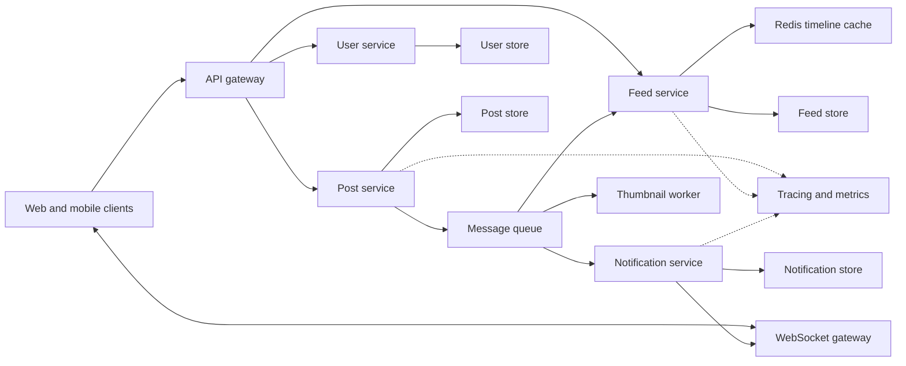
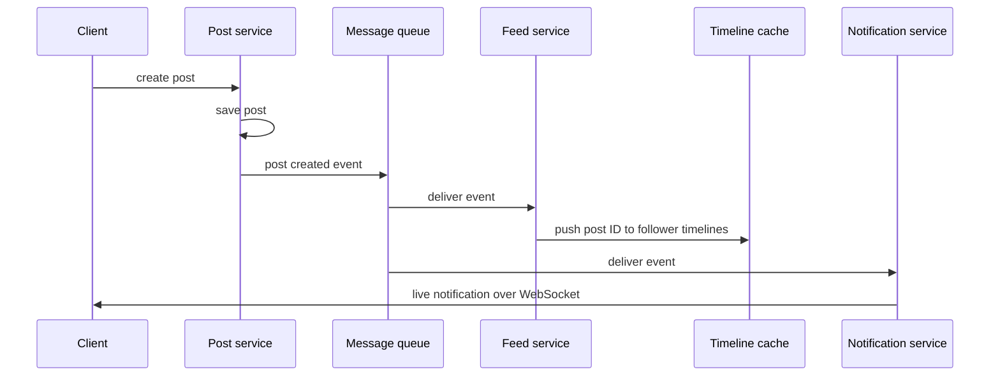
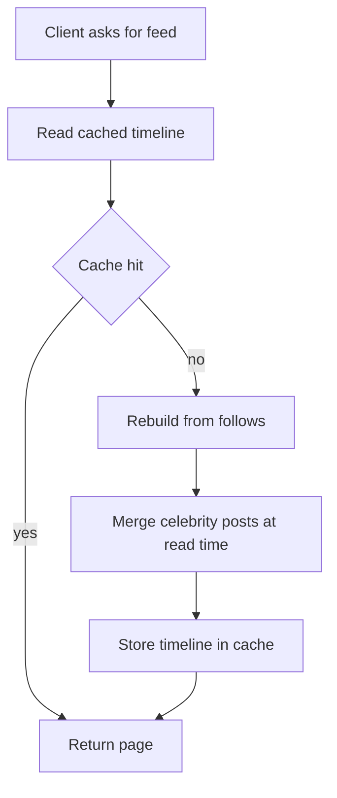

# Project 2: Social Media and Feed System

!!! note "In simple words"
    Users write posts and follow each other. When you open the app, you see a list of recent posts from the people you follow, and you get live alerts when someone likes or comments on your work. This project teaches how to make that work for many users at once.

A social app where users publish posts, follow other users, and see a feed of recent posts from the people they follow, with live notifications. The project focuses on scale and distribution: fan-out, caching, real-time delivery, asynchronous processing, and observability across several services.

## Scope

Start with a modular monolith or two services, then split along the seams that the design makes obvious. Splitting too early creates distributed problems before you have a product worth protecting. The feed is the hardest part of this system, so plan it early and measure it from the start.

## Architecture diagram

The diagram below shows the main services and how they connect. Clients talk to an API gateway for normal requests and to a WebSocket gateway for live updates. Services publish and consume events through a message queue, and each service owns its own data store.



## Why it matters

- Reads vastly outnumber writes in most social products, so the feed must be fast even when posting is slower.
- A simple "query every followed account on each request" approach works for a small demo but collapses when someone follows thousands of accounts.
- Live updates, background jobs, and cross-service calls each add failure modes. Good design keeps those failures contained and visible.
- The project is a good way to practise the trade-offs interviewers ask about: data modelling, caching, real-time delivery, and messaging.

## How it works

### Core features

- **User profiles:** create and edit profiles, avatars stored by reference, and privacy settings.
- **Follow and unfollow:** a follow graph stored efficiently, counts maintained, and rate limits on follow actions.
- **Posts:** create, edit, and delete posts, and attach media references.
- **Feed generation:** a timeline of posts from followed accounts, ordered by time. Personalised ranking can be added later.
- **Caching:** cached timelines, invalidation when a followed account posts, and cache warm-up for active users.
- **Real-time notifications:** likes, comments, and new followers delivered over WebSockets, with a fallback poll for clients that cannot open a socket.
- **Asynchronous work:** background fan-out, thumbnail generation, and notification delivery through message queues.
- **Microservices:** user, feed, and notification services, each with its own data store.
- **Deployment:** containers on Kubernetes with horizontal scaling based on load.
- **Observability:** distributed tracing across services, correlated logs, and dashboards for feed latency.

### Build order

1. **Core data model.** Define users, follows, and posts. Decide the keys and indexes for "posts by author" and "follows by user".
2. **Basic feed (pull).** Build a feed by querying followed authors at read time. Measure how it behaves with a large follow count.
3. **Feed with caching (push or hybrid).** Fan out to follower timelines on write for typical accounts, and fall back to a pull for accounts with very many followers. Record the trade-off in a short design note.
4. **Notifications.** Publish events for likes, comments, and follows. Deliver them through a queue to a notification service, then to connected clients over WebSockets.
5. **Service split.** Separate the user, feed, and notification services, each with its own schema. Communicate through events and through synchronous calls that have timeouts.
6. **Kubernetes deployment.** Container images, deployments, a horizontal autoscaler, and readiness and liveness probes.
7. **Tracing and observability.** Propagate trace context through HTTP calls and queue messages. Build a dashboard for feed latency and queue lag.
8. **Load and resilience tests.** Simulate a popular account posting and a burst of follows. Verify that the system degrades gracefully instead of failing outright.

### Fan-out on write versus fan-out on read

There are two basic ways to build a feed, and a hybrid mixes them.

- **Fan-out on write (push):** when an author posts, the system copies the post ID into the timeline of every follower. Reads are cheap because the timeline is already built. Writes are expensive for accounts with many followers.
- **Fan-out on read (pull):** when a user opens the feed, the system fetches recent posts from every followed author and merges them. Writes are cheap, but reads do more work.
- **Hybrid:** push for typical accounts, pull for celebrity accounts, and merge the two at read time.

The write path below shows how a new post reaches followers and notifications through the queue.



The read path uses the cache first and rebuilds the timeline only when needed.



### Java example: choosing a mode and merging a hybrid timeline

This is a plain Java 21 example. I checked it by reading it carefully. It was not compiled or run as part of this page.

```java
import java.util.ArrayList;
import java.util.Comparator;
import java.util.List;

public class HybridFeed {

    public record Post(String id, String authorId, long createdAt) {}

    private static final int CELEBRITY_FOLLOWERS = 100_000;

    // Accounts above the threshold are read with a pull, not pushed on write.
    public static boolean usePullFor(long followerCount) {
        return followerCount >= CELEBRITY_FOLLOWERS;
    }

    // pushed: posts already stored in the user's timeline
    // pulled: recent posts fetched from celebrity authors at read time
    public static List<Post> mergeTimeline(List<Post> pushed, List<Post> pulled, int limit) {
        List<Post> all = new ArrayList<>(pushed);
        all.addAll(pulled);
        all.sort(Comparator.comparingLong(Post::createdAt).reversed());
        return all.subList(0, Math.min(limit, all.size()));
    }

    public static void main(String[] args) {
        List<Post> pushed = List.of(new Post("p1", "alice", 100L));
        List<Post> pulled = List.of(new Post("p2", "celebrity", 200L));
        System.out.println(mergeTimeline(pushed, pulled, 10));
    }
}
```

### Java example: idempotent consumer

Queues usually deliver at least once, so the same event can arrive twice. This plain Java 21 sketch skips events it has already handled. In production the processed IDs must be stored durably, for example in a database table with a unique key, so the check survives restarts.

```java
import java.util.Set;
import java.util.concurrent.ConcurrentHashMap;

public class IdempotentNotifier {

    private final Set<String> processed = ConcurrentHashMap.newKeySet();

    // Returns true when the action ran, false when the event was a duplicate.
    public boolean handle(String eventId, Runnable action) {
        if (!processed.add(eventId)) {
            return false;
        }
        action.run();
        return true;
    }

    public static void main(String[] args) {
        IdempotentNotifier notifier = new IdempotentNotifier();
        notifier.handle("evt-1", () -> System.out.println("notify once"));
        notifier.handle("evt-1", () -> System.out.println("never printed"));
    }
}
```

### Spring example (not compiled)

This Spring Kafka listener is shown only to illustrate the wiring. It is not compiled, and the class names are placeholders.

```java
// Spring example (not compiled)
@KafkaListener(topics = "post-created", groupId = "feed-service")
public void onPostCreated(PostCreatedEvent event) {
    feedWriter.fanOut(event);
}
```

### Real-time delivery

- Each client opens a WebSocket to a gateway instance. The gateway sends heartbeats so dead connections are detected.
- Clients reconnect with exponential backoff and random jitter, so a restart does not cause every client to reconnect at the same moment.
- When an event arrives at one gateway instance, the instance publishes it on a shared channel, such as a Redis pub/sub topic, so every instance can reach the clients it holds.
- Clients that cannot keep a socket open fall back to polling the feed or notification endpoint at a slower interval.

### Partitioning and ordering

Use a consistent key, such as the user ID, when publishing related events. Events with the same key land in the same partition, so their order is preserved for that user. Ordering across different users is not guaranteed, and the design should not depend on it.

### Tracing across the queue

Propagate the trace context in HTTP headers and in message headers. A single post should produce one trace that shows the API call, the queue hop, and the work done by the feed and notification services. Without this, delays that happen inside the queue are invisible.

## Where it is used

- Social networks that show a home timeline of posts from accounts a user follows.
- News and activity feeds, where a user sees updates from sources they chose.
- Team collaboration tools that stream comments, mentions, and status changes to connected users.
- Any product that needs live counters or alerts delivered over a socket with a polling fallback.

## Benefits

Building this project gives you practice with the skills that appear most often in system design interviews:

- **Data modelling for fan-out:** deciding when to do work on write and when to do it on read.
- **Caching:** choosing cache keys and TTLs, planning invalidation, and protecting against cache stampedes.
- **Real-time delivery:** managing WebSocket connections, heartbeats, reconnection, and fan-out across several server instances.
- **Messaging:** reasoning about at-least-once delivery, idempotent consumers, and dead-letter handling.
- **Microservices:** setting service boundaries, assigning data ownership, and designing event contracts.
- **Containers and orchestration:** writing Kubernetes deployments, probes, and autoscaling rules.
- **Observability:** using distributed tracing and metrics to measure latency and lag.

For the wider picture on each concern, see the notes on [alternative protocols](../../learning/21-api-design/alternative-protocols.md) for real-time transport, [alerting and health checks](../../learning/20-observability/alerting-health-checks.md) for probes and alerts, and [distributed tracing](../../learning/20-observability/distributed-tracing.md) for trace propagation. The [system design projects](../../resources/full-stack-java-roadmap/part-4-design-interview-projects.md) page covers caching in more depth.

## Cons and limits

- **Pure fan-out on write fails for huge follower counts.** One post from an account with millions of followers creates millions of writes. A hybrid design handles this case.
- **Pure fan-out on read is slow for heavy followers.** A user who follows thousands of accounts makes the read path merge thousands of lists.
- **Microservices add overhead.** Each service needs its own deployment, data store, and monitoring. Splitting too early adds cost without benefit.
- **Caches go stale.** Invalidation is hard. Stale timelines are a real risk if you do not plan for them.
- **Duplicate work is common.** Retries and at-least-once delivery mean the same message can be processed twice.
- **Real-time connections are stateful.** A WebSocket server holds open connections, which makes scaling and deployments harder than for stateless HTTP servers.

### Common pitfalls

- Splitting into microservices before the boundaries are clear.
- Using pure fan-out on write for accounts with very large follower counts.
- Caches with no invalidation plan, so stale feeds persist.
- WebSocket servers that cannot broadcast across instances.
- Retrying queue messages without idempotency, which duplicates notifications.
- No tracing across the queue, so asynchronous delays are invisible.

## Best practices

- **Decide the fan-out model early.** Choose push, pull, or hybrid based on your read-to-write ratio, and write the choice down in a design note.
- **Make consumers idempotent.** A notification sent twice is an annoyance. A counter incremented twice is a bug.
- **Prefer simple cache strategies.** Versioned keys or short TTLs are easier to reason about than elaborate invalidation logic. Add jitter to TTLs and use a single lock or early refresh to avoid stampedes on hot keys.
- **Rate-limit follow actions.** A token bucket per user stops bulk following from overloading the follow graph.
- **Keep follower counts correct, not instant.** Counters can be updated asynchronously and reconciled later, as long as the design says so.
- **Measure feed latency at p95 and p99.** Averages hide the slow requests that users notice.
- **Use dead-letter queues.** Messages that keep failing should move aside after a set number of retries, where someone can inspect them.
- **Keep services stateless where possible.** Store state in the data stores, so Kubernetes can add and remove pods freely.

### Definition of done

- A user can follow others, post, and see a feed that updates within a short, stated delay.
- A notification appears live in a connected client, and it is still recorded if the client was offline.
- Traces show one post's journey from the API to the feed and notification services.
- A load-test report includes feed latency at p95 and p99 under a realistic follow distribution.
- The design note explains the fan-out choice and its failure modes.

!!! tip "Interview tip"
    **Q: How do you generate a feed for a user who follows thousands of accounts?**
    A: Explain the two options. Fan-out on write precomputes each follower's timeline when a post is created, which makes reads cheap but writes expensive for popular accounts. Fan-out on read merges recent posts from followed accounts at request time, which is cheap to write but costly to read. A hybrid pushes for typical accounts and pulls for celebrity accounts, then merges at read time. Name the trade-off and explain how you would measure it.

## Quick recap

- Decide fan-out (push, pull, or hybrid) early and document it.
- Feed latency is the key metric. Cache timelines and invalidate them carefully.
- Deliver real-time updates over WebSockets, with a fallback.
- Process events asynchronously with idempotent consumers.
- Trace requests across services and queues.

## Official documentation

- [Apache Kafka documentation](https://kafka.apache.org/documentation/)
- [Redis documentation](https://redis.io/docs/latest/)
- [Kubernetes Horizontal Pod Autoscaler](https://kubernetes.io/docs/tasks/run-application/horizontal-pod-autoscale/)
- [OpenTelemetry documentation](https://opentelemetry.io/docs/)

**See also:** [E-Commerce Platform](ecommerce-platform.md), [Multi-Tenant SaaS Application](saas-application.md), [Portfolio Requirements](portfolio-requirements.md)
