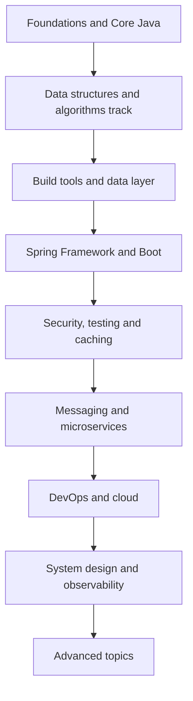
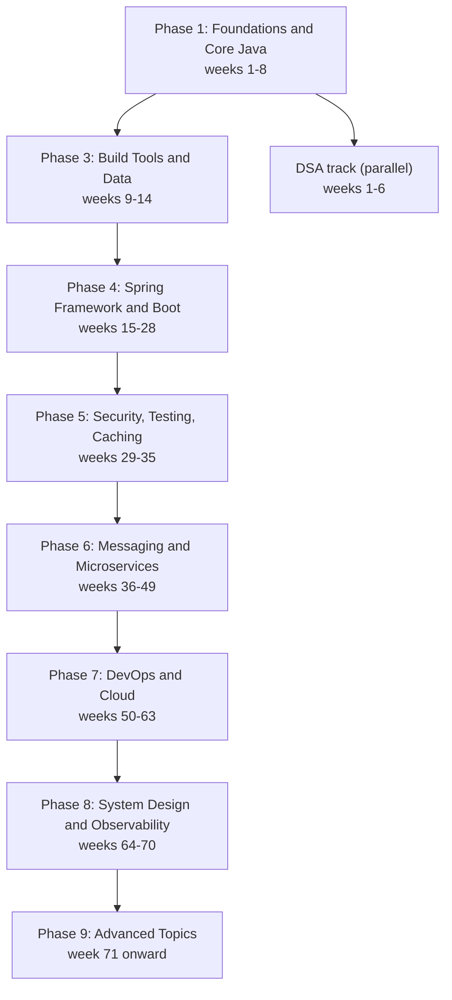

# Time-Boxed Java Roadmap

!!! note "In simple words"
    This is a condensed route to learning backend Java in roughly 6 to 8 months. Go through the phases in sequence, and build each phase's small project before moving on.

This is a 6 to 8 month route to backend Java interview readiness, organized into nine phases and 23 topics. Every phase lists its time budget, its concepts, and a small deliverable you can demo or talk through.

---

## Topics

### [Phases 1 to 3: Foundations, DSA and Data](phases-1-to-3.md)
**Programming basics - Core Java - Modern Java - DSA track - Build tools - SQL - JDBC and JPA**
Language fundamentals, the DSA track that runs alongside, Maven and Gradle, relational databases, and persistence.

### [Phases 4 to 6: Spring, Security and Messaging](phases-4-to-6.md)
**Spring Core - Spring Boot - Security - Testing - Caching - Kafka - RabbitMQ - Microservices**
Spring from the container up to REST APIs, followed by authentication, testing, caching, and event-driven services.

### [Phases 7 to 9: Delivery, Design and Advanced Topics](phases-7-to-9.md)
**Docker - Kubernetes - CI/CD - Cloud - System design - Observability - API design - AI integration**
Shipping and operating services, designing large-scale systems, and specialist topics beyond the core track.

### [Learning Resources, Tips and Further Reading](learning-resources-and-tips.md)
**Resources by phase - Study habits - Additional platforms**
Documentation and practice sites organized by phase, habits that shorten your schedule, and community help.

---

## Roadmap at a glance

---

## Phase Overview

## Timeline

| Phase | Focus | Weeks | Core skills |
|-------|-------|-------|-------------|
| 1 | Foundations and Core Java | 1-8 | OOP, collections, concurrency, Java 8 to 21 |
| 2 | Data structures and algorithms (parallel) | 1-6 | Arrays, trees, graphs, dynamic programming |
| 3 | Build tools and data layer | 9-14 | Maven, Gradle, SQL, JDBC, JPA |
| 4 | Spring Framework and Boot | 15-28 | IoC, dependency injection, AOP, REST |
| 5 | Security, testing and caching | 29-35 | Spring Security, JWT, OAuth 2.0, JUnit, Redis |
| 6 | Messaging and microservices | 36-49 | Kafka, RabbitMQ, service discovery, resilience |
| 7 | DevOps and cloud | 50-63 | Containers, orchestration, pipelines, three cloud providers |
| 8 | System design and observability | 64-70 | Scalability, caching, logs, metrics, tracing |
| 9 | Advanced topics | 71 onward | API design, GraphQL, gRPC, LLM integration |

Both the diagram and the timeline show Phase 2 as weeks 1 to 6. It is a parallel track, so plan on about four to six weeks of focused work.

---

## How to Use the Plan

- Read each week range as a time budget. When a topic runs over, move on and revisit it through a project.
- Complete each phase's deliverable before moving on. A working program teaches more than notes do.
- Begin the DSA track in week one and hold a steady pace next to the main curriculum.
- Come back to the [Java Code Review Guidelines](../code-review-guidelines/java-code-review-guidelines.md) once you begin reviewing or writing production-grade code.

**See also:** [Learning resources and tips](learning-resources-and-tips.md), [Interview questions](../../interview-questions/index.md), [System design interview questions](../../interview-questions/technical/architecture-and-distributed.md)
