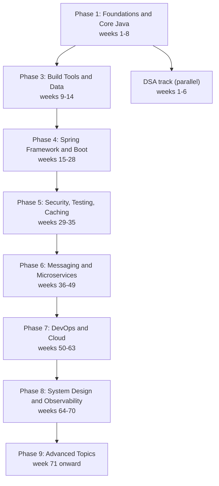

# Time-Boxed Java Roadmap

A 6 to 8 month plan for backend Java interviews, split into nine phases and 23 topics. Each phase has a time box, the concepts it covers, and a small deliverable you can show or explain.

---

## Topics

### [Phases 1 to 3: Foundations, DSA and Data](phases-1-to-3.md)
**Programming basics - Core Java - Modern Java - DSA track - Build tools - SQL - JDBC and JPA**
Covers the language base, the parallel DSA track, Maven and Gradle, relational databases, and persistence.

### [Phases 4 to 6: Spring, Security and Messaging](phases-4-to-6.md)
**Spring Core - Spring Boot - Security - Testing - Caching - Kafka - RabbitMQ - Microservices**
Covers the Spring stack from the container to REST APIs, then authentication, tests, caching, and event-driven services.

### [Phases 7 to 9: Delivery, Design and Advanced Topics](phases-7-to-9.md)
**Docker - Kubernetes - CI/CD - Cloud - System design - Observability - API design - AI integration**
Covers shipping and running services, designing systems at scale, and the advanced topics that come after the core track.

### [Learning Resources, Tips and Further Reading](learning-resources-and-tips.md)
**Resources by phase - Study habits - Additional platforms**
A phase-by-phase list of documentation and practice sites, study habits that shorten the timeline, and where to find community help.

---

## Phase Overview

## Timeline

| Phase | Focus | Weeks | Core skills |
|-------|-------|-------|-------------|
| 1 | Foundations and Core Java | 1-8 | OOP, collections, concurrency, Java 8 to 21 |
| 2 | Data structures and algorithms (parallel) | 1-6 | Arrays, trees, graphs, dynamic programming |
| 3 | Build tools and data layer | 9-14 | Maven, Gradle, SQL, JDBC, JPA |
| 4 | Spring Framework and Boot | 15-28 | IoC, dependency injection, AOP, REST |
| 5 | Security, testing and caching | 29-35 | Spring Security, JWT, OAuth 2.0, JUnit, Redis |
| 6 | Messaging and microservices | 36-49 | Kafka, RabbitMQ, service discovery, resilience |
| 7 | DevOps and cloud | 50-63 | Containers, orchestration, pipelines, three cloud providers |
| 8 | System design and observability | 64-70 | Scalability, caching, logs, metrics, tracing |
| 9 | Advanced topics | 71 onward | API design, GraphQL, gRPC, LLM integration |

The week ranges come from the source roadmap. Phase 2 is shown as weeks 1 to 6 in the diagram and 4 to 6 in the timeline, so treat it as a parallel track of about four to six weeks of focused work.

---

## How to Use the Plan

- Treat each week range as a budget. If a topic takes longer, move on and come back to it with a project.
- Finish each phase with its deliverable. A working program teaches more than a list of notes.
- Start the DSA track in week one and keep it going at a steady pace alongside the main track.
- Revisit the [Java Code Review Guidelines](../code-review-guidelines/java-code-review-guidelines.md) once you start reviewing or writing production-style code.

**See also:** [Learning resources and tips](learning-resources-and-tips.md), [Interview questions](../../interview-questions/index.md), [System design interview questions](../../interview-questions/technical/architecture-and-distributed.md)
